# Need for Geschwindigkeit

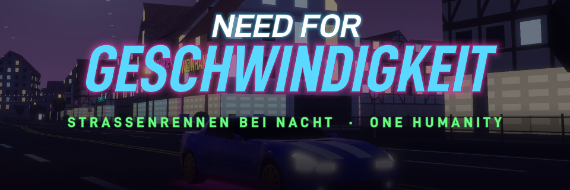

Nächtliches Straßenrennen im Stil der frühen 2000er (früher „Underground Sprint“), Low-Poly-3D mit Pixel-Look (Godot 4.7).

Ein Spiel von **ONE HUMANITY** – kostenlos auf [itch.io](https://onehumanity.itch.io/need-for-geschwindigkeit) für
Windows, macOS, Linux und im Browser.

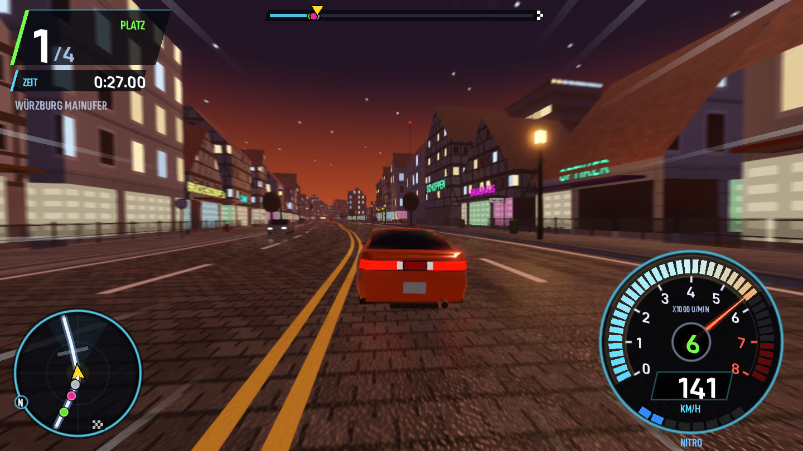

<table>
<tr>
<td width="50%">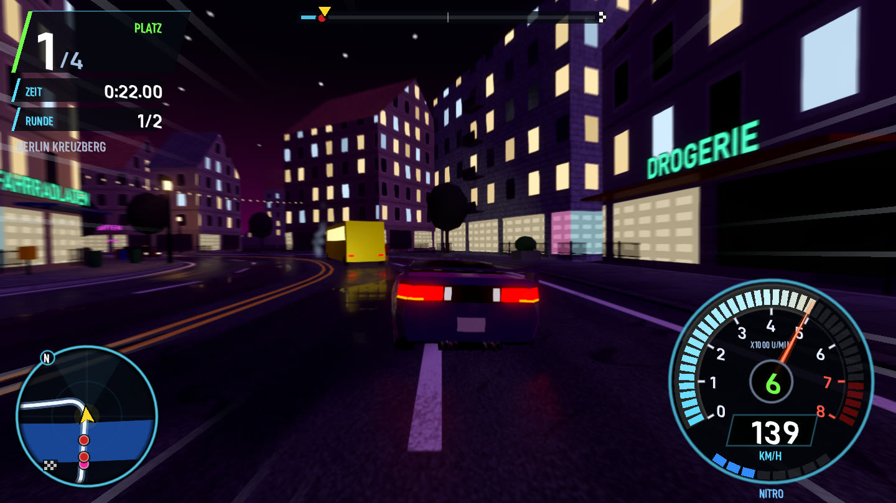 Berlin Kreuzberg im Shiden NX-1</td>
<td width="50%">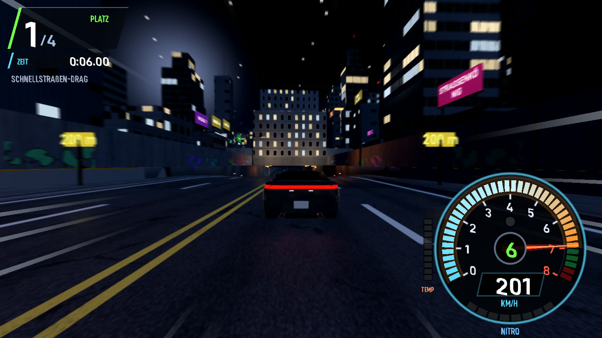 Drag auf der Schnellstraße im Ryujin 30Z</td>
</tr>
<tr>
<td>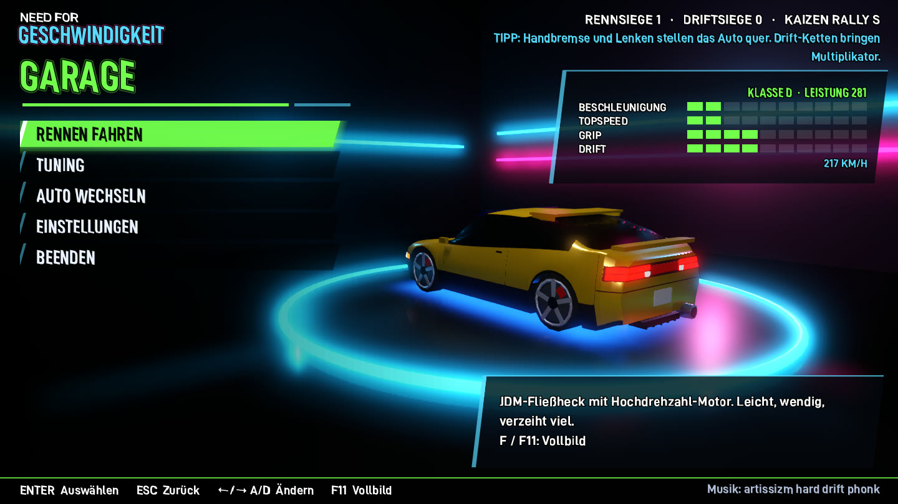 Garage mit Klasse und Leistungsindex</td>
<td>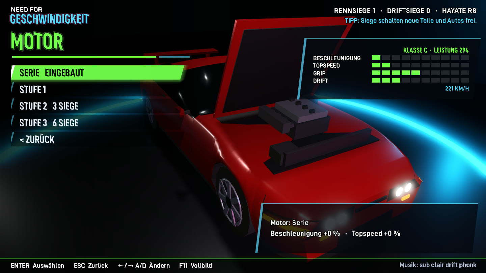 Tuning wie in NFS: Motor des Hayate R8</td>
</tr>
<tr>
<td>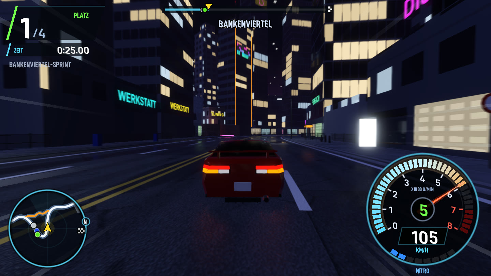 Bankenviertel-Sprint in Frankfurt</td>
<td>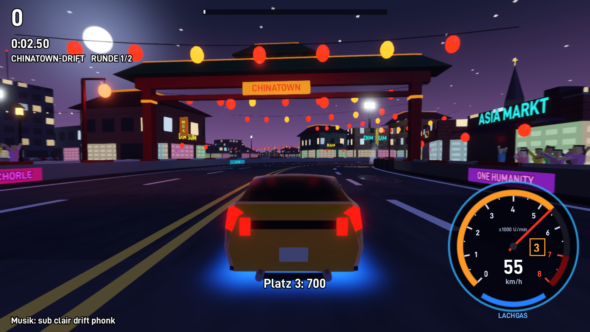 Drift-Event</td>
</tr>
</table>

## Starten
Ordner in Godot 4.7 öffnen (Import), dann F5. Das Spiel startet mit dem ONE-HUMANITY-Intro (überspringbar) und dann in der Garage.

## Steuerung
| Taste | Gamepad | Funktion |
|---|---|---|
| W / ↑ | RT | Gas (auch beim Countdown zum Hochdrehen) |
| S / ↓ | LT | Bremse / Rückwärts (im Drag: S schaltet hoch) |
| A D / ← → | linker Stick | Lenken |
| Leertaste | B | Handbremse (Drift) |
| Shift / N | A | Nitro (leer ist leer: erst loslassen, dann lädt es nach) |
| S / X (oder E / Q) | RB / LB | Drag: hoch-/runterschalten (A/D wechselt dort die Spur); steht klein neben dem Drehzahlmesser |
| C | Y | Kamera: Verfolger (Standard) / Stoßstange / Motorhaube |
| R | Back | Auto auf die Straße zurücksetzen |
| M | | Nächster Musiktrack |
| Esc / Enter / P | Start | Pause (im Browser-Vollbild beendet Esc nur das Vollbild, dann Enter oder P) |
| ↑↓←→ / W A S D, Enter, Esc / Rücktaste | Steuerkreuz, A, B | Menüs: wählen, ändern, bestätigen, zurück |
| F11 / Alt+Enter | | Vollbild an/aus |

Nitro lädt sich langsam von selbst auf. Driften, knapp am Verkehr vorbei und Sprünge geben Punkte (klein unten
links), die Nitro ein Stück nachfüllen: eine schöne Drift-Kette etwa ein Zehntel, gedeckelt, damit Driften kein
Nitro-Automat wird. In der Bildmitte steht nur noch Countdown und Ergebnis.

## Events
**Karriere:** Garage → Rennen fahren zeigt alle 21 Events als Liste neben einer Deutschlandkarte. Jedes Event liegt in
einer deutschen Stadt (die ausgedachten Strecken in Frankfurt, München, Hamburg, Köln, Leipzig …, die echten in ihren
Orten). Seit 2.16 in **fünf Stufen** wie in NFSU2 (Einstieg, Szene, Hafen und Altstadt, Großstadt, Finale, je 4–5
Events, `Catalog.STAGES`): alle Events einer offenen Stufe sind gleichzeitig frei und in beliebiger Reihenfolge
fahrbar, **3 Siege in einer Stufe** öffnen die nächste. Ein Event, das einem nicht liegt, kann man also auslassen.
Jede Stufe mischt die Arten, die Schwierigkeit steigt von Stufe zu Stufe. Was nach der alten Kette (bis 2.15) schon
offen war, bleibt offen. Auf der Karte sind gesperrte Städte grau, offene grün, gewonnene gold, die gewählte pulsiert.
Umriss: Natural Earth (gemeinfrei).

**Events auf einen Blick (seit 2.16):** jede Art hat ihre Farbe, überall gleich: Sprint cyan, Rundkurs grün, Drag
pink, Drift orange (`UI.TYPE_COL`). In der Karriere-Liste trägt jede Zeile rechts ein Abzeichen der Art und die
Schwierigkeit als Rauten (golden, wenn gewonnen), über jeder Stufe steht der Stand („1/3 SIEGE“, „FERTIG“,
„GESPERRT“). Das Infofeld nennt Ort, Art, Runden, das **Ziel** in einem Satz (im Drift die Punkte für Platz 1 und 3)
und den Bestwert. Die Startkarte während des Kameraflugs zeigt Abzeichen, Namen und Ziel in der Farbe der Art, im
Countdown steht das Ziel noch einmal unter der Zahl und blendet gut zwei Sekunden nach dem Start aus.

- **Sprint** (6): von A nach B gegen 3 Gegner.
- **Rundkurs** (4): 2–3 Runden gegen 3 Gegner.
- **Drag** (3): geradeaus gegen 3 Gegner, wie in Underground. Das Auto läuft wie auf Schienen in seiner Spur, A/D
  wechselt die Spur (weicher Schwenk, vier Spuren), geschaltet wird von Hand: **S hoch, X runter** (E/Q gehen auch;
  die Tasten stehen neben dem Drehzahlmesser, der Titel vor dem Start sagt „DRAG · A/D SPUR · S/X SCHALTEN“). Nur hier
  wird von Hand geschaltet, in allen anderen Rennen schaltet das Getriebe selbst. Großer Drehzahlmesser mit grünem
  Schaltbereich und Schaltlicht: dort schalten ist „perfekt“ (kaum Zugkraftunterbrechung, kurzer Schub), zu früh
  kostet Zug, wer im Begrenzer bleibt, überhitzt den Motor (Temperaturbalken) bis zum Motorschaden. Auffahren oder frontal in den Verkehr ist Totalschaden. Start im
  grünen Drehzahlbereich = perfekter Start, Nitro und Near Miss wie sonst. Entfernungstafeln alle 200 m, Viertelmeile.
- **Drift** (2): allein auf kleinen, rundum abgesperrten Kursen. Eigenes Fahrverhalten: ist das Auto
  quer, hält Gas den Winkel, Lenken steuert ihn, Gas weg richtet es auf. Querfahren ab 12° gibt Punkte
  (Winkel × Tempo), verkettete Drifts steigern den Multiplikator bis x5, jede Bandenberührung kostet die laufende
  Kette. **Bonuszonen** wie in Underground (seit 2.15): am Außenrand jeder engeren Kurve (Radius unter 75 m) leuchtet
  ein oranger Pfeilstreifen an der Bande; wer darin driftet, bekommt doppelte Punkte, der Streifen wird grün und im
  HUD steht „ZONE x2“. Zielpunkte für Platz 3/2/1 stehen im HUD.
- **Städte** (6): echte Strecken durch Aachen, Würzburg, Bad Kissingen, Tauberbischofsheim, Hammelburg und
  Berlin-Kreuzberg (siehe unten).
- **Wie in Underground:** Near Miss am Verkehr gibt Punkte und etwas Nitro; wer kurz vor GO Gas gibt (Drehzahl im
  grünen Bereich), schafft einen perfekten Start (gut eine Sekunde mehr Zug, kein Satz nach vorn), zu viel Gas lässt
  die Räder kurz durchdrehen. Kleinteile am Straßenrand fliegen weg und kosten Tempo statt zu stoppen.

**Start und Ziel wie in Underground:** Vor dem Countdown fliegt die Kamera übers Startfeld (Gas/Enter überspringt),
links und rechts jubelt Publikum auf den Gehwegen, zwischen den Autos steht die Starterin: Arme hoch beim Countdown,
bei GO runter. Im Ziel bleibt das Auto stehen, die Kamera kreist, Fans laufen auf die Straße und tanzen (nach einem
Sieg) oder klatschen. Unterwegs schauen Zuschauergruppen zu: hinter den Absperrungen der Seitenstraßen und hinter
den Zäunen, wo kein Haus steht (dort kommt man mit dem Auto nicht hin). Sie jubeln, winken, klatschen oder filmen mit
dem Handy. In den Wohnungen flackern hier und da Fernseher, manchmal steht jemand am Fenster.
Die Leute sind seit 2.14 richtige Figuren statt Klötzchen: runde Formen, Ellbogen (klatschen, Arme verschränken,
Handy am Ohr), Hände, Turnschuhe, ein Gesicht mit Augen, Brauen, Nase und Mund. Kleidung und Frisur wechseln:
T-Shirt (manche mit Aufdruck), Langarm, Hoodie mit Kapuze und Kordeln, offene Jacke; Jeans mit Gürtel, Shorts, Rock;
kurze oder lange Haare, Zopf, Dutt, Glatze, Kappe, Mütze; dazu schmale und kräftige Statur. In der Ferne (je nach
Detaildichte ab 30–96 m) zeigt das Spiel die einfache Blockfigur, die kostet kaum etwas.

**Freischalten:** Rennsiege (Sprint + Rundkurs) und Driftsiege werden getrennt gezählt. 23 Autos: zwei sind von
Anfang an frei (Kaizen Rally S und der Kei-Wagen Chibi K-Turbo), danach kommt mit fast jedem Rennsieg bis zum 17. ein
Auto dazu, jedes ein Stück stärker (Klasse D, C, B, A). Driftautos (Hachi, Hotaru, Sakura, Kaido, Kitsune, Hakone,
Mirai, Kumo, Ronin) gibt es auch für Driftsiege, Teile für Siege insgesamt. Alle Autos der Klasse S (Vortex GT-R,
Ronin DR, Shiden NX-1, Ryujin 30Z, Kaze TT und die drei Exoten Kagura V10, Falke 9 RS, Furia V12) sind gleich stark
(Leistungsindex ~456) und unterscheiden sich nur im Charakter: Grip, Antritt, Lenkung, Drift oder Endtempo. Die
Garage zeigt Klasse und Leistungsindex (mit Tuning bis ~770). Wer mit den alten Schwellen (bis 2.10) schon ein Auto
hatte, behält es.

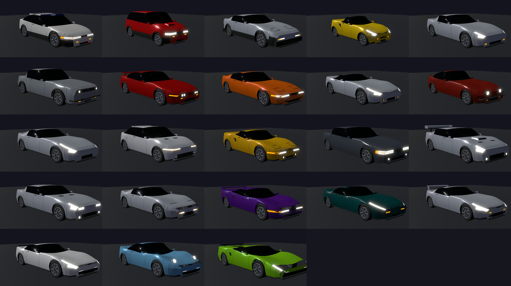
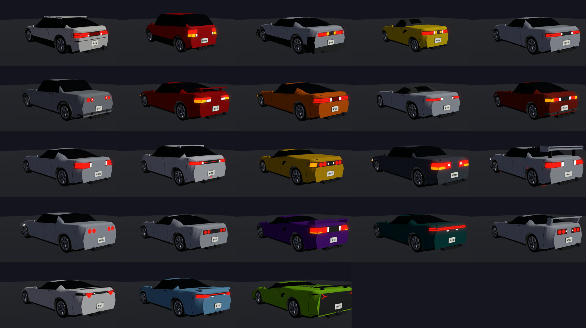

Alle 23 Autos ab Werk, in der Reihenfolge des Freischaltens (je Zeile fünf): Kaizen Rally S, Chibi K-Turbo, Hachi
Touge, Hotaru MR-K, Sakura D2 · Kaido 2000GT, Hayate R8, Kitsune 18S, Tsubame Spyder, Hakone 240 · Mirai 240R,
Tanuki R4, Tenshi MR-T, Kumo JX6, Raijin RS-4 · Vortex GT-R, Ronin DR, Shiden NX-1, Ryujin 30Z, Kaze TT · Kagura V10,
Falke 9 RS, Furia V12 (Exoten).

| Neu in 2.17 | Art | Antrieb | Klasse | frei ab |
|---|---|---|---|---|
| Chibi K-Turbo | Kei-Wagen mit Turbo-Dreizylinder und Hutze | Front | D | Start |
| Hotaru MR-K | Kei-Roadster mit Mittelmotor und Stoffverdeck | Mittelmotor | D | 2 Rennsiege oder 1 Driftsieg |
| Kaido 2000GT | 70er-Hardtop mit Reihensechser, Chrom, Verbreiterungen | Heck | C | 3 Rennsiege oder 1 Driftsieg |
| Hakone 240 | 70er-Fließheck mit langer Haube, Scheinwerfer in Mulden | Heck | B | 5 Rennsiege oder 2 Driftsiege |
| Tanuki R4 | Allrad-Kleinwagen mit Turbo-Dreizylinder | Allrad | B | 7 Rennsiege |
| Kagura V10 | Supersportwagen mit V10 vorn, drei Endrohre | Heck | S | 15 Rennsiege |
| Falke 9 RS | Heckmotor-Boxer, runde Scheinwerfer auf den Kotflügeln | Heckmotor | S | 16 Rennsiege |
| Furia V12 | flacher V12-Keil, 2,03 m breit | Allrad | S | 17 Rennsiege |

## Städte (echte Orte)
Die Strecken folgen echten Straßen, die Wahrzeichen stehen an ihrem Platz, die Häuser hinter der Straßenfront
haben die echten Grundrisse. Kartendaten © OpenStreetMap-Mitwirkende (ODbL, openstreetmap.org/copyright).

<table>
<tr>
<td width="50%">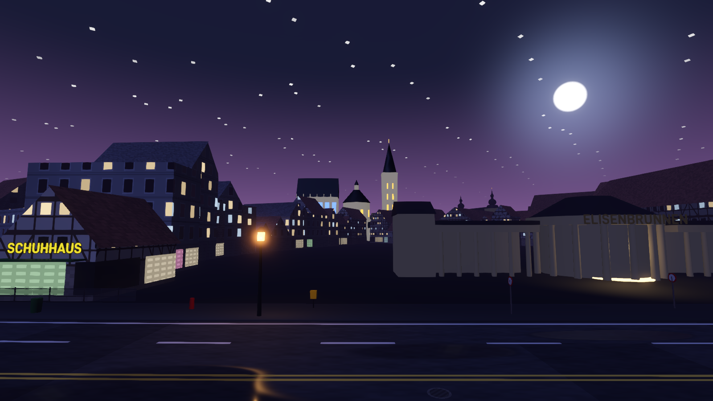 Aachen: Dom und Rathaus in der Mitte des Grabenrings</td>
<td width="50%">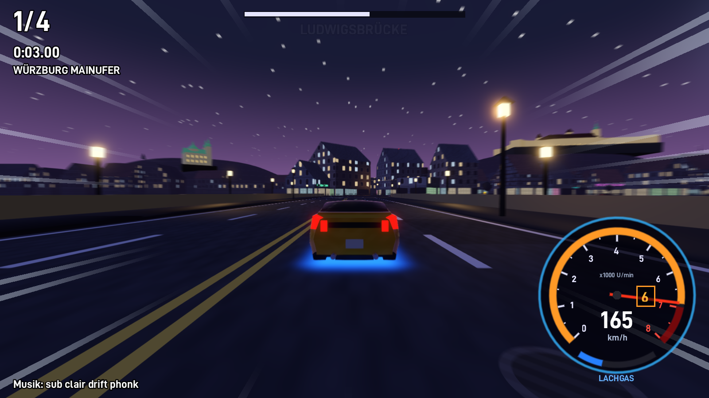 Würzburg: Alte Mainbrücke und Festung Marienberg</td>
</tr>
</table>
- **Aachen Grabenring** (Rundkurs, 2 Runden, 2,8 km): Templergraben am SuperC der RWTH vorbei, Seilgraben,
  Friedrich-Wilhelm-Platz am Elisenbrunnen, Theater, Kapuzinergraben, Löhergraben, Karlsgraben. In der Mitte Dom
  (Oktogon mit Faltkuppel, gläserne Chorhalle, Westturm) und Rathaus mit Granusturm, Marktturm und Karlsbrunnen.
- **Würzburg Mainufer** (Sprint, 5,4 km): Röntgenring, Rennweg an der Residenz (Ehrenhof, Frankoniabrunnen) vorbei,
  Friedrich-Ebert-Ring, Sanderring, über die Ludwigsbrücke, unter der Festung Marienberg (angestrahlt, auf dem
  Weinberg) entlang, über die Friedensbrücke zurück und den Main entlang zum Alten Kranen. Dazwischen Dom St. Kilian,
  Marienkapelle, Käppele und die Alte Mainbrücke mit zwölf Heiligenfiguren und Leuten beim Brückenschoppen.
- **Bad Kissingen Kurmeile** (Sprint, 2,9 km): am Regentenbau und Arkadenbau vorbei, Spielbank im Luitpoldpark,
  über die Fränkische Saale durch die Stadt und am Fluss entlang zum Gradierbau der Oberen Saline.
- **Tauberbischofsheim Altstadt** (Rundkurs, 3 Runden, 1,8 km): Schmiederstraße, Vitryallee, Hauptstraße rund um die
  Altstadt mit Türmersturm und Kurmainzischem Schloss, neugotischem Rathaus und St. Martin.
- **Hammelburg Saaleck** (Sprint, 2,5 km): Berliner Straße mit Bahnübergang dort, wo die Strecke Gemünden–Bad Kissingen
  kreuzt (in echt führt die Straße auf einer Brücke darüber, im Spiel kommt der Zug ebenerdig), am
  Renaissance-Rathaus mit Treppenturm und Marktbrunnen vorbei, über die Saale und den Schlossberg hinauf, oben auf dem
  Weinberg Schloss Saaleck.
- **Berlin Kreuzberg** (Rundkurs, 2 Runden, 5,2 km): Skalitzer Straße unter der Hochbahn der U1 (Kottbusser Tor,
  Schlesisches Tor), über die Oberbaumbrücke mit ihren Backsteintürmen, die Mühlenstraße an der East Side Gallery
  entlang, über die Schillingbrücke, Köpenicker und Adalbertstraße zurück zum Kotti mit dem Neuen Kreuzberger Zentrum.
  Altbauten mit Graffiti im Erdgeschoss, Spätis, Döner, Kiezkneipen, der Fernsehturm über den Dächern (näher gerückt
  und kleiner, damit er in Sichtweite steht).

Dazu: gelbes Ortsschild am Start, Straßenschilder, der echte Straßenname wird beim Abbiegen eingeblendet, Flüsse mit
Ufermauern und Steinbrücken, Hügel mit Weinbergen, Fachwerk, Putzfassaden, Ziegel- und Schieferdächer, Läden der
Stadt (Printen, Bocksbeutel, Kurcafé, Fechtclub, Häckerwirtschaft …). Die Straßen sind breiter als in echt
(vier Spuren), enge Ecken sind auf mindestens 38 m Radius abgerundet, die Wahrzeichen rücken bei Bedarf ein Stück
von der Straße weg. Neu erzeugen: `python3 tools/osm_city.py <ordner-mit-overpass-json>` (Abfragen und Wegpunkte im
Skript), schreibt `scripts/city_data.gd`.

## Strecken
- Jede Strecke führt durch mehrere Stadtviertel mit eigenem Stil (Name wird beim Reinfahren eingeblendet):
  - **Bankenviertel:** Glastürme, LED-Videowände, Schilderbrücken
  - **Marktviertel:** Wohn- und Geschäftshäuser (Altbau-Putz, Klinker) mit Läden unten, Ziegel- und Schieferdächer,
    Markisen, Lichterketten über der Straße, Hochbahn
  - **Prachtallee:** Gründerzeit-Altbauten mit Schieferdächern, dazwischen Bürohäuser, Mittelstreifen mit Bäumen
  - **Altstadt:** Putz, Fachwerk, Klinker, rote Ziegeldächer (teils mit Giebel zur Straße), Bäume, alte Laternen
  - **Hafen:** Hallen und Klinkerspeicher, Containerkräne über der Straße, Schornsteine, Natriumdampf-Licht
  - **Schnellstraße:** Lärmschutzwände mit Graffiti, Wegweiser-Brücken, Straßenbrücken
- **Häuserschlucht:** Hinter der Straßenfront stehen zwei weitere Häuserreihen (nur Baukörper und Dächer im
  gemeinsamen Häuser-Mesh, ohne Schilder), in den Städten die echten Gebäude. Jeder Bauplatz wird am ganzen Rand
  geprüft (Ecken und Kantenpunkte): hinter dem Gehweg, neben Gassen und Gabelungen, nicht im Fluss, See, Park oder
  Bahngelände, nicht in anderen Häusern, Wahrzeichen oder Hochbahn-Endblöcken. Passt ein Haus nicht (Kurveninnenseite,
  Einmündung), wird ein schmaleres versucht, sonst 4 m weiter. Echte Grundrisse (als umschließende Rechtecke) dürfen
  sich bis 2,5 m überlappen (Winkelbauten im Block).
- **Tunnel** unter Häuserblocks (Kacheln, Lichtbänder, Hall im Sound): Die Fahrbahn taucht vorher in einem offenen
  Betontrog gut 6 m ab (Leitlichter in der Mauer, oben läuft der Gehweg der Stadt weiter) und kommt dahinter wieder hoch.
  Am Anfang der Trogmauer führt ein schräger Anpralldämpfer vom Gehweg zur Mauer, damit man dort nicht hängen bleibt.
  **Hochbahn** mit Zug über der Außenspur, **Stadion** mit Flutlicht.
- **Höhen:** Die Altstadt-Route der Gabelungen zweigt nach oben ab und führt als Bergstraße über eine Kuppe (gut 5 m,
  Häuser stehen am Hang, Stützmauern). Mit viel Tempo hebt man an der Kuppe kurz ab. Bergauf zieht es etwas, bergab
  schiebt es. Viele Seitenstraßen steigen hinter ihrer Absperrung sichtbar den Hang hinauf.
- **Abkürzungen:** kurvige Gassen (Kopfsteinpflaster, Lichterketten) und ein Seesprung über eine Schanze. Sie sparen 100–150 m, sind aber enger bzw. brauchen Tempo (ab ca. 120 km/h über den See, sonst Platsch).
  Damit man sie nicht im Dunkeln suchen muss: Gabelungen und Gassen sind Lichttunnel aus leuchtenden Bögen alle
  12 m (cyan bzw. pink, mit Lampen), am ersten Bogen groß „ABKÜRZUNG“, Leuchtbänder an beiden Rändern zeigen den
  Weg; der Seedamm hat warme Leuchtbänder (`Track._shortcut_lights`).
- **Bahnübergang mit Bahnhof:** zweigleisig mit Oberleitung, daneben ein kleiner Bahnhof (Bahnsteige mit Dach und
  Stationsschildern, Wartende, Fußgängerbrücke, Empfangsgebäude mit Uhr, S-Bahn-Säule an der Straße, Signale).
  Kommt der Zug, gehen Schranken runter. Wer drauf zufährt, crasht. Auf der rechten Außenspur steht eine Rampe, mit
  genug Tempo springt man über den Zug.
- **Sprünge und Fallen:** Schwerkraft knapp 2 g, Rampen werfen das Auto mit bis zu 14 m/s nach oben (Seesprung gut
  1 s Flug, 3 m hoch). In der Luft hebt sich erst die Nase und kippt dann mit der Flugbahn ab; wer seitlich über eine
  Kante fährt, kippt zur freien Seite. Harte Landungen federn kurz nach, schiefe kosten Tempo. In der Luft kann man
  nicht lenken, Nitro schiebt aber weiter. Wer am See zu kurz springt, fällt ins Wasser.
- **Sprungkamera** wie in NFSU: Beim Absprung rechnet das Spiel die Flugbahn voraus. Wird der Sprung mindestens 1,6 m
  hoch und 0,6 s lang (Seesprung, Bahnrampe; Kuppen nicht), schneidet das Bild auf eine feste Kamera knapp über dem
  Boden schräg vor der Landestelle, nur wenn sie von dort Absprung, Scheitel und Landung frei sieht. Sie schaut dem
  Auto nach und zoomt mit, sodass es etwa gleich groß bleibt. Ein Aufhelllicht auf der Kameraseite sorgt dafür, dass
  das Auto nachts von vorn nicht schwarz bleibt, und oben und unten fahren schwarze Kino-Balken ein. Dazu leichte Zeitlupe (Faktor
  0,45–0,7, je länger der Flug, desto weniger), in der Motor und Effekte dumpf klingen. Kurz nach dem Aufsetzen geht es
  zurück zur Fahrerkamera, bei Überschlag oder Platsch erst etwas später. Einstellungen → Kamera & Tempo → Sprungkamera: An / Ohne
  Zeitlupe / Aus.
- **Überschlag** wie in echt: nur wer quer rutschend (ab 36 km/h Querfahrt, Schräglage über gut 30°, mindestens
  50 km/h) mit der Flanke gegen Wand oder Auto kracht, kippt darüber, oder wer schief landet. Beurteilt wird die Lage
  im Moment des Aufpralls (nicht erst nach dem Ausrichten an der Wand, sonst sähe jeder schräge Treffer wie Querrutschen aus). Frontal oder streifend
  gibt es Crash und Dreher, keinen Überschlag. Das Auto hebt ab, rollt um die Längsachse und federt bei jedem Aufschlag. Landet es auf den Rädern, geht es weiter; auf Dach oder
  Seite wird es nach gut einer Sekunde auf die Straße zurückgesetzt. Hart getroffene Verkehrsautos überschlagen sich
  ebenfalls und bleiben liegen. Laternen, Schilder und Poller werden am Treffpunkt angestoßen und kippen um.
- **Kollision:** Alles Feste und Schmale auf Fahrbahn und Gehweg (Masten, Pfosten, Stämme, Schaltkästen, Schilder,
  Bänke) bekommt beim Streckenbau automatisch eine Kollisionsbox (`Track._auto_collide`), am Bahnübergang Schranken-
  antrieb und Andreaskreuz. Durchlässig bleiben nur Schilf, Kabel und Passanten. Prüfen: `tools/track_check.tscn --
  --ghosts --nobatch`.
- **Gegner schieben:** Gegner fahren nicht durch dich oder einander hindurch. Von hinten bleiben sie an der
  Stoßstange und schieben mit (gleich schwere Autos teilen sich das Tempo, Gas geben schiebt den Vorderen weiter),
  nebeneinander drücken sich beide auseinander, wer blockiert wird, weicht auf die Spur mit dem meisten Platz aus.
- **Gabelungen:** Vor der Teilung zeigt ein Wegweiser beide Wege. Die Altstadt-Route ist kürzer, aber zweispurig
  mit Gegenverkehr; außen herum geht ein breiter Boulevard. Wer sich nicht entscheidet, landet auf der Verkehrsinsel.
- **Boulevards:** breite Straßen mit bepflanztem Mittelstreifen (auf der Schnellstraße mit Betonleitwand).
- Kreuzungen mit Ampeln, Verkehr in beide Richtungen. Laternen, Mülltonnen, Zeitungsboxen, Parkuhren,
  Schilder, Büsche und Container fliegen weg und kosten etwas Tempo. Sackgassen sind an der Einmündung abgesperrt,
  vor den Trögen lenkt eine schräge Leitwand hinein.
- **Anecken wie in NFSU:** An Wänden und Banden schrammt man entlang und dreht dabei weich parallel zur Wand
  (höchstens 230° pro Sekunde, ein schräger Treffer braucht etwa 0,2–0,4 s, nie ein Sprung im Bild); die Reifen
  halten dabei weniger, damit sie das Auto nicht wieder in die Wand ziehen, und das Schrammen zählt nicht als Drift. Je flacher der Winkel, desto weniger Tempo
  kostet es (15° ≈ 5 %, 30° ≈ 20 %, 45° ≈ 45 %). Feste Hindernisse federn seit 2.15 nicht mehr zurück: frontal
  (Wand, Hausecke, Baum, Mast) steht das Auto mit einem Schlag, man muss zurücksetzen; wer dagegen Gas gibt, wird
  nicht weggeschoben. Baumstämme und Pfosten halten das Auto auf, sobald es sie mit der Front trifft (die runde Form
  lenkt es nicht mehr um sich herum), nur seitliches Streifen rutscht vorbei. Kleine Hindernisse wie Poller und Bänke
  drehen das Auto kaum (ihre Ecken hätten sonst schräge Richtungen vorgegeben). Verkehr bestraft härter:
  seitlich abprallen, frontal oder beim Auffahren Dreher und kurz keine Kontrolle. Mittelstreifen laufen spitz aus.

## Fortschritt
Kein Geld: Jeder 1. Platz zählt als Sieg. 3 Siege in einer Karriere-Stufe öffnen die nächste (`Catalog.STAGES`), Siege
insgesamt schalten Autos und Tuningteile frei (Werte in `scripts/catalog.gd`). Die Grundteile der Optik sind von
Anfang an frei, Besonderes (Chrom, Perlweiß, Kreuzspeichen, Monster-Flügel, Breitbau …) kommt mit Siegen. Gesperrte Teile kann man in der Garage
als Vorschau ansehen. Alte Spielstände übernehmen ihre bisherigen Siege in die Karriere.

## Stimmungen
Jedes Event hat sein eigenes Licht (`scripts/moods.gd`), damit sich die Städte unterscheiden: **Neon** (lila Himmel,
satte Farben), **Mitternacht** (tiefblau, Sterne, Mond), **Natrium** (orange Straßenlampen, dunstig), **Regen**
(Tropfen vor der Kamera, nasse Fahrbahn mit Spiegelungen und Pfützen, im Tunnel trocken), **Nebel** (dichter, kühler
Dunst), **Dämmerung** (oranger Horizont, letzte Helligkeit), **Kiez** (Magenta und Violett). Dazu Kopfsteinpflaster
in den Altstädten und Graffiti an den Altbauten im Kiez.

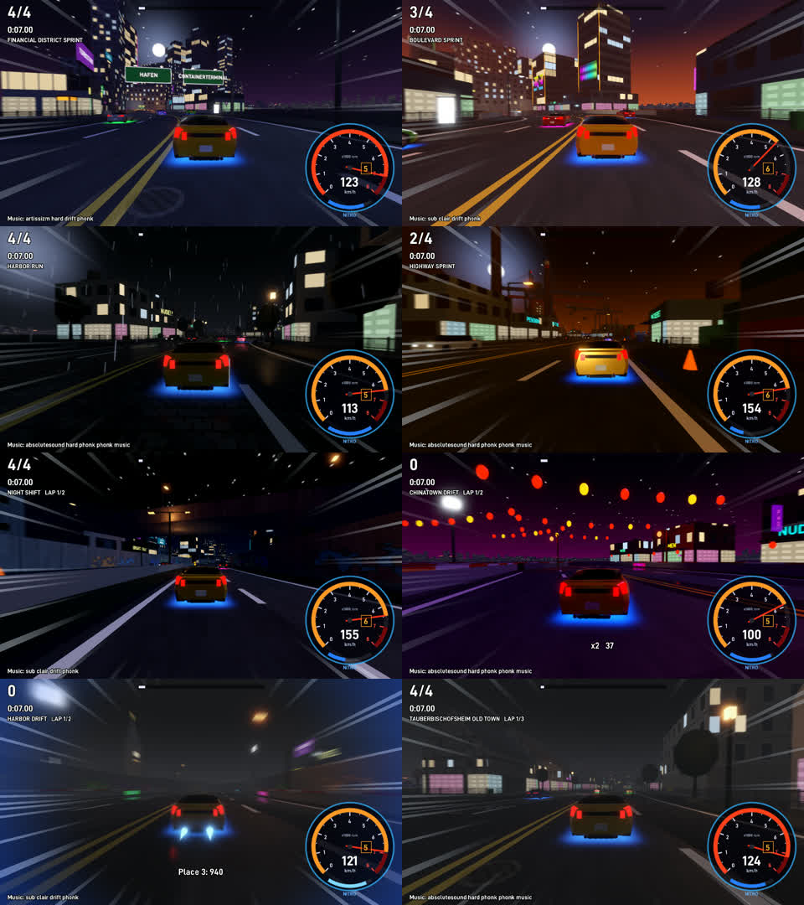

## Musik und Sounds
Musik (`music/`, sieben Tracks: Phonk, Trap, Drill, Rap-Beat) und Intro-Sound (`assets/intro_sound.mp3`) sind
lizenzfreie Tracks von Pixabay. Die Musik läuft wie ein durchgehender Mix (`scripts/music.gd`): zufällige Reihenfolge,
jeder Track bis zum Ende (ein neues Rennen schneidet ihn nicht ab), die letzten 6 s blendet der nächste über; ist die
Liste durch, wird neu gemischt. Die Tracks sind gleich laut gemacht (mit `ffmpeg -af ebur128` gemessen, Ziel -11 LUFS,
Tabelle `TRACKS`), Stille am Anfang und Ende wird übersprungen. M springt mit kurzer Überblendung weiter. Weitere
mp3/ogg-Dateien in `music/` laufen automatisch mit (ohne Eintrag in der Tabelle ohne Angleich).

Motorsound, Nitro und Crashs werden im Spiel erzeugt. Der Motor ist seit 2.13 heller: zu den Obertönen kommen die
Druckstöße im Auspuff (ein schmaler Puls je Zündung), unter Last ein leises Rasseln im Takt und beim Gaswegnehmen
bei hoher Drehzahl ab und zu ein Plopp; der Tiefpass reicht bis knapp 2 kHz statt 1 kHz. Zug, Glocke, Landung, Platschen, Tunnel, Stadion,
Reifenquietschen usw. sind synthetisch erzeugte WAVs in `assets/sfx/` (`python3 tools/make_sfx.py`, einzelne mit
`python3 tools/make_sfx.py skid`).
- **Reifen (seit 2.14):** zwei Schleifen. `scrub.wav` ist das Schrubben schon bei leichtem Rutschen (raues, eher tiefes
  Rauschen mit Körnung vom Asphalt). `skid.wav` ist das Quietschen im echten Drift und bei durchdrehenden Rädern:
  kein reiner Pfeifton mehr, sondern die Haft-Gleit-Schwingung der Reifen (rauer Sägezahn mit unruhiger Periode)
  durch die Resonanzen von Reifen und Karosserie (um 1,2 / 2,3 / 3,6 kHz), zwei Reifen fast gleich hoch (Schwebung
  statt Akkord, der nach Pfeife klang), dazu Rattern und Zischen. Beides setzt weich ein, wird mit dem Driftwinkel
  lauter und mit Tempo etwas höher. Seit 2.16 hängt es nicht mehr am Querrutschen in m/s (das reichte im normalen
  Rennen nie: selbst mit Handbremse rutscht ein Auto bei Tempo nur 2–3 m/s quer, das Quietschen begann erst bei 6),
  sondern am Rutschwinkel, an der Kurvenfahrt am Grip-Limit (Schrubben, leises Quietschen), an Handbremse,
  Vollbremsung, Drift und durchdrehenden Rädern. Gut 3 dB lauter als vorher.
- **Nitro (seit 2.14):** beim Zünden `nitro_on.wav` (Ventil-Klacken, dumpfer Stoß, aufschießendes Zischen und ein
  Wusch), solange es läuft `nitro.wav` (Fauchen der Düsen, Brausen der Flamme, leiser Pfeifton), beim Loslassen
  `nitro_off.wav` (Abblasen, seit 2.16); der Motor klingt dabei heller. Seit 2.16 4 dB lauter: vorher lag das
  Fauchen etwa so laut wie der Motor und ging unter der Musik unter, jetzt steht es im Hochton rund 10 dB über der
  Musik. Reifen- und Nitro-Schleifen laufen im Stream-Modus wie der Motor (im Browser lassen sich fertige Samples nicht
  zuverlässig in jedem Bild in Lautstärke und Tonhöhe nachführen). Der Motor schaltet im Drift nicht mehr herunter: Gang und
  Drehzahl, die man hört und sieht, richten sich nach dem Tempo über Grund, mit Gas dreht er durch die
  durchdrehenden Hinterräder hoch (bis knapp unter den Begrenzer). Der Vortrieb rechnet weiter mit dem Gang nach
  dem Tempo nach vorn, das Fahrverhalten bleibt also gleich.

## Menüs
Im Stil von NFS Underground (`scripts/ui_style.gd`): schräge Leisten, Neongrün für die Auswahl, kursive
DIN-Schmalschrift, große Abschnittstitel (GARAGE, RENNEN, TUNING, AUTOHAUS), Leistungsbalken des Autos (mit
Motor-Tuning), Tastenleiste unten, wechselnde Tipps oben rechts. Pause und Ergebnis im gleichen Look.

**Anzeigen im Rennen** im selben Stil:
- **Oben links (`scripts/hud_info.gd`):** Platz groß und kursiv mit „/4“ (leuchtet bei Platzgewinn grün, bei
  Verlust rot), darunter Zeit, Runde und Rennname auf schrägen Glasleisten; im Drift die Punkte.
- **Oben mittig:** ein Fortschrittsbalken mit allen Fahrern: du als gelbes Dreieck, die Gegner als Punkte in ihrer
  Lackfarbe, Rundenstriche und eine Zielflagge.
- **Unten links (`scripts/minimap.gd`):** Radar-Minimap, die sich mit der Kamera dreht. Du bist der gelbe Pfeil, die
  Gegner sind Punkte in Lackfarbe (außer Sicht kleiner am Rand). Abkürzungen sind orange, gesperrte Seitenstraßen
  grau, Flüsse und Seen blau, das Ziel eine Schachbrettflagge (außer Sicht am Rand, zeigt so die Richtung), dazu
  ein Nordzeiger. Je schneller du fährst, desto weiter zoomt sie heraus. Im Drag gibt es keine Minimap.
- **Unten rechts (`scripts/tacho.gd`):** Drehzahlmesser mit LED-Bogen aus 40 Segmenten (Cyan, Weiß, Orange, roter
  Bereich) mit Leuchtschein und spitzer Nadel. Der Gang steht neongrün in der Nabe, das Tempo groß in einem
  schrägen Feld mit blassen führenden Nullen, Nitro als Segmentbogen. Am Begrenzer blinkt der Rand rot, mit
  Nitro leuchtet er blau und das Instrument zittert. Im Drag kommen der grüne Schaltbereich, ein Schaltlicht und
  eine Temperaturleiste dazu.
- **Unten links über dem Radar:** Punkte-Zeilen (DRIFT +240, KNAPP VORBEI +300, SPRUNG 1,2 s +240, Abkürzung,
  Runde), darunter der Name des Viertels oder der Straße. Im Drift-Event steht dort die laufende Kette.
- **Drag:** neben dem Drehzahlmesser die Schalttasten und kurz das Ergebnis des letzten Schaltvorgangs.
- **Sonstiges:** Die Tastenhilfe blendet nach 12 s aus. Den Musiktitel zeigt seit 2.15 eine kleine Blase unten in der
  Mitte: beim Trackwechsel ploppt sie mit einem Equalizer auf, klappt auf (Titel, darunter klein der Künstler) und
  nach gut drei Sekunden wieder zu. Auf Handy und Tablet bleibt sie weg. Während der Startkarte wartet sie, bis die
  Karte weg ist; in der Garage sitzt sie rechts unten in der Tastenleiste (links liegt die lange Karriere-Liste).

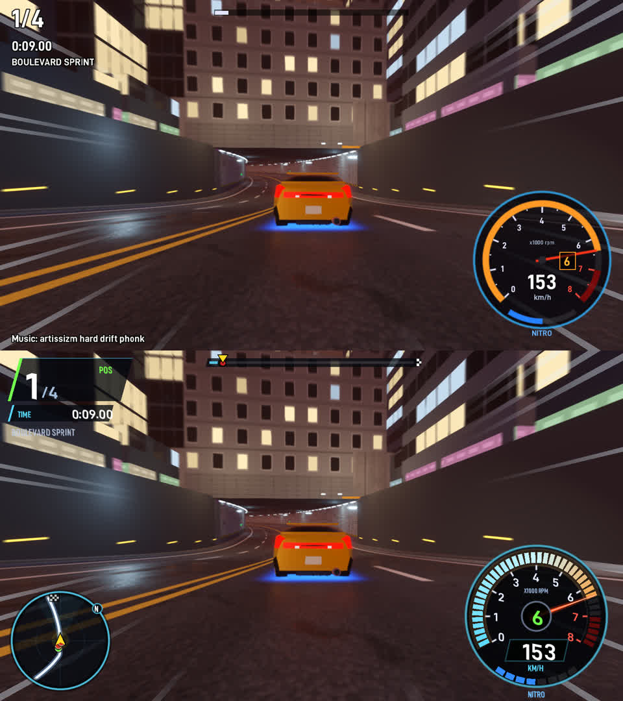

Oben die alten Anzeigen, unten die neuen seit 2.10 (Minimap, Drehzahlmesser, Platz, Fortschrittsbalken).
- **Leistung im Browser:** Alles Feste wird nur einmal gezeichnet; Nadel, Karte und Marken werden pro Bild nur
  gedreht oder verschoben. Die Karte liegt in Weltkoordinaten, `shaders/minimap_clip.gdshader` schneidet sie am
  Kreis ab. Zeit und Tempo werden Zeichen für Zeichen ohne Textformung gezeichnet.

## Tuning wie in NFS
**Ein Satz Teile für die ganze Garage** (wie in Underground): was eingebaut ist, passt auf alle eigenen Autos, beim
Autowechsel bleibt alles dran. Rücktaste und Esc gehen eine Ebene zurück (Teileliste → Kategorie → Optik/Leistung →
Garage), der Fokus steht wieder auf dem Eintrag, aus dem man kam.

Garage → Tuning → **Optik** oder **Leistung** (Motor, Turbo, Nitro, Fahrwerk, Reifen) → Teil wählen. Optik:
- **Lack:** 21 Farben, dazu Oberflächen: glänzend mit Klarlack, stark metallisch (Candyblau, Bronze, Gold), matt
  (Mattschwarz, Mattgrau), Perlweiß mit Schimmer an den Kanten, Chrom.
- **Felgen:** 23 Bauarten, jede eigens gebaut: Serie (je Auto eine eigene Werksfelge), Fünfspeichen, Gitter,
  Tiefbett (poliertes breites Horn), Doppelspeichen, Y-Speichen, Mehrspeichen, Stahlfelge mit Löchern, Turbine,
  Rennsport-Sechs, Kreuzspeichen mit Zwischenring, Aero-Scheibe, Tiefbett Stern, dazu seit 2.18 Konkav-Stern,
  Retro-Loch (Telefon-Wählscheibe), Radkappe, Rallye, Sichel (gebogene Speichen in Laufrichtung), Schmiede-Zehn,
  Dreiteilig (Stufenbett mit Schraubenring), Kleeblatt, Drahtspeichen mit Flügelmutter und Zentralverschluss. Alle
  mit Sechskant-Radmuttern (4 oder 5 je nach Auto), Nabendeckel mit Emblem und Ventil. **Felgenfarbe** extra
  (passend, Silber, Schwarz, Gunmetal, Weiß, Wagenfarbe, Rot, Gold, Bronze, Neongrün, Chrom).
- **Zoll:** Standard, -1 und +1 bis +4 Zoll. Die Liste zeigt die echte Größe für das gewählte Auto (z. B. 17"), das
  Infofeld die Reifengröße (z. B. „245/30 R19“). Der Reifen behält seinen Durchmesser, die Flanke wird flacher; zu
  groß für das Auto geht nicht (mindestens 4,5 cm Flanke). Nur Optik, ändert keine Fahrwerte.
- **Spoiler:** Lippe, Entenbürzel, Street-Flügel, GT-Flügel, Schwanenhals, Doppeldecker, Dachspoiler, Bügelflügel,
  Monster-Flügel.
- **Bodykit:** Seitenschweller, Street (lackierte Lippe, Schweller, Heckschürze), Rallye (Schmutzfänger,
  Unterfahrschutz, Zusatzscheinwerfer), Racing (Kohlefaser-Splitter, Canards, großer Diffusor), Breitbau, Breitbau
  Racing.
- **Motorhaube:** Lufthutze, Lamellen, NACA-Einlass, Doppelhutze, Kohlefaser (Köperbindung), Kohlefaser mit Hutze.
- **Auspuff:** Sport, Doppelrohr, Ovalrohr, Titan (blau angelaufen), Rennauspuff mittig.
- **Folierung:** Rennstreifen, Seitenstreifen, Mittelstreifen, Zweifarbig, Flankenband, Haube und Heck,
  Kontrastdach, Rallye; **Folienfarbe** extra (Kontrast, Weiß, Schwarz, Rot, Blau, Gelb, Gold, Neongrün, Pink, Carbon).
- **Unterbodenneon** in acht Farben, **Scheiben** getönt bis verspiegelt, **Scheinwerfer** Serie, Xenon, Gelb,
  Eisblau (Lichtkegel in derselben Farbe).

Beim Auswählen fährt die Kamera an das Teil (Felge, Heck, Haube, Auspuff, Unterboden …),
beim Motor und Turbo geht die Haube auf (Ventildeckel in der Farbe der Stufe, Pilzfilter, Turbolader, Domstrebe),
beim Nitro der Kofferraum (Flaschen je nach Stufe). Vorschau beim Auswählen, Einbauen mit Enter, gesperrte Teile
zeigen die nötigen Siege. Leistungsteile wirken wirklich (`Catalog.stats`): Motor und Turbo auf Schub und Endtempo,
Fahrwerk und Reifen auf Grip und Lenkung, das Fahrwerk legt das Auto tiefer; die Balken zeigen Gewinn (cyan) und
Verlust (rot) gegenüber dem eingebauten Teil. Ab Werk: Bremsscheiben mit Sätteln (rot ab der ersten Leistungsstufe),
Frontlippe, Diffusor, Chrom-Endrohre (größer ab Motor+Turbo 2), Ladeluftkühler im Einlass mit Turbo, Haubenschlitze
mit Motor Stufe 3.

**Feinere Teile (seit 2.16):** Reifen sind Drehkörper mit runden Schultern, leicht gewölbten Flanken und drei
Profilrillen (36 Segmente statt eines Zylinders mit 14 Ecken). Bremsscheiben mit dunklem Topf und zwei versetzten
Lochkreisen, kräftigere Sättel mit Deckplatte. Speichen an der Nabe breiter als am Horn, mit gefasten Kanten; Felgenhorn,
Tiefbett und Zwischenringe mit 40 statt 16 Segmenten, große Scheiben (Felgen, Leuchten) runder. Heckflügel haben ein
echtes Flügelprofil (oben flach, unten gewölbt) mit Abrisskante statt flacher Kästen. Damit Gegner in der Ferne nicht
teurer werden, lässt die Fernansicht (LOD) Lochkreise, Schrift und Wischer weg und nimmt einen einfachen Reifen.
Die Garage rendert die 3D-Welt in voller Fensterauflösung (bis 1440 Zeilen, Handy 900) mit 4x MSAA (Handy 2x),
unabhängig von der Einstellung „3D-Auflösung“, die erst im Rennen gilt.

## Handy und Tablet (Browser)
Auf Handy und Tablet erscheinen Knöpfe, am Rechner nicht (Einstellungen → Touch-Steuerung: Auto/An/Aus; Auto erkennt
das Gerät am Browser, auch iPads im Desktop-Modus): links Lenken (Daumen kann rüberrutschen), rechts Gas, Bremse, Handbremse, Nitro,
im Drag Hoch-/Runterschalten statt Bremse; Pause oben in der Mitte, Drehzahlmesser klein oben rechts, Minimap links
unter der Platzanzeige. Hochkant kommt
ein Hinweis zum Drehen. Auf Handys werden in den Städten nur die Häuser nahe der Strecke gebaut, Grafik startet
auf „Niedrig“ mit dynamischer Auflösung. Zum Testen am Rechner: `-- --touch`.

## Sprachen
Englisch und Deutsch: Beim ersten Start fragt das Spiel (Englisch vorausgewählt), später unter Einstellungen → Sprache.
Übersetzungen in `scripts/i18n.gd` (Schlüssel sind die deutschen Texte, `tr()`); Titel, Ortsnamen, Läden und Schilder
in der Welt bleiben deutsch.

## Schrift und Texte
Alles auf Deutsch, im Ton von NFS Underground (KNAPP VORBEI +300, DRIFT +240, SPRUNG, Tuning-Marken auf den
Dächern, Ladetipps im Menü). Schrift überall im Stil der deutschen Straßenschilder (DIN 1451):
D-DIN von Datto, SIL Open Font License 1.1 (`assets/fonts/COPYING.txt`). Alte englische Eventnamen werden im
Spielstand automatisch umgeschrieben, der Spielstand aus „Underground Sprint“ wird beim ersten Start übernommen.

## Grafik
Garage → Einstellungen → Grafik (wird gespeichert), aufgebaut wie in großen PC-Spielen: eine **Voreinstellung**
(Niedrig / Mittel / Hoch / Ultra) setzt alle Optionen, jede lässt sich danach einzeln verstellen (Links/Rechts),
dann steht „Benutzerdefiniert“ da. Werte in `GameState.GFX`.
- **3D-Auflösung** 540p–1440p (höchstens so viele Zeilen, darüber weich hochskaliert), **Dynamische Auflösung**
  (fällt die Bildrate unter 60, geht die 3D-Auflösung in Stufen bis 60 % herunter; bringt das nichts, weil der
  Prozessor bremst, bleibt sie oben), **Sichtweite** 600–1400 m, **Detaildichte** (ab wann Kleinteile verschwinden
  und Autos auf die Fernansicht wechseln), **Texturdetails** (Normal: Straße mit 4-facher anisotroper Filterung,
  Lichtkarte bis 1024 Pixel; Hoch: 16-fach, Lichtkarte bis 2048 Pixel), **Lichter** (wie weit Laternen Autos und Häuser beleuchten; die Lichtkreise auf der Straße sind immer da), **Kantenglättung** (Aus, FXAA,
  MSAA 2x/4x), **Glühen**, **Spiegelungen** und **Umgebungsverdeckung** (nur am Rechner, nicht im Browser),
  **Effekte** (Regen, Dampf), **Pixel-Look**.
- Einstellungen: **Schwierigkeit** (Leicht / Normal / Schwer), **FPS anzeigen** (oben in der Mitte, mit aktueller 3D-Auflösung), **V-Sync**, **FPS-Limit**, **Vollbild**.
- **Kamera & Tempo** (alles einzeln abschaltbar, z. B. gegen Übelkeit): **Bewegungsunschärfe** (Aus / Dezent / Normal /
  Stark), **Tempo-Zoom** (Sichtfeld wird mit Tempo und Nitro weiter), **Kamerawackeln** (Stöße bei Einschlägen und
  Landungen, Neigen beim Lenken), **Sprungkamera** (An / Ohne Zeitlupe / Aus).
- **Bewegungsunschärfe wie in NFS Underground** (`shaders/speed_fx.gdshader`) statt gezeichneter Tempolinien: ab gut
  40 % Tempo verwischt der Bildrand entlang der Fahrtrichtung (Zoom-Unschärfe vom Fluchtpunkt aus, zehn versetzte
  Proben je Bildpunkt), die Mitte mit dem eigenen Auto bleibt scharf; beim Einlenken verwischt das Bild zusätzlich
  seitlich, mit Nitro stärker, dazu ein blauer Schimmer und leichte Farbsäume. Steht nichts an, ist der Effekt ganz aus.
  Seit 2.14 rechnet er in der 3D-Auflösung (Ebene im Welt-Viewport) statt im ganzen Fenster: auf 4K-Bildschirmen nur
  noch ein Viertel bis die Hälfte der Bildpunkte, ohne eigene Kopie des Fensterbilds. Spiegelungen auf „Niedrig“
  laufen in halber Auflösung.
- Erststart: Handy/Tablet „Niedrig“, sonst „Mittel“ (beide mit dynamischer Auflösung).
- **Leistung:** Unbewegliche Teile der Strecke werden je Material und Rasterzelle zu einem Mesh verschmolzen
  (`Track.batch_static`), Autos je Material und beweglichem Teil (Karosserie, Räder), dazu eine Fernansicht in
  Vertexfarben mit wenigen Flächen (`CarBuilder._build_lod`). Das halbiert etwa die Draw Calls. Im Browser fährt
  vor dem Start eine unsichtbare Kamera die Strecke ab, damit alle Shader übersetzt sind, bevor es losgeht
  („Strecke wird vorbereitet“), sonst ruckelt es beim ersten Anblick jedes neuen Materials. Verkehr außer
  Sichtweite wird ausgeblendet und nur zweimal pro Sekunde bewegt, der Motorsound rechnet auf Handy/Tablet mit
  halber Abtastrate. Messmodus: `-- --race=N --drive --quit=32 --bench` (Bildzeit, Draw Calls, Ruckler,
  was im Bild ist); `--nobatch` schaltet das Verschmelzen zum Vergleich ab, `--gfx=ssr:0,bloom:0,blur:0` stellt
  einzelne Grafikoptionen nur für den Test um. GPU-Zeiten liefert Godot unter macOS nur mit
  `--rendering-driver vulkan`.
- Verkehr nach Schwierigkeit: 1 Stern ohne, 2 Sterne wenig, 3 Sterne voller Verkehr.
- **Tempo-Stufe:** am Anfang fahren alle (auch Gegner) mit 72 % Höchsttempo, mit jedem Sieg mehr, ab 20 Siegen volles Tempo.
- **Gegner-Stärke** wie in NFSU mit dem Spiel wachsend: Gegner fahren Autos passend zur Stufe des Events (1 Stern:
  Kaizen, Hachi, Sakura; 2 Sterne bis Klasse A; 3 Sterne alle), mit 84 / 88 / 92 % Können je Stufe, dazu
  0,4 % je Sieg (bis 10 Siege). Schwierigkeit **Leicht** −11 % (zum Kennenlernen der Strecken), **Schwer** +5 % und
  Autos eine Stufe höher. Gummiband: liegst du weit vorn, holen sie auf Leicht gar nicht, auf Normal höchstens 7 %,
  auf Schwer 15 % auf; liegst du weit hinten, fahren sie mit 82 / 88 / 90 % (Leicht / Normal / Schwer).
  Abkürzungen (sie sparen bis zu einem Fünftel der Zeit) nehmen Gegner in den 1-Stern-Rennen nie, danach auf Leicht nur 30 % so oft, auf Normal 80 %. Oben heraus beschleunigen auch Gegner
  schwächer (Gänge, Luftwiderstand). Driftziele: Leicht 65 %, Normal 85 %, Schwer 100 %.
- **Antrieb (seit 2.15):** Frontantrieb (Kaizen, Hayate), Heckantrieb (die meisten), Mittelmotor mit Heckantrieb
  (Tenshi, Shiden) und Allrad (Raijin, Vortex); steht in der Garage. Hecktriebler drängen unter Gas in der Kurve mit
  dem Heck nach außen (Mittelmotor noch mehr), Fronttriebler schieben dagegen über die Vorderräder und drehen beim
  Gaswegnehmen etwas ein, Allradler liegen ruhig. Beim Anfahren greift Allrad am besten, Frontantrieb am
  schlechtesten. Im Drift-Event fahren alle gleich (dort zählen nur Leistung und Handling).
- **Bremse und Rückwärtsgang (seit 2.15):** die Bremse verzögert bis zum Stand; wer im Stand weiter bremst, legt nach
  0,3 s den Rückwärtsgang ein (Tacho: R) und rollt gemächlich rückwärts (5 m/s², höchstens ~40 km/h). Gas im
  Rückwärtsgang bremst erst bis zum Stand, nach 0,15 s geht es vorwärts. Vorher sprang die Bremse unter 1 m/s ohne
  Pause auf vollen Rückwärtsschub (wie ein Hoverboard).
- **Fahrgefühl:** mit Gas in der Kurve schiebt das Heck raus, im Drift dreht das Auto um die Vorderachse. Gas baut sich in gut einer Drittelsekunde auf, Drehmoment folgt der Drehzahl, beim Anfahren
  begrenzt die Haftung (die Kupplung schleift, der Zug kommt mit dem Tempo), jeder Gangwechsel nimmt kurz Zug weg, das
  Getriebe schaltet mit Hysterese (kein Pendeln an Gangwechseln). Seit 2.13 gibt es keine Sprünge mehr im Tempo:
  der perfekte Start gibt gut eine Sekunde mehr Zug statt 30 km/h auf einen Schlag, Nitro setzt in einer
  Drittelsekunde ein, im Drag gibt perfektes Schalten einen kurzen Schub statt eines Satzes nach vorn. Langsam begrenzt der Wendekreis (5,2 m), bei Tempo die Querbeschleunigung (2,1–2,7 g je
  Auto, bei Topspeed etwas weniger). Kurven kosten kein Tempo, an der Haftgrenze rutscht das Auto sichtbar ein paar
  Grad; Rutschen radiert etwas ab, würgt das Tempo aber nicht ab. Anbremsen in die Kurve lässt das Heck leicht kommen,
  Handbremse dreht bei 80 km/h in 0,8 s um gut 90°. Bremsen ~2,4 g, Gegenlenken geht schneller als Einlenken.
  Karosserie wankt nach der echten Querbeschleunigung, taucht beim Bremsen ein; die Verfolgerkamera dreht leicht
  verzögert mit und bleibt nah am Auto (im Stand 4,7 m, bei Tempo knapp 7 m, Blickwinkel 58°–80°). Messwerte aller Autos: `tools/handling_lab.tscn`.
**Räder (seit 2.18):** Jedes Auto hat eine eigene Werksfelge in eigener Größe, Kei-Wagen und 70er auf 13 bis 14 Zoll
mit hohem Reifen, die Exoten auf 18 bis 20 Zoll (`Catalog.FACTORY_RIMS`). Aufrüstfelgen sind ein bis drei Zoll größer
als die Werksfelge (`plus`), die Kategorie Zoll verschiebt das (`Builder.rim_spec`). Das Rad hat jetzt Tiefe: der
Reifen ist innen offen, darin liegt das Felgenbett (zwischen den Speichen sichtbar), Bremsscheibe und Sattel sitzen
5 cm hinter der Speichenebene, die Speichen laufen konkav von der Nabe zum Horn. Klasse S hat ab Werk gelbe Sättel und
gelochte Scheiben, getunte Autos rote. Die Räder drehen wie echte: Bremse und Handbremse lassen sie blockieren (alle
vier bzw. hinten, das Auto rutscht mit stehenden Rädern und die Reifen radieren hörbar), beim Start mit zu viel Gas,
beim Anfahren mit Vollgas und im Drift drehen die Antriebsräder durch (Front, Heck oder alle, je nach Antrieb), in
der Luft laufen sie frei weiter. Gegner blockieren beim kräftigen Bremsen. Gegen den Wagenrad-Effekt (bei 60 Bildern je
Sekunde scheinen schnelle Speichen zu stehen oder rückwärts zu laufen) dreht das Rad sichtbar höchstens 0,42
Speichenteilungen je Bild weiter, darüber blendet eine Unschärfescheibe in der Mischfarbe aus Speichen und Felgenbett
ein, wie auf echten Aufnahmen. Kostet im Rennen etwa 4 % mehr Draw Calls und Dreiecke, die Bildzeit bleibt gleich.

- **Autos** (23) sind aus Querschnitten gebaut (Radhäuser, Kotflügel-Buckel, Hüften, eingezogenes Glashaus), lose
  angelehnt an RX-7, 350Z, Civic EG, Silvia, Skyline, AE86, S2000/MX-5, Lancer Evo/Impreza, Supra, Integra (vier runde
  Scheinwerfer, Flügel auf der Klappe), 180SX (Klappscheinwerfer, Fließheck), MR2 und NSX (Mittelmotor: Kabine vorn,
  Lufteinlässe in den Flanken, Motor in der Garage hinten), Chaser (Viertürer mit Chrom) und 300ZX (Glasdach mit
  Mittelsteg, Leuchtenband über die ganze Breite). Seit 2.17 dazu Kei-Autos (Alto Works, Beat), ein Allrad-Kleinwagen
  (GR Yaris), zwei 70er-Klassiker (Hakosuka mit Chromstoßstangen und aufgeschraubten Verbreiterungen, S30 mit
  Scheinwerfern in Mulden) und drei Exoten (LFA, 911 mit runden Scheinwerfern auf den Kotflügeln und Heckmotor,
  Countach-Keil mit Y-Leuchten). Radgröße (`wheel_r`) und Achsabstand zu Bug und Heck (`axle`) stehen je Auto in
  `SHAPES`: Kei-Wagen rollen auf 0,27-m-Rädern mit kurzen Überhängen, die Exoten auf 0,34 m mit langen; das ganze Rad
  (Reifen, Felge, Bremse) wird dafür skaliert. Neuer Antrieb `rr` (Heckmotor): viel Traktion beim Start, das Heck
  kommt leichter als beim Mittelmotor. Der Startwagen
  Kaizen ist ein JDM-Fließheck: langes Dach, steile Heckscheibe, schmale Scheinwerfer, durchgehendes Leuchtenband,
  Dachspoiler, Sonnenstreifen mit Schriftzug, rotes Emblem und Abschlepphaken, unten schwarz abgesetzt, ab Werk tiefer
  und in Championship-Weiß (Lack-Stufe „Werkslack“ ist je Auto eigen, `CARS.paint`). Front- und
  Heckschürze sind eigene Teile. Leuchten sind je ein Stück (`_lamp`): ein Feld auf der Stirnfläche und ein Streifen,
  der der Flanke auf gleicher Höhe um die Ecke folgt, so sitzen Rücklicht-Ecke und Band nie versetzt (vorher wirkte das
  wie ein Auto im Auto). Türfugen, Spiegel, Griffe, Scheibenwischer, Kennzeichen mit Schrift („NF-G 86“); Anbauteile der Schürzen werden mit der Karosserie
  verschmolzen (~15 Draw Calls weniger je Auto) und sind auch in der Fernansicht zu sehen. Unterbodenneon ist ein Lichtteppich auf der Straße.
- **Straße wie in Underground** (`shaders/road.gdshader`): dunkler, körniger Asphalt mit Splitt, Flecken, Rissen und
  Teerfugen aus einer nahtlosen Detail-Textur samt Normal-Map (8 x 8 m, eine zweite, gedrehte Lage gegen sichtbare
  Kachelung). Immer etwas feucht glänzend, bei Regen deutlich; das Relief bricht trocken die Lichtreflexe in Körnung
  auf, nass wird es glatt und Laternen und Rücklichter spiegeln sich als lange Streifen. In jeder Spur zwei dunkle,
  glatt gefahrene Radspuren mit Öltropfen dazwischen, am Rand ein Rinnstein mit Gully-Rosten, abgefahrene
  Markierungen, Flickstellen mit Teerrand, Gullydeckel, Pfützen; Linien kantengeglättet (kein Flimmern in der Ferne).
  Normal-Mapping ohne Tangenten im Mesh (Basis aus Bildschirm-Ableitungen), daher auch nach dem Zusammenfassen.
- **Laternenlicht auf der Straße** (`Track._bake_street_light`, `shaders/street_light.gdshaderinc`): Beim Aufbau der
  Strecke kommt unter jede Lampe (Laternen, Tunnel, Brücken, Flutlicht, Lichterketten) ein weicher Lichtkreis in eine
  Lichtkarte über der ganzen Strecke (2 m je Bildpunkt, meist unter 1000 x 1000, 10–35 ms). Tunnel bekommen
  dazu ein durchgehendes Lichtband. Fahrbahn, Gehweg und Tunnelwände lesen sie im Shader: Jede Laterne beleuchtet
  sichtbar die Straße, auch im Browser, wo jedes Objekt nur von wenigen echten Lampen Licht bekommt (lange
  Straßenstücke und Tunnel blieben dort stellenweise schwarz). Überlagern sich viele Kreise, sättigt es weich.
- **Kopfsteinpflaster:** kleine, gewölbte Steine in Reihen quer zur Fahrtrichtung, jede Reihe mit eigener Steinbreite
  und zufällig versetzt; in der Ferne geht das Muster in den mittleren Farbton über (kein Flimmern). Vorher waren es
  große Rechtecke im Ziegelverband, die im Dunkeln wie eine Hauswand aussahen.
- **Fassaden** (`shaders/building.gdshader`, seit 2.15 in Fassadenkoordinaten): jede Hauswand kennt ihre Breite,
  Höhe und Lage zur Straße (`Track._bb_box`). Die Fensterachsen werden gleichmäßig auf die Breite verteilt (an
  beiden Ecken gleicher Rand, keine angeschnittenen Fenster), nur ganze Geschosse unter der Dachkante bekommen
  Fenster, Erdgeschoss und Schaufenster sitzen auf Straßenhöhe, auch am Hang. Vorher lag das Raster in
  Weltkoordinaten: an Ecken angeschnittene Fenster, an schräg stehenden Häusern bis zu 40 % breitere Fenster,
  an 45°-Kanten ein Sprung im Muster. Licht geht wohnungsweise an (zwei Fenster, im Büro ganze Räume), mit einer
  Lichtfarbe je Haus (Wohnhaus warm, Büro kühl). Dazu Fensterkreuze, Vorhänge oder Jalousien, Deckenlicht (oben
  heller), Schaufenster mit Regalen und Theke, Graffiti als Stücke mit Kontur. In der Ferne geht alles in den
  Mittelwert über (kein Flimmern). Giebel und Sockel am Hang bleiben ohne Fenster.
- **Schilder:** Ladennamen sitzen auf Leuchtkästen (dunkler Kasten mit Neonrahmen, `Track._sign_box`), dazu senkrechte
  Leuchtschilder und Dachwerbung. Frei an der Fassade schwebende Schriftzüge gibt es nicht mehr.
- **Gehweg** (`shaders/pavement.gdshader`): Betonplatten 1,5 x 1,5 m mit Fugen, je Platte etwas anders getönt,
  Flecken und Kaugummi-Punkte, an beiden Rändern eine Reihe heller Bordsteine, Bordsteinkanten aus hellem Beton.
  Wo kein Haus die Streckenbegrenzung verdeckt, steht ein Zaun.

## Entwicklung in Bildern
Vergleichsbilder aus der Entwicklung liegen in `update_bilder/` (Godot ignoriert den Ordner, sie landen nicht im
Spiel). Die wichtigsten:

- **2.18 – Felgen:** alle 23 Bauarten am Kaizen in ihrer Standardgröße, je Zeile von links: Serie (Kaizen),
  Fünfspeichen, Gitter Gold, Tiefbett Schwarz, Doppelspeichen, Y-Speichen · Mehrspeichen, Stahlfelge, Turbine,
  Rennsport-Sechs, Kreuzspeichen, Aero-Scheibe · Tiefbett Stern, Konkav-Stern, Retro-Loch, Radkappe, Rallye, Sichel ·
  Schmiede-Zehn, Dreiteilig, Kleeblatt, Drahtspeichen, Zentralverschluss und zuletzt Fünfspeichen bei 100 km/h mit
  Unschärfe.
   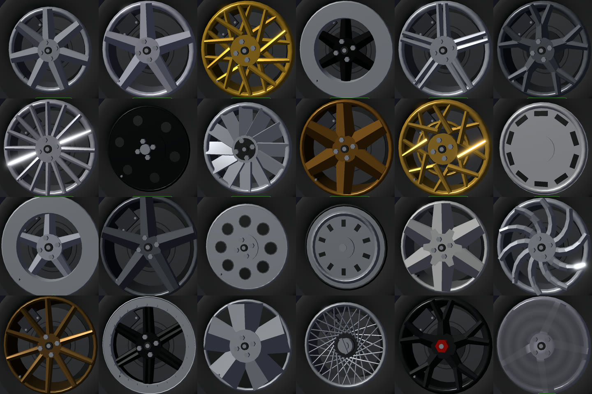
- **2.14 – Zuschauer:** oben die Blockfiguren bis 2.13 (bleiben als Fernansicht), unten die neuen Figuren mit
  Gesicht, Ellbogen, Händen, Kleidung und Frisuren.
   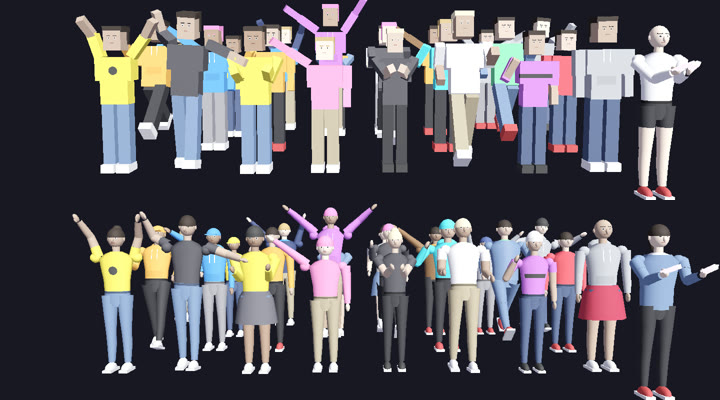
- **2.13 – neue Tuningteile:** Felgen (13 Bauarten, Felgenfarbe), Bodykits, Motorhauben, Auspuffe, Spoiler,
  Scheinwerferfarben und Folien.
   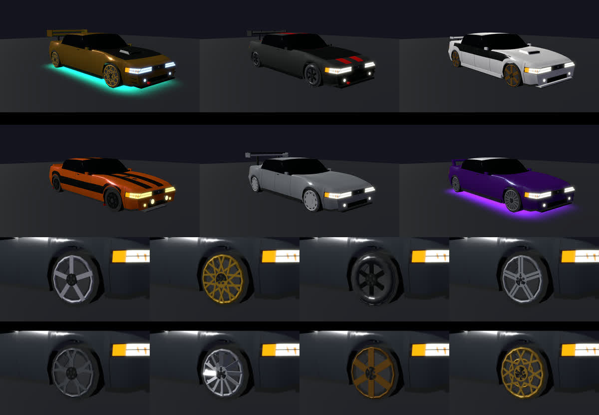
- **2.12 – Laternenlicht auf der Straße:** links vorher, rechts nachher, an denselben Stellen derselben Rennen
  (Hafentunnel, Aachen, Unterführung mit Asphalt statt Ziegelmuster am Boden).
   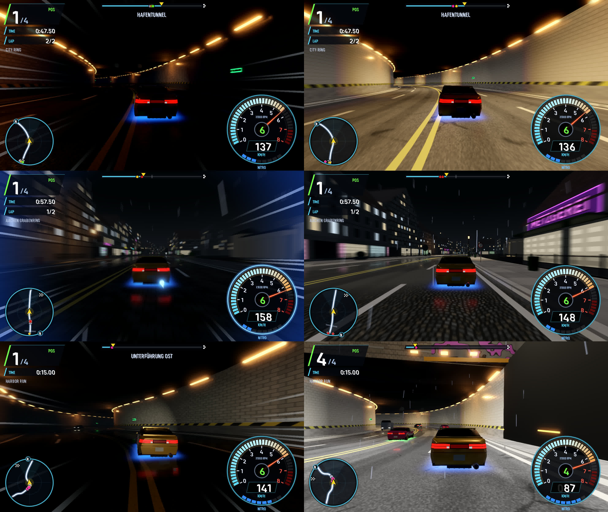
- **2.11 – Startwagen von hinten:** links vorher (Keile an den Ecken plus ein zweites Band innen), rechts nachher
  (ein Leuchtenband um die Ecken).
   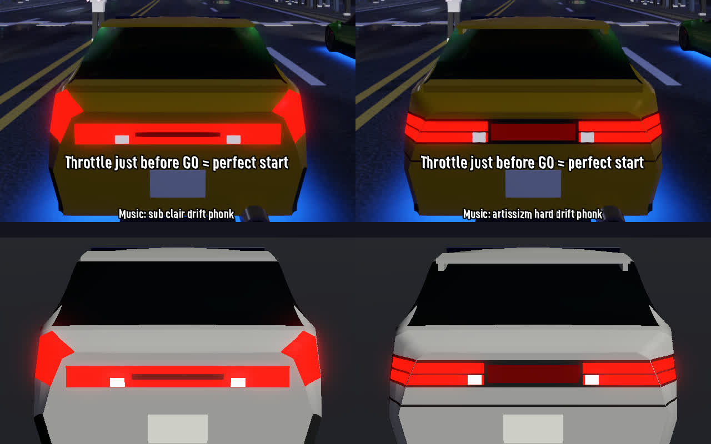
- **Häuserschluchten im deutschen Stil:** oben vorher, unten nachher (Kamerafahrt über Bankenviertel, Marktviertel
  und Prachtallee).
   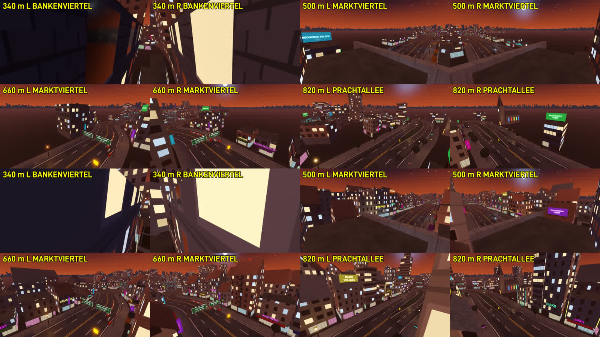
- **Asphalt und Gehwege im Underground-Stil:** je Reihe der alte und der neue Boden an derselben Stelle.
   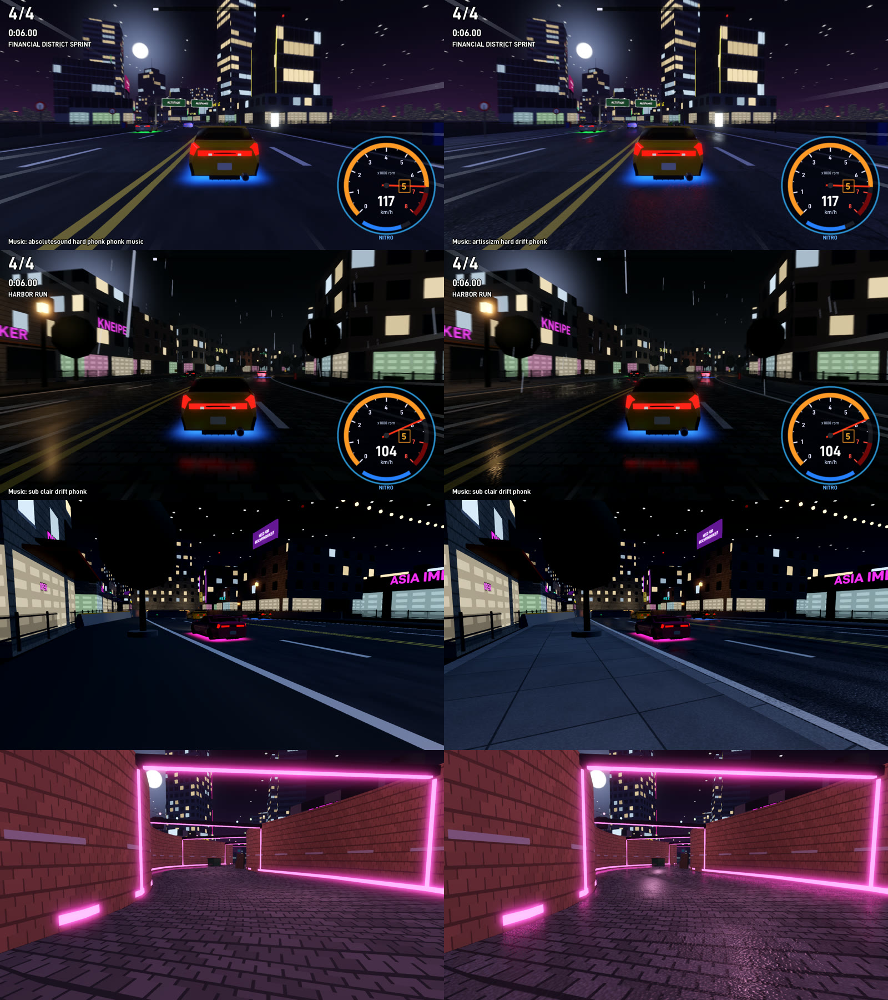
- **Lichttunnel, Abkürzungen, Sprünge und Überschläge:**
   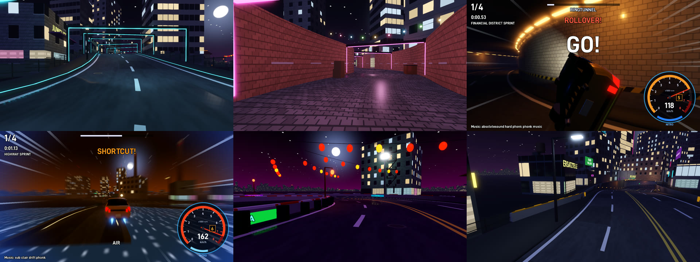
- **Erste Fassung des JDM-Startwagens** und der Stand mit neun Autos:
   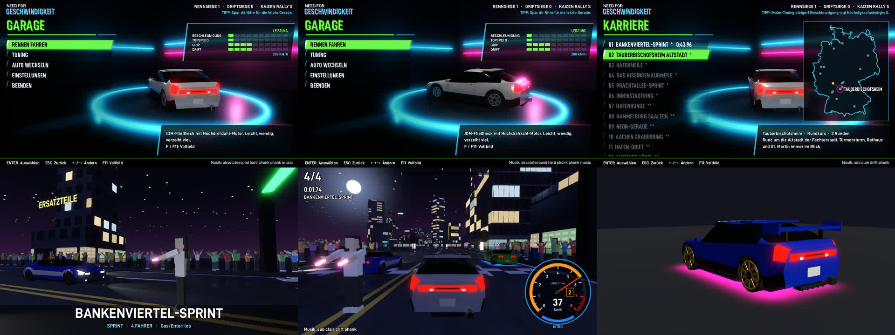
   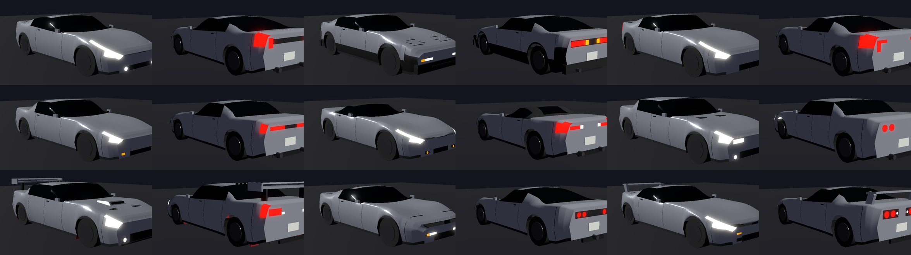
- **Karriere mit Deutschlandkarte** (frühe Liste) und die erste Fassung von Berlin-Kreuzberg:
   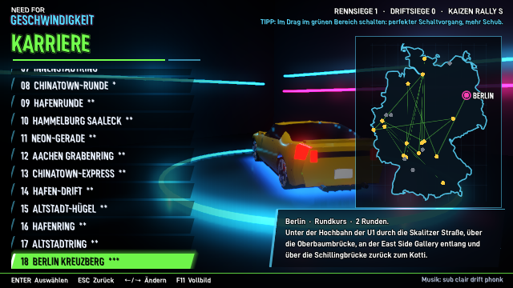 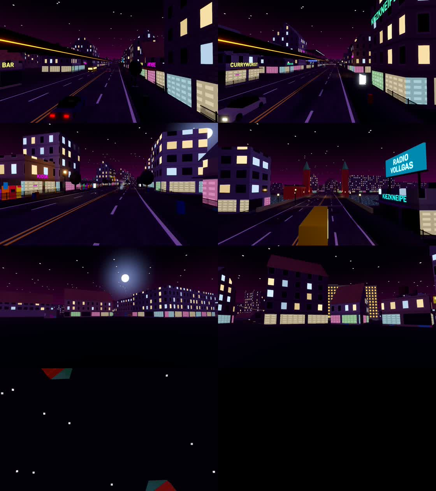
- **Früher Überblick:** Strecken, Bahnübergang, Startaufstellung mit Publikum und Siegertanz:
   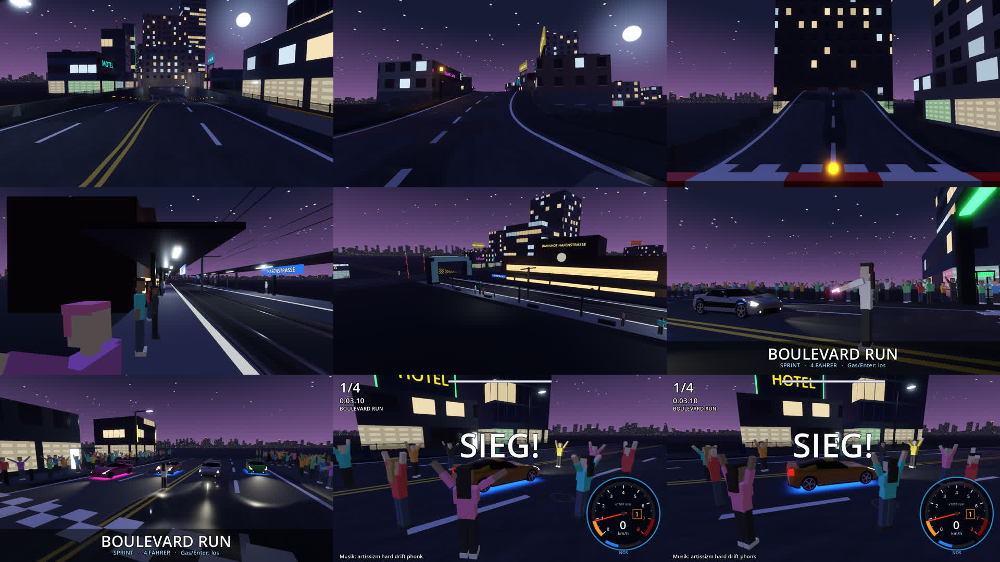

## Export
Vorlagen für Windows, macOS, Linux und Web stehen in `export_presets.cfg` (Godot-Exportvorlagen 4.7.1 nötig).

**Im Browser:** Die Web-Version (`builds/web`, ohne Threads, läuft auf itch.io ohne Sondereinstellungen) nutzt den
einfacheren WebGL-Renderer: keine Spiegelungen auf der Straße und keine Umgebungsverdeckung (fehlen dort im
Grafikmenü), entfernte Kleinteile werden ausgeblendet. Deshalb gibt es keine Shader-Werte pro Objekt (Häuser sind zu Meshes je
Stadtzelle zusammengefasst, ihre Werte stehen in den Vertexdaten). Lokal testen:
`python3 -m http.server 8060 --directory builds/web`.
Texte, Cover und Screenshots für die itch.io-Seite: `release/`.

## Aufbau
- `scripts/catalog.gd` – Autos, Teile, Rennen
- `scripts/player_car.gd` – Fahrphysik, Kamera, Geschwindigkeitsgefühl
- `scripts/engine_audio.gd` – synthetischer Motorsound (Turbo, Blow-off, Wind) und Reifenquietschen
- `scripts/track_builder.gd` – prozedurale Stadtstrecke
- `scripts/ai_car.gd` – Gegner
- `scripts/garage.gd` / `scripts/race.gd` – Menü und Rennen
- `scripts/intro.gd` – Studio-Intro
- `scripts/traffic_car.gd` – Verkehr
- `scripts/rail_crossing.gd` – Bahnübergang mit Bahnhof und Zug
- `scripts/city_builder.gd` – Wahrzeichen der Städte-Strecken (Dom, Residenz, Festung, Gradierbau, Türmersturm …)
- `scripts/city_data.gd` – Straßenverläufe, Flüsse, Gebäude und Wahrzeichen-Positionen (erzeugt von `tools/osm_city.py`)
- `scripts/people.gd` + `shaders/people.gdshader` – Figuren (Publikum, Starterin, Fans, Wartende): ein Modell mit allen
  Kleidungs- und Frisur-Varianten, der Shader wählt je Figur aus und bewegt sie; Vorschau mit `tools/people_shots.tscn`
- `scripts/race_show.gd` – Kameraflug, Publikum und Starterin am Start, Zielszene
- `scripts/elevated_rail.gd` – Hochbahn-Zug, `scripts/ambient_sound.gd` – ortsfeste Geräusche (Stadion)
- `tools/track_stats.tscn` – baut alle Strecken und zeigt Kennzahlen
- `tools/gen_ground_tex.tscn` – erzeugt die nahtlosen Bodentexturen `assets/textures/asphalt.png` (Körnung, Flecken,
  Risse, Glanz) und `asphalt_n.png` (Normal-Map) aus Rauschen, in gut 2 Sekunden
- `tools/track_check.tscn` – prüft alle Strecken auf Baufehler: zu enge Kurven (dort schneiden sich Fahrbahnrand und
  Wände) und Wände in der Fahrbahn; mit `-- --buildings` Häuser in Fahrbahn, Gehweg, Nebenstraßen, Fluss, See,
  Bahngelände, Wahrzeichen, Hochbahn-Endblöcken oder ineinander (gibt auch die Bauzeit je Strecke aus). Kurven enger als die halbe Breite plus Gehweg rundet `Track._round_corners`
  beim Bauen selbst ab (die Drift-Sterne hatten 5 m Radius: Leitplanke quer über der Straße).
- `tools/track_map.tscn` – Plan von oben (Straßen, Abkürzungen, Wände, Umfahrbares, Rampen, Lampen mit Reichweite):
  `-- --race=8 --out=karte.png [--zoom=d0:d1]`
- `tools/handling_lab.tscn` – Fahrphysik-Messlabor (0–100, Bremsweg, Kurvenradius, Querbeschleunigung, Schräglauf,
  Lenkansprechen, Handbremse) auf leerer Fläche: `--headless --fixed-fps 60 … -- --cars=kaizen,kaze`
- `tools/overview.tscn` – Bilder aus erhöhter Sicht auf Tunnel, Hochbahn, Stadion, Viertel (`-- --race=1 --out=pfad`)
- `scripts/debug_shot.gd` – nur für Tests/Videos (`-- --drive`, `--demo`, `--at=lake|crossing|alley|fork|tunnel|el|stadium|<viertel>|d:<m>`,
  `--race=n`, `--trace`, `--shot=pfad`, `--times=…`, `--quit=s`, `--intro` (Kameraflug auch im Test),
  `--view=weg:d:quer:höhe:ziel_d:ziel_quer:ziel_höhe` (feste Kamera ohne HUD), `--sweep=schritt[:hoch]` (Kamera fährt
  die Hauptstraße ab, je Schritt ein Bild auf jede Häuserzeile, mit Streckenmeter und Viertel im Bild), `--look=wahrzeichen:höhe:blickhöhe:abstand[:d]`
  (Kamera auf ein Wahrzeichen der Städte-Strecken), `--racelog` (Rennverlauf alle 3 s), `--crash=tempo:winkel|k[:d]`
  (Auto mit Tempo gegen die Wand bzw. auf die nächste Laterne, `q` quer rutschend, Verlauf von Überschlag und Flug),
  `--airlog`, `--tumblelog` (wodurch ein Überschlag ausgelöst wurde), `--jumplog` (vorhergesagte Sprünge und
  geprüfte Standorte der Sprungkamera), `--block=d:spur` (Spieler blockiert, Abstände der
  Gegner), `--fulltest` (ganzes Rennen mit Autopilot, der vor engen Kurven bremst; meldet als `FT …` Hänger,
  Stürze unter den Boden, Fahrten neben der Strecke, Ruckler über 60 ms, hängende Gegner mit Ursache, Abkürzungen
  der Gegner und das Ergebnis, beendet sich nach dem Ziel), `--branches` (Autopilot nimmt jede Abkürzung), `--tune=engine` (Garage direkt
  in einer Tuning-Kategorie), `--touch` (Touch-Knöpfe am Rechner); im Drag schaltet der Autopilot im
  grünen Bereich, `--lateshift` erst im Begrenzer, `--noshift` gar nicht, `--nolanes` ohne Spurwechsel, `--dragcrash`
  setzt Verkehr vor das Auto)
- `tools/short_overlays.gd` – rendert Texttafeln fürs Release-Short
- `tools/trailer_cards.tscn` – Texttafeln für den Trailer (Titel, Abspann, Sprüche, gelbe Ortsschilder): `-- --out=ordner`
