# Need for Geschwindigkeit

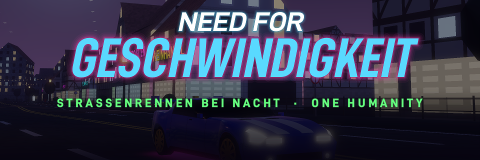

Nächtliches Straßenrennen im Stil der frühen 2000er (früher „Underground Sprint“), Low-Poly-3D mit Pixel-Look (Godot 4.7).

Ein Spiel von **ONE HUMANITY** – kostenlos auf [itch.io](https://onehumanity.itch.io/need-for-geschwindigkeit) für
Windows, macOS, Linux und im Browser. Was noch kommt, steht im [Fahrplan](FAHRPLAN.md).

**Open Source** ([github.com/DesignStraub/need-for-geschwindigkeit](https://github.com/DesignStraub/need-for-geschwindigkeit)): der Code steht unter der [MIT-Lizenz](LICENSE), die eigenen Inhalte unter [CC BY 4.0](LICENSE-INHALTE.md);
fremde Motorklänge, Geräusche, Musik und Schriften unter ihren eigenen Lizenzen ([CREDITS.md](CREDITS.md)), die
Kartendaten der Städte unter der ODbL. Name und Logo von ONE HUMANITY sind nicht frei lizenziert. Selbst bauen: mit
[Godot 4.7](https://godotengine.org) den Ordner öffnen und starten (F5); Exportvorlagen für Windows, macOS, Linux und Web
stehen in `export_presets.cfg`. Stand der Freigabe: [OPEN_SOURCE.md](OPEN_SOURCE.md).

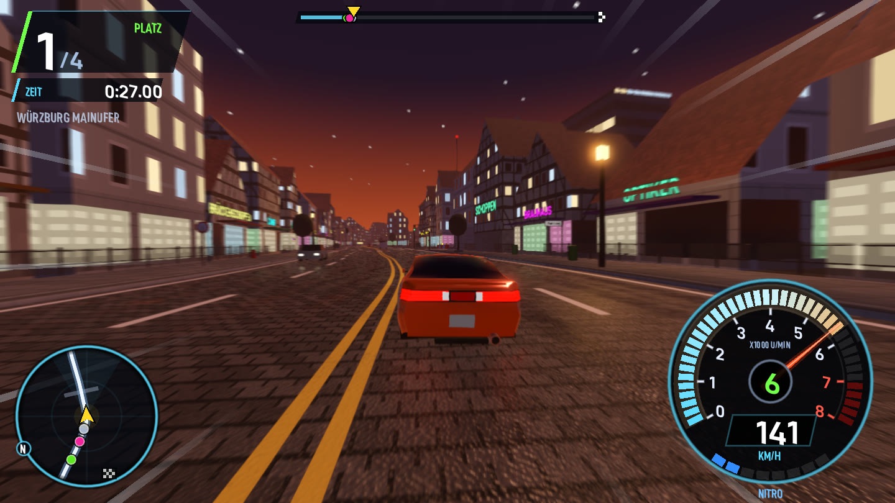

<table>
<tr>
<td width="50%">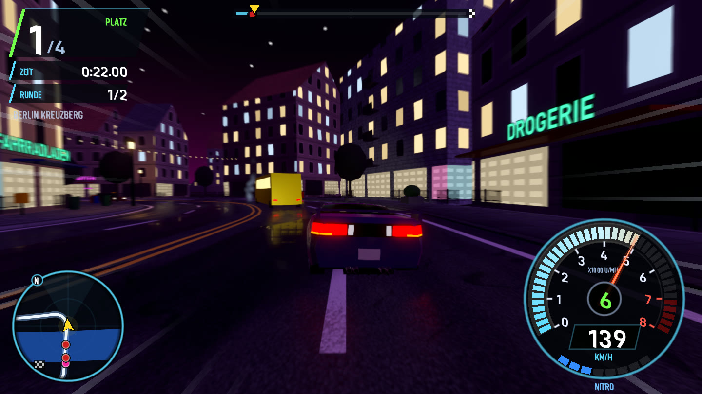 Berlin Kreuzberg im Shiden NX-1</td>
<td width="50%">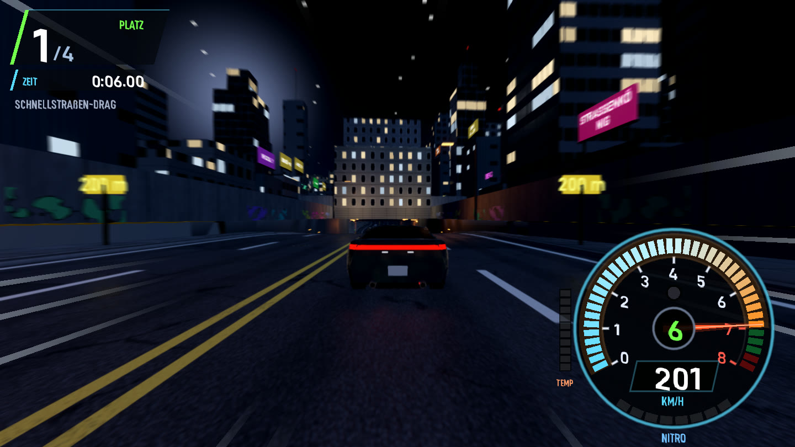 Drag auf der Schnellstraße im Ryujin 30Z</td>
</tr>
<tr>
<td>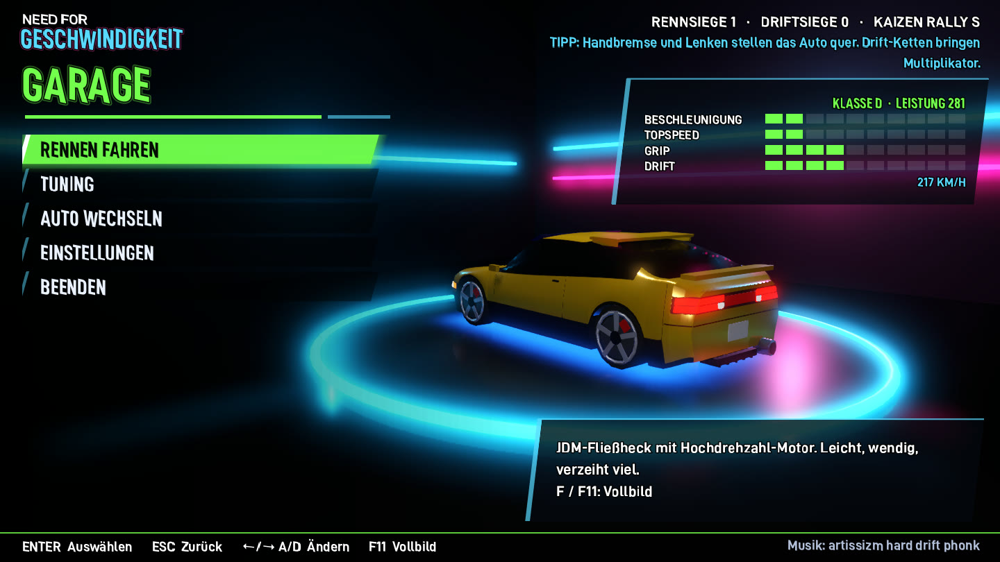 Garage mit Klasse und Leistungsindex</td>
<td>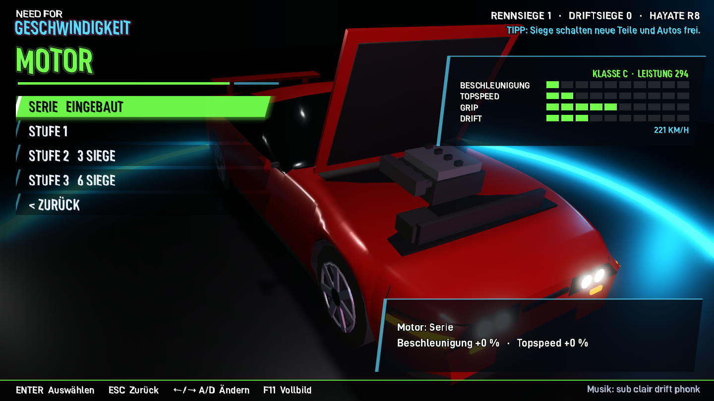 Tuning wie in NFS: Motor des Hayate R8</td>
</tr>
<tr>
<td>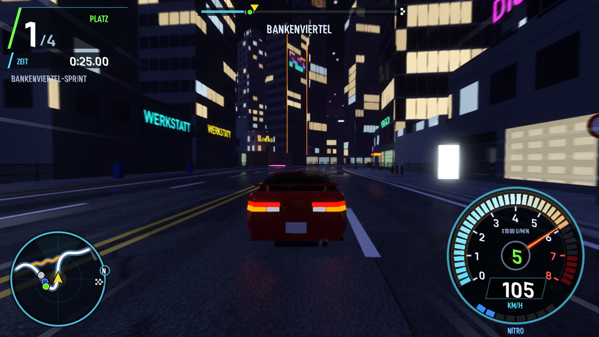 Bankenviertel-Sprint in Frankfurt</td>
<td>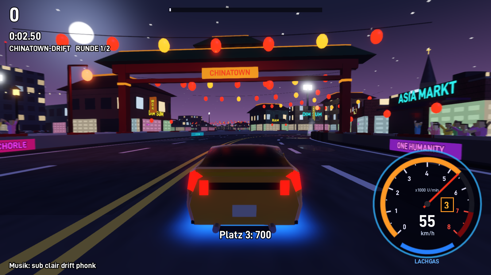 Drift-Event</td>
</tr>
</table>

## Starten
Ordner in Godot 4.7 öffnen (Import), dann F5. Das Spiel startet mit dem ONE-HUMANITY-Intro (überspringbar) und dann in der Garage.

## Steuerung
| Taste | Gamepad | Funktion |
|---|---|---|
| W / ↑ | RT | Gas (auch beim Countdown zum Hochdrehen) |
| S / ↓ | LT | Bremse / Rückwärts (im Drag: S schaltet hoch) |
| A D / ← → | linker Stick | Lenken |
| Leertaste | B | Handbremse (Drift) |
| Shift / N | A | Nitro (leer ist leer: erst loslassen, dann lädt es nach; seit 2.22 brennt es nach dem Zünden mindestens eine halbe Sekunde und zündet danach erst nach knapp einer Sekunde wieder, kein Dauerfeuer durch Tippen) |
| S / X (oder E / Q) | RB / LB | Drag: hoch-/runterschalten (A/D wechselt dort die Spur); steht klein neben dem Drehzahlmesser |
| C | Y | Kamera: Verfolger (Standard) / Verfolger weit / Stoßstange / Motorhaube; die Wahl wird gespeichert |
| R | Back | Auto auf die Straße zurücksetzen |
| M | | Nächster Musiktrack |
| Esc / Enter / P | Start | Pause (im Browser-Vollbild beendet Esc nur das Vollbild, dann Enter oder P) |
| ↑↓←→ / W A S D, Enter, Esc / Rücktaste | Steuerkreuz, A, B | Menüs: wählen, ändern, bestätigen, zurück |
| F11 / Alt+Enter | | Vollbild an/aus |

Nitro lädt sich langsam von selbst auf. Driften, knapp am Verkehr vorbei und Sprünge geben Punkte (klein unten
links), die Nitro ein Stück nachfüllen: eine schöne Drift-Kette etwa ein Zehntel, gedeckelt, damit Driften kein
Nitro-Automat wird. In der Bildmitte steht nur noch Countdown und Ergebnis.

**Fahrgefühl wie Underground (seit 2.24):** direkt und griffig. 2.23 hatte nach einem Forza-Vergleich eine deutliche
Trägheit in der Drehrate, ein ruhigeres Lenkrad und 7 % weniger Querhaftung; das war zu träge und ist zurückgenommen.
Geblieben ist nur eine kleine Glättung der Drehrate (nach einem Lenkimpuls bei 120 km/h ist sie nach 0,15 s auf 63 %,
in 2.22 nach 0,12 s, in 2.23 nach 0,25 s; gemessen mit `tools/handling_lab.tscn`) und die Karosserie, die beim
Einlenken und Bremsen etwas wankt und einmal sanft nachfedert (Feder mit knapp 1,6 Hz).

**Kamera (seit 2.24):** der Verfolger sitzt ein Stück höher (1,95 m statt 1,6 m, 4,6 m statt 4,4 m hinter dem Auto)
wie in NFSU, dazu gibt es „Verfolger weit“ (2,55 m hoch, 6,4 m dahinter). C schaltet durch alle vier Kameras, die Wahl
steht im Spielstand.

## Open World „Mini-Deutschland“ (im Aufbau, Zweig `open-world`)
Garage → **Losfahren** führt in eine offene Welt statt in die Rennen-Liste. Alle Strecken außer Drag liegen außen an
einem **Autobahnring** (knapp 26 km), möglichst nah an der Himmelsrichtung ihrer Stadt vom Mittelpunkt Deutschlands
aus (der Ring ist 18 % größer als nötig, der Spielraum zieht jede Stadt zu ihrer echten Richtung; `scripts/world_layout.gd`). Jede Stadt hat eine **Ausfahrt** zur Autobahn: Sprints gehen hinter dem Start einfach
weiter, Rundkurse bekommen eine Seitenstraße an ihrer äußersten geraden Stelle (`track_builder._plan_world_exit`);
eine gerade **Auffahrt** führt von der Mittellinie der Autobahn dorthin (Mittelstreifen dort offen).
Der Ring besteht aus Stücken von 2,6 km im Viertel „Schnellstraße“ (Lärmschutzwand, Schilderbrücken), mit
**drei Spuren je Richtung** (`track["extra"] = AB_EXTRA`, Fahrbahn-Shader mit `lanes` 3 bzw. 6).

**Rund, ohne Sackgassen:** ein zweiter Ring, der **Außenring** (gut 44 km), läuft in sanften Bögen außen um alle
Städte (`world_layout._outer_ring`: jeder Straßenpunkt hebt ihn auf mindestens 260 m Abstand an, Kuppen mit 900 m
Radius, Täler geglättet; engster Bogen gut 850 m). Sprints gehen jetzt auch **hinter dem Ziel** weiter
(`track["world_exit2"]`), eine Verbindung im Bogen führt von dort zum nächsten freien Ring (`_connect_ends`: bis 3,2 km
zur Seite gesucht, alle 10 m geprüft, nie näher als 32 m an einer anderen Straße, nicht enger als gut 130 m). Acht
Sprints enden am Außenring. Würzburgs Ziel liegt im Inneren der eigenen U-förmigen Strecke, ohne Kreuzung kommt man
dort nicht heraus (die erste Verbindung lief quer durch die eigene Hauptstraße, die Prüfung tastete nur alle 70 m ab):
dort biegt die Straße hinter dem Ziel im Bogen zurück und mündet in die eigene Hauptstraße (`_plan_tail_join`,
`race["tail_join"]`), man fährt über die Strecke zurück zur Ausfahrt. So fährt man durch: Autobahn → Stadt →
Außenring → nächste Stadt → Autobahn. Rundkurse und Drift-Kurse sind Schleifen mit ihrer einen Ausfahrt. Draufsicht:
`tools/world_map.tscn -- --png=/pfad.png --worldlog`.

- **Nachladen:** Strecken im Umkreis von 700 m werden nebenher gebaut (am Rechner in einem eigenen Thread, im Browser
  Schritt für Schritt), ab 1,3 km wieder entfernt. In der Welt ohne Verschmelzen der Häuser: im Thread liest das jedes
  Mesh einzeln vom Grafikserver zurück und dauerte dreimal so lange (21 statt 7 s), die Bildrate ist ohne kaum anders.
- **Strecken liegen gedreht und verschoben** (`track["xf"]`), bleiben aber in ihren eigenen Koordinaten; das Auto
  rechnet seine Lage für Boden, Rampen und Zurücksetzen dorthin um und fährt immer auf der Strecke, deren Fahrbahn
  am nächsten ist. Die Lichtkarte der Laternen gilt für die Strecke, auf der man gerade ist.
- **Rennen:** an jedem Start eine Lichtsäule in der Farbe der Art. Hineinfahren, Enter: das Rennen startet wie
  bisher mit Ladebildschirm, danach „ZUR WELT“ zurück an den Marker.
- **Gesperrt wie in der Karriere:** die Stufen gelten weiter (3 Siege öffnen die nächste). Gesperrte Marker sind grau
  und sagen, wie viele Siege in welcher Stufe fehlen; gewonnene leuchten golden angehaucht.
- **Minikarte** unten links wie im Rennen (dreht mit der Kamera, zoomt mit dem Tempo weiter raus), mit allen Straßen
  der Welt und den Rennen in Sicht (`world_minimap.gd`, erbt von `minimap.gd`).
- **Große Karte** mit Tab (Gamepad: linker Stick drücken) oder Esc > Karte: Ring, Städte, Rennen in der Farbe ihrer
  Art, du als Pfeil; rechts Art, Name, Stadt, Stand, Bestzeit, Luftlinie. ←/→ wählt ein Rennen, Enter setzt es als
  **Ziel**: dann zeigt die Zielflagge auf der Minikarte die Richtung (`world_map_view.gd`).
- **Esc-Menü:** Weiter, Karte, Tuning, Auto wechseln, Vollbild, Garage. Tuning und Auto wechseln öffnen die Garage
  direkt dort; „Fertig“ bzw. Zurück bringt einen an dieselbe Stelle in der Welt zurück (`GameState.world_menu`).
  Achtung beim Benennen: eine Funktion `_enter_world` in einem Node3D ruft die Engine selbst beim Laden auf.
- **Verkehr:** jede geladene Strecke bekommt Verkehr, der an ihrem Knoten hängt und mit ihr verschwindet (höchstens
  160 Autos, ein paar pro Bild eingesetzt, nie direkt vor der Nase). Autobahn: festes Tempo je Spur (innen 130, Mitte
  108, außen 86 km/h mit Bussen und Transportern), am Ende eines Stücks fahren die Autos aufs nächste weiter; in den
  Städten wie im Rennen, am Ende außer Sicht neu eingesetzt.
- **Zusammenstöße wie in Underground (auch im Rennen):** Verkehr rammen wird bestraft. Stoß nach Impuls gegen schwere
  Wagen (Pkw 2,5-, Transporter 4-, Bus 10-mal so schwer wie das eigene Auto); ab gut 30 km/h Unterschied frontal oder
  von hinten ist es ein Crash (Auffahren 150 auf 108: man fällt auf knapp 40 km/h und dreht sich). Gegner sind gleich
  schwer: wer auffährt, verliert Tempo, der andere wird geschoben. Verkehr bremst rechtzeitig für den Spieler, Wracks
  und den Vordermann (Bremsweg mit 6 m/s², 6 m Abstand), wechselt vor einem Wrack die Spur und steckt nie mehr im Auto
  des Spielers. Wände: streifend gut 90 % Tempo, 30° gut 50 %, ab 60° Stillstand (neu anfahren).
- **Bahn:** der Zug erfasst ein Auto auf den Gleisen und schleudert es seitlich weg (mitgerissen, Dreher); er schob es
  vorher nach unten durch den Boden, dann setzte das Spiel einen hinter dem Zug neu ein. Der Bahnübergang rechnet in
  den Koordinaten seiner Strecke und fährt auch in der Welt. Test: `race.tscn -- --race=0 --at=train` („TRAIN …“).
- **Nichts steht mehr auf fremden Straßen:** jede Stadt bekommt die Fahrbahnen in ihrer Nähe (Ring, Auffahrten,
  Nachbarstädte) als Sperrflächen (`world_layout._add_keepout`); Häuser und Wahrzeichen kommen dort nicht hin. Vorher
  ragten 223 Häuser vor allem aus den echten Stadtplänen auf Autobahn und Nachbarstraßen. Prüfen:
  `world.tscn -- --worldcheck` baut die ganze Welt und listet jede Überschneidung („WC …“, jetzt 0).
- **Rundfahrt-Test** (`scripts/world_tour.gd`): ein Autopilot fährt jede Straße der Welt ab, beide Ringe Stück für
  Stück, in jeder Stadt Auffahrt, Ausfahrt, Hauptstraße bzw. Runde, Ziel-Ausfahrt, Verbindung zum Ring und alle
  Abzweige, und meldet „TB WAND/FEST/FALL/NEBEN/KIPPT/ZEIT/BAU/FEHLT“ mit Ort und dem Ding, woran er stieß (Wände
  heißen nach ihrer Straße: `WallsRoad`, `WallsBranch<n>`, …), am Ende „TOUR SUMME“.
  `world.tscn --headless --fixed-fps 60 --log-file /tmp/tour.log -- --wtour=ring|outer|cities|<Rennname>` (dazu
  `--wpaths`: alle Wege jeder Strecke mit Anfang und Ende). Headless baut die Welt ohne Thread (der Ersatz-Renderer
  ist nicht threadsicher, Meshes aus dem Bau-Thread zerschossen dort die RIDs und das Log lief in die Gigabytes);
  `--log-file` hält Godots eigenes Log aus dem Benutzerordner. Ergebnis: innerer Ring 26,6 km und Außenring 43,9 km
  ohne Befund, alle Städte (66 km) ohne Straßenfehler. Übrig, alle geprüft: in den engen 135°-Kehren mit
  Mittelstreifen (Hafenrunde, Hafen-Sprint, Prachtallee) schneidet der Autopilot die Kurve und streift mit 2 m/s die
  Kante des Mittelstreifens; eine gewollte Kiste in einer Gasse; am Altstadtring erwischt ihn je nach Zeitpunkt der Zug
  am Bahnübergang (d = 809) und schleudert ihn auf den Gehweg. Jede Wand nennt ihre Strecke
  (`root.get_meta("race_name")`), mit `--wpaths` auch Richtung und Höhe der Straße um die Stelle.
  `--worldcheck`: 0 Überschneidungen.
- **Gewonnene Rennen** verschwinden aus der Welt und von der Minikarte; die große Karte zeigt sie als goldenen Haken.
- **Tasten:** Esc (oder P) öffnet das Menü, Enter bestätigt nur noch, M (oder Tab) öffnet die Karte, „.“ wechselt die
  Musik. Test: `world.tscn -- --wspawn=ring:10 --ctest=rear40` (auch rear120, side,
  standing, wrongway, bus, wreck, wall10/30/60/90, median30, near, chal), gibt alle 0,1 s „CT …“ aus.
- Testen: `world.tscn -- --wspawn=ring:5 --wdrive --worldlog` (Autopilot auf dem Ring, Bauzeiten),
  `--wspawn=ramp:15` (vor der Auffahrt nach Aachen), `--nothreads` (wie im Browser); Draufsicht:
  `tools/world_map.tscn -- --worldlog --png=/pfad.png`.
- **Anfahren ruhiger, Teile mit Siegen:** die unteren Gänge ziehen schwächer (`player_car.GEAR_PULL`), Gegner passend
  (`Catalog.ACCEL_SCALE`); ab dem 4. Gang und das Endtempo wie vorher. 0–100: Kaizen 6,9 s (vorher 5,4), Sakura 6,2 s
  (4,8), Sakura mit Motor 1 und Turbo 3 4,9 s (3,7). Leistungsteile kommen wieder mit Siegen (Motor 1/3/6, Turbo 2/4/7,
  Nitro 2/5, Fahrwerk 1/3/6, Reifen 1/4/6); ein eingebautes, noch gesperrtes Teil gilt als die beste freie Stufe.
  Messen: `world.tscn -- --wspawn=ring:10 --ctest=accel --car=sakura --cfg=engine:0,turbo:0`.
- **Herausforderer (wie die Outrun-Gegner in Underground 2):** alle 1,5–3 Minuten freier Fahrt auf der Autobahn
  kommt von hinten ein getuntes Auto ungefähr so schnell wie deins (`challenger_car.gd`, roter Punkt auf der
  Minikarte), überholt und fährt dann gut 100 km/h vor dir her. Dicht dran (35 m) startet Enter das Duell: er fährt
  so schnell wie dein Auto (Leicht/Normal/Schwer 92/97/100 %), wechselt vor langsameren Autos zügig die Spur und wird
  beim Rempeln nur geschoben. 300 m Vorsprung gewinnt (zählt in `GameState.outruns`, füllt Nitro), 300 m Rückstand
  verliert, wer die Autobahn verlässt, gibt auf. Test: `world.tscn -- --wspawn=ring:10 --wdrive --challenger`
  (kommt nach 3 s, Duell startet von selbst, „CH …“), Spurwechsel: `--ctest=chal`.
- **Knapp vorbei** gibt in der freien Fahrt Nitro, aber nur, wenn es wirklich knapp und schnell ist: ab 120 km/h,
  mindestens 40 km/h schneller als das Auto, an dem man vorbeizieht (oder Gegenverkehr), höchstens 1,2 m Luft
  zwischen den Karosserien. Je knapper und schneller, desto mehr (250–600 Punkte, bis 12 % der Flasche), unter 0,5 m
  „SEHR KNAPP“, mehrere innerhalb von 4 s als Kette (x2, x3 …). Vorher reichten 90 km/h und 1,7–3,4 m von Mitte zu
  Mitte. Test: `--ctest=near` (0,9 m Luft, +8 %), `nearclose` (0,3 m, +12 %), `nearslow` und `nearwide` (nichts).
- **Ruckler beim Nachladen behoben:** alle paar Sekunden ruckelte es eine Sekunde lang, bei hohem Tempo öfter. Ursache:
  jedes Verkehrsauto wurde beim Einsetzen aus Teilen gebaut und verschmolzen (gut 20 ms), nach jeder fertigen Strecke
  kamen ein Dutzend auf einmal (70 ms je Bild über eine Sekunde). Jetzt wird jedes Modell (Art und Farbe) einmal beim
  Laden gebaut und dann geteilt. Messen: `world.tscn -- --wspawn=ring:5 --wdrive --hitch` („HITCH …“: jedes Bild über
  25 ms mit Ursache). Übrig: kurze Einbrüche um 30 ms, während eine Strecke im Thread entsteht (der Grafikserver lädt
  ihre Meshes im Hauptbild hoch), und 50–110 ms im Bild, in dem sie fertig in die Welt kommt. Ein eigener Render-Thread
  (`--render-thread separate`) glättete das, machte das Bauen aber 3–7-mal langsamer (Würzburg 17 statt 5,5 s): bei
  hohem Tempo käme man vor der Stadt an.
- **Nebenstraßen zwischen den Häusern** (bis 2.38, seit 2.39 ersetzt durch `street_net.gd`, siehe dort;
  `track_builder._plan_lanes`, nur in der Welt): in den Städten zweigen
  Nebenstraßen rechtwinklig ab, laufen gut 26 m hinter der Gehwegkante (hinter der ersten Häuserreihe) parallel zur
  Hauptstraße und münden 75–160 m weiter wieder ein: ein Block zum Drumherumfahren. Zwei Spuren (10 m), Ecken mit
  18 m Radius, an beiden Seiten Häuser, wo keins steht ein Zaun, eigene Laternen; die Wände dahinter halten einen auf
  der Straße. Bei Blöcken ab gut 100 m führt in der Mitte zusätzlich eine schmale Durchfahrt (eine Spur, 6,8 m) zwischen
  den Häusern von der Hauptstraße zur Nebenstraße; wo eine Durchfahrt einmündet, sind Wand und Zaun der Nebenstraße
  offen (`_other_branch_clear`). Sie folgen auch Kurven der Hauptstraße (nach innen nur bei weitem Bogen), nicht an Tunneln, Trögen,
  Brücken, Hochbahn, Bahnübergang, Flüssen, Seen, Hügeln, anderen Abzweigen, fremden Fahrbahnen der Welt und nicht, wo
  an der Einmündung ein Mittelstreifen liegt. 69 Nebenstraßen und 34 Durchfahrten in 16 Strecken (Kreuzberg 21
  Abzweige). In der Welt
  gibt es dafür keine abgesperrten Sackgassen mehr (`_drop_spurs`; geplant werden sie trotzdem, damit der Zufall der
  übrigen Strecke wie im Rennen bleibt). Rennen bauen ihre Strecke ohne `world`: dort gibt es die Nebenstraßen nicht,
  die Strecke ist abgesperrt wie bisher. Auf Minikarte und großer Karte sind Abzweige, Gassen und Auffahrten
  hellgrau wie Straßen (vorher orange als „Abkürzung“). Rundfahrt-Test: alle Städte 77 km, ohne Hänger; übrig sind
  Schrammer des Autopiloten, der die 90°-Ecken mit 40 km/h schneidet (2–5 m/s gegen die Wand).
- **Viertel als Gegenden:** die Viertel einer Strecke wechseln nicht mehr alle 400 m, sondern bleiben je zwei bis drei
  Abschnitte gleich (800–1200 m, eigener Zufall, auch im Rennen). In der Welt steht beim Wechsel ihr Name oben.
  Chinatown kommt jetzt vor (Frankfurt, Köln), die Fassaden haben je Viertel eigene, kräftigere Farben (Marktviertel
  bunt, Altstadt Ocker, Rosa, Salbei, Bankenviertel kühles Glas, Hafen roter Klinker, deutsche Altstadt Pastell).
  Auch der Gehweg wechselt mit dem Viertel (`Track.PAVE`, `pave` im Gehweg-Shader): Betonplatten, kleines Pflaster
  (Altstadt, Kurviertel), Klinker im Läuferverband (Hafen, Marktviertel, Kiez), große helle Granitplatten
  (Bankenviertel, Prachtallee, Innenstadt, Campus), rote Platten (Chinatown).
- **Mitte: Kreisel und Querspangen** (`world_layout._plan_middle`): die leere Mitte des inneren Rings hat jetzt einen
  großen Kreisel (Autobahn 3+3 um einen Platz, 150 m Radius) und vier Diagonalen („Querspange“, je knapp 4 km, eine
  sanfte S-Kurve), die über breite Auffahrten am inneren Ring und am Kreisel hängen. Ihre Winkel liegen möglichst weit
  von den Auffahrten der Städte weg. Der Verkehr fährt am Ende einer Diagonale nicht aufs erste Stück zurück
  (`race["open"]`), an den Enden hat der Mittelstreifen eine Lücke (`gap_start`, `gap_end`).
- **Kuppen:** jedes Stück einer Diagonale hat eine Kuppe von 5–9 m (170 m Anstieg, `race["crests"]` → Höhenprofil der
  Hauptstraße). Gehweg, Wände, Laternen, Schilderbrücken, Zäune und Kleinteile stehen auf Fahrbahnhöhe
  (`Track._lift`), darunter läuft eine Grasböschung (1:1,6) zum Boden, die Häuser bleiben am Boden und rücken um die
  Böschung ab; oben steht statt der Lärmschutzwand ein Geländer, der Blick geht über die Stadt. Straßenbrücken nicht
  über Kuppen. Test: `world.tscn -- --wspawn=seg:4:0:820` (Ring 2 Kreisel, 3–6 Diagonalen, Stück, Meter),
  Rundfahrt `--wtour=mitte` (17 km, ohne Befund).
- **Unsichtbare Wände an den Nahtstellen der Autobahn behoben:** jedes Autobahnstück bekam wie eine Stadt an beiden
  Enden ein 45 m langes Ausfahrtsstück („tail“); dessen Wände standen bei 9,3 m quer durch die äußere Spur des
  nächsten Stücks (im Kreisel mitten auf der Fahrbahn). Autobahnstücke haben jetzt keine Ausfahrt mehr.
- **Crashs wie in Underground:** an Wänden überschlägt man sich nicht mehr (vorher kippte, wer quer gegen eine Wand
  rutschte, und flog durch die Gegend); frontal steht man, streifend schrammt man entlang. Ein schwerer Crash mit
  Verkehr (frontal oder Auffahren ab gut 30 km/h Unterschied) ist dagegen groß: der getroffene Wagen hebt ab und
  überschlägt sich (Busse nur ein Ruck, `traffic_car.launch`), kurz Zeitlupe (0,35-fach, knapp 1 s, mit der
  Einstellung der Sprungkamera abschaltbar), Funken und Glassplitter (`player_car._crash_fx`). Der Zug wirft das
  Auto um (Überschlag zur Seite). Test: `--ctest=rear40` (151 auf 37 km/h, Wagen fliegt), `wall60` (steht, kein
  Überschlag).
- **Kein Deckel über Tunneltrögen:** über dem Hafentunnel in Rostock lag eine schwarze Fläche, bis man durch war:
  der große Weltboden und der Boden des Außenrings hatten keine Löcher über fremden Trögen. Jetzt bekommt jeder Boden
  die Tröge und Flussbetten aller Städte als Löcher (`world_layout` → `race["world_holes"]`, `Track.ground_holes`),
  der Weltboden ebenso. Test: `--whatsat=x:z` listet beim Bild (`--wshot`) alle flachen Meshes an dem Punkt,
  `--whathide=<shader|std|Name>` blendet sie vorher aus, `--noground` ohne Weltboden.
- **Keine Start- und Zieltore in der Welt:** Rennen starten an ihrer Lichtsäule; Tore, Schachbrett-Linien und
  START/ZIEL-Schilder gibt es nur noch im Rennen.
- **Abfahrten:** die Lärmschutzwand endet 90 m vor und hinter jeder Abfahrt (auf deren Seite); dort stehen die Häuser
  an der Straße wie an einer Kreuzung, statt dicker Mauern links und rechts der Einmündung.
- **Tag und Nacht:** die Uhr läuft (1 Spielstunde je echter Minute, ein Tag in 24 Minuten, Start 20 Uhr). Himmel,
  Umgebungslicht, Nebel und Farbfilter blenden zwischen Nacht, Morgen (6:30), Tag (8–17 Uhr) und Abend (19 Uhr) über
  (`Moods.at_hour`); die Sonne geht im Osten auf und wandert, nachts steht der Mond, die Skyline im Himmel wird am Tag
  hell und ohne Fensterlichter. Die Nacht ist heller als „mitternacht“ im Rennen (keine fast schwarzen Ecken mehr).
  Test: `--tod=13` (Uhrzeit beim Start), Bild: `--wshot=/pfad.png:5`.
- **Motorklang bei Höchsttempo:** bei gleichbleibender hoher Drehzahl liefen dieselben zwei kurzen Schleifen
  (0,4–0,5 s) in fester Tonhöhe und klangen nach Endlosschleife. Jetzt wandern Drehzahl (±1 %), Mischung der beiden
  Schleifen und Pegel langsam, eine dritte Schleife kommt zeitweise dazu, und ein leises Getriebesingen
  (`whine.wav`, Tonhöhe nach Tempo) läuft mit (Vorbild: AngeTheGreat, https://www.youtube.com/watch?v=qj5F_s3veiU&t=84s).
  Wiederholung der Wellenform nach einer Schleifenlänge: Sakura 0,76 → 0,14, Kagura 0,42 → 0,08, Boxer 0,51 → 0,40.
  Messen: `tools/engine_snd.tscn -- --car=sakura --live=1 --out=/pfad.wav` (8 s Vollgas bei Höchsttempo; `--live=0`
  wie vorher). Zufällige Sprünge in der Schleife waren schlechter (Einbrüche bis 6 dB beim Neuansetzen).
- **Stadion-Drift hat eine Ausfahrt:** der Zickzack-Kurs hat keine Gerade mit Platz zur Seite; die Ausfahrt geht jetzt
  an der äußersten Kurve gerade nach außen (`Track._apex_exit`), mit Lücke in den Betonwänden. Damit liegen alle
  18 Rennen (alle außer Drag) in der Welt.
- **Schilder:** Tunnelnamen waren vom Häuserblock über dem Tunnel verdeckt (stand 0,75 m vor dem Portal, nur „HA“ zu
  sehen); Ortsschilder und Straßennamen sind so breit wie ihr gemessener Text; Balkone und Feuertreppen über einem Laden
  beginnen erst im 2. Stock (verdeckten das Ladenschild).
- Browser: der Web-Export startet, die Welt baut sich ohne Skriptfehler auf (gut 25 s). Noch offen: eine Testfahrt mit
  Bildrate im sichtbaren Browserfenster (Herausforderer, Nachladen, Verkehr).
- **Anflug von oben wie in GTA** beim Laden der Welt, nach Schnellreise und bei der Rückkehr aus Rennen oder Garage
  (seit 2.38, Einzelheiten dort).
- **Städte mit Hinterland, Straßennetz mit Kreuzungen, Gelände zum Austoben** (seit 2.39, Einzelheiten dort).
- **Verbindungen mit Höhen und Tiefen, 15 Tunnel, Mittelstreifen in Abschnitten** (seit 2.40, Einzelheiten dort).
- **Verkehr mit Details, Ampeln für den Verkehr, Kleinkram zum Umfahren** (seit 2.41, Einzelheiten dort).
- **Weiter, wo man war; Schnellreise erst nach dem ersten Besuch** (seit 2.42, Einzelheiten dort).
- **Autobahn-Rennen von Stadt zu Stadt** (seit 2.43, Einzelheiten dort).
- **Efeu und ONE-HUMANITY-Wandbilder statt Graffiti, echte Werbung von ONE HUMANITY** (seit 2.44, Einzelheiten dort).
- **Driften mit Ketten, Boni und einer Driftzone in jeder Stadt** (seit 2.45, Einzelheiten dort).
- **Charme je Stadt: Gruß in Mundart am Ortsschild, Läden mit Ortskolorit** (seit 2.46, Einzelheiten dort).
- **Splitscreen für zwei in Rennen** (seit 2.47, Einzelheiten dort).
- **Anzeigen links statt in der Mitte, ruhigere Schrift** (seit 2.48, Einzelheiten dort).
- **Ruhigeres Grundtempo, Kamera nach echtem Tempo, neue Karte mit Zoom und Springen** (seit 2.49, Einzelheiten dort).

## Ruhigeres Grundtempo, neue Karte mit Zoom und Springen (2.49)
Rückmeldung: das Grundtempo ist noch zu hoch, Vergleich mit Underground (Tempo-Effekte); die Karte (M) sieht nicht
gut aus, Gebiete sollen erkennbar sein, beim Öffnen nah, mit Maus oder Bild↑/↓ heraus, und mit Sprüngen überall hin.

- **Grundtempo:** Die Tempo-Stufe (für alle gleich: du, Gegner, Herausforderer, Autobahn-Rennen) läuft jetzt von
  66 % bis 90 % statt von 72 % bis 100 %, der Schub ist etwas geringer (`GameState.accel_k`). Mit 7 Siegen fährt die
  Kitsune knapp 160 statt gut 170 km/h. Rundenzeiten in der Stadt steigen nur um gut 3 % (Kurven bestimmen sie).
- **Wie in Underground:** Tempo kommt dort aus Unschärfe, Lichtspuren und Kamera, nicht aus mehr km/h. Darum:
  Sichtfeld, Abstand und Zittern der Kamera richten sich nach dem echten Tempo (30 bis 280 km/h) statt nach dem
  Anteil am Endtempo; bis 2.48 stand das Sichtfeld eines langsamen Autos bei 170 km/h schon ganz offen. Die
  Verfolgerkamera fällt beim Beschleunigen ein Stück zurück und rückt beim Bremsen auf. Die Bewegungsunschärfe mit
  Lichtspuren setzt ab 75 statt 90 km/h ein und ist bei 225 km/h voll da.
- **Karte:** Vollbild, öffnet nah um dein Auto. Mausrad (zum Zeiger hin), Bild↑/↓, +/−, Trackpad oder Gamepad-Trigger
  zoomen; WASD, Pfeile, Stick oder Ziehen verschieben; H zurück zu dir. Städte als bebaute Flächen entlang ihrer
  Straßen, nah mit Häusern aus OpenStreetMap, unentdeckte dunkler; Gelände, Dörfer, Seen, Autobahn kräftig in
  Bernstein; nah einzelne Rennen, Dorf- und Viertelnamen; Maßstab unten links.
- **Springen:** an jeden Ort, an dem man schon war: Stadteingang, Tor eines Geländes, vor dem Start eines
  Autobahn-Rennens (neu entdeckt mit „NEU AUF DER KARTE“, Gelände 300 XP). Q/E oder Klick wählt, Leertaste, Doppelklick
  oder Knopf springt, Enter setzt ein Ziel (auch ohne Rennen).

## Anzeigen links statt in der Mitte, ruhigere Schrift (2.48)
Rückmeldung: die Drift-Anzeige (2.45) und die Gebietsnamen standen oben in der Mitte im Sichtfeld; im Rennen steht
Driften links. Und die Schrift noch einmal überarbeiten.

- **Links über dem Radar wie im Rennen:** Meldungen, die Drift-Anzeige (jetzt kompakt und linksbündig: DRIFT, Zahl,
  „x3“, schmaler Balken, Boni, Driftzone) und der Gebiets- oder Stadtname klein in Versalien mit Laufweite. Bis 2.47
  stand der Name groß oben in der Mitte; die Ortsschilder zeigen ohnehin, wo man ist. Im Rennen sitzt die
  Drift-Anzeige ebenso links unter den Meldungen.
- **Oben links:** Autobahn-Rennen (Name, Platz, Zeit, Restweg) und die Duell-Leiste mit ihrem Hinweis, wo im Rennen
  Platz und Zeit stehen. In der Mitte bleiben nur Countdown und Ergebnis; Hinweise an den Startsäulen sind kleiner.
- **Schrift wie in den Menüs:** HUD-Texte in Inter mit dünner, halbdurchsichtiger Kontur und weichem Schatten statt
  der dicken schwarzen Kontur, kleinere Größen (Meldungen 11 statt 15 Punkt bei 640 x 360).

## Splitscreen für zwei (2.47)
Aus dem Fahrplan (Punkt 7): Splitscreen nur in Rennen (in der offenen Welt wären zu viele Orte gleichzeitig geladen)
und nur am Rechner, nicht im Browser.

- **Garage → Zu zweit** (nicht im Browser und nicht auf Touch-Geräten): Liste der offenen Sprints und Rundkurse.
  Spieler 2 fährt das freie Auto, das deinem im Tempo am nächsten kommt (sonst dasselbe). Ein Spaßrennen: ohne
  Erfahrung und Karriere, ohne Verkehr (der bremst nur für Spieler 1), mit zwei Gegnern statt drei.
- **Bild geteilt** (`scripts/split_screen.gd`): Spieler 1 oben, Spieler 2 unten. Die zweite Bildfläche (`PixelView`,
  `half`) rechnet mit halber Höhe und teilt sich die 3D-Welt mit der ersten (`find_world_3d`); ihre Kamera folgt jedes
  Bild der Kamera von Spieler 2. Oben die gewohnte Anzeige, kleiner (Drehzahlmesser, Radar, Meldungen neben dem
  Radar), unten Platz, Runde, Tempo und Nitro von Spieler 2; Countdown und Zielplatz in beiden Hälften.
- **Tasten** (`GameState.split_input`): Spieler 1 WASD, Leertaste Handbremse, linke Umschalttaste Nitro, R
  zurücksetzen, erstes Gamepad; Spieler 2 Pfeiltasten, rechte Umschalttaste Handbremse, Enter Nitro, Rücktaste
  zurücksetzen, zweites Gamepad. Beim Verlassen des Rennens gilt wieder die normale Belegung. Das Auto liest seine
  Tasten mit einem Kürzel (`player_car.input_prefix`, Spieler 2 „p2_“).
- **Ziel:** sind beide durch (oder 25 s nach dem ersten), eine gemeinsame Wertung mit Platz und Zeit beider
  Spieler, NOCHMAL oder GARAGE.
- **Tests:** `race.tscn -- --race=i --split --drive --p2bot --splitquit` (beide fahren selbst, Ausgabe „SPLIT Ziel …“):
  Bankenviertel-Sprint bis ins Ziel ohne Fehler (Spieler 2 Platz 3 in 1:21,0, Spieler 1 Platz 4 in 1:30,6),
  Innenstadtring Köln mit Rundenanzeige; beide Bildhälften zeigen dieselbe Welt mit eigenen Kameras.

## Charme für jede Stadt: Gruß am Ortsschild, Läden mit Ortskolorit (2.46)
Aus dem Fahrplan (Punkt 6): ein bisschen Charme für jede Stadt.

- **Gruß in Mundart** unter dem gelben Ortsschild, als weiße Zusatztafel wie „Partnerstadt …“ (`Catalog.RACES`,
  `greet`; `track_builder._build_city_signs`): KÖLLE ALAAF! (Köln), MOIN MOIN! (Hamburg), MOIN! (Bremen, Rostock),
  EI GUDE! (Frankfurt), SERVUS! (München, Würzburg), GRÜSS GOTT! (Stuttgart, Nürnberg, Bad Kissingen,
  Tauberbischofsheim, Hammelburg, Freudenstadt), GLÜCK AUF! (Dortmund, Gelsenkirchen, Harz), WILLKOMMEN IN OCHE!
  (Aachen), NA, ALLET JUT? (Berlin), HERZLICH WILLKOMMEN! (Heidelberg).
- **Läden mit Ortskolorit** auch in den entworfenen Städten (bisher nur in denen aus echten Straßendaten): je Stadt
  sechs bis acht eigene Namen zwischen den übrigen, z. B. KÖLSCH, HALVER HAHN und JECKENLADEN in Köln, FISCHBRÖTCHEN
  und FRANZBRÖTCHEN in Hamburg, APFELWEIN und HANDKÄS in Frankfurt, WEISSWURST und OBATZDA in München, MAULTASCHEN und
  BESENWIRTSCHAFT in Stuttgart, TRINKHALLE und POMMESBUDE im Ruhrgebiet, LEBKUCHEN und SCHÄUFELE in Nürnberg,
  STUDENTENKUSS in Heidelberg, MATJES und SANDDORN in Rostock. Ausgewählt wird mit derselben Zufallszahl wie vorher:
  die Städte bleiben sonst, wie sie waren (nur andere Namen über den Läden).
- **Tests:** `--worldcheck` 0 Überschneidungen, `--signlog` (alle 20 Ortsschilder), Bild vom Start des
  Innenstadtrings in Köln (Ortsschild mit Zusatztafel).

## Driften süchtiger: Ketten, Boni, Driftzonen, Nitro im Rennen (2.45)
Aus dem Fahrplan (Punkt 5): Driften soll sich im Rennen lohnen und in der freien Welt richtig Spaß machen.

- **Drift-Anzeige** (`scripts/drift_meter.gd`, in der freien Fahrt und in Sprints und Rundkursen): oben in der Mitte
  die laufende Kette als Zahl in der Farbe des Multiplikators (weiß, grün, blau, pink, gold), daneben „x3“, darunter
  ein Balken (beim Driften der Weg zur nächsten Stufe, danach die ablaufende Frist bis zur Gutschrift) und die aktiven
  Boni; nach der Gutschrift steht „+3.350“ kurz in Gold. Bis 2.44 war es eine Textzeile unten. Kein eigener Ton.
- **Boni im Drift:** GROSSER WINKEL (über 38°) x1,3, SCHNELL (über 110 km/h) x1,25, NAH AM RAND (höchstens 1,8 m bis
  zur Kante der Fahrbahn) x1,5; KNAPP VORBEI im Drift legt 60 % seiner Punkte in die Kette und hält sie offen. Der
  Multiplikator wächst wie bisher mit der Driftzeit (Welt alle 3 s, bis x5); Wand oder Crash kosten die Kette.
- **Driftzonen** (`scripts/drift_zones.gd`): in jeder Stadt der kurvigste Abschnitt der Hauptstraße (bis 650 m, nicht
  über dem Start des Rennens), Anfang und Ende als orange Linie quer über die Fahrbahn mit kleinen Pfosten, am Anfang
  ein Schild mit der Bestleistung, orange auf der Minikarte. Wer vorwärts über die erste Linie fährt, startet die Zone;
  die Anzeige zeigt Stand und nächstes Ziel. Bronze, Silber, Gold je nach Länge (650 m: 3.000, 7.000, 12.000; ein
  guter Drift von 7 s bei 30° und 80 km/h bringt 3.350), neue Medaillen je 400 XP, die Bestleistung wird gespeichert
  (`GameState.drift_best`). Rückwärts, über 3 s von der Hauptstraße ab oder im Autobahn-Rennen: abgebrochen.
- **Im Rennen lohnt es sich:** schon während des Drifts füllt sich Nitro (bei 30° und 80 km/h gut 3 % je Sekunde, mit
  Boni bis etwa doppelt so viel), dazu wie bisher die Gutschrift am Ende.
- **Tests:** Rechentest der Wertung (7 s Drift: 1.120 Punkte, x3, gutgeschrieben 3.350; Crash setzt zurück),
  `--wstart=4 --dzone=4 --wdrive --botdrift` (vor der Driftzone Köln, Zone startet und endet), `--metertest`
  (laufende Kette vortäuschen, für Bilder der Anzeige).

## Deko und Werbung statt Graffiti (2.44)
Aus dem Fahrplan (Punkt 4): die Graffiti am Straßenrand sahen nach Müll aus; lieber normale Deko und echte Werbung von
ONE HUMANITY.

- **Lärmschutzwände** (`shaders/panel_wall.gdshader`): statt bunter Zufallsflecken wächst Efeu in Flecken vom Boden
  hoch (blättriger Rand, Lücken, unterschiedlich hoch), und selten (etwa alle 450 m je Seite) steht das
  ONE-HUMANITY-Herz als weißes, leicht verwittertes Wandbild darauf (`assets/murals/onehumanity_heart.png`, aus dem
  Logo erzeugt mit `tools/mural_gen.gd`). Das Bild ist von beiden Seiten der Straße richtig herum (Amerika links): die
  Richtung von UV.x auf dem Bildschirm entscheidet. Brücken und Tunnelportale sind schlichter Beton.
- **Altbau** (Fassadenart 8, `shaders/building.gdshader`): statt Graffiti in Hüfthöhe ein dunkler Sockel aus
  Naturstein.
- **Echte Werbung:** drei Plakate von ONE HUMANITY kommen zu den zwölf ausgedachten dazu (`tools/posters.gd`, Bild jetzt
  2048 x 3072, `scripts/poster_atlas.gd`): das Herz mit „ONE PLANET. ONE HUMANITY.“, „ONE HUMANITY LAB“ (Robotics,
  Games, Tools und 3D-Design aus Aachen) und die Website. Die Texte stammen von der eigenen Website, die Adresse ist dort
  geprüft: **oneplanetonehumanity.com** (im Fahrplan stand „OnePlanet1Humanity.com“). Jedes fünfte Plakat in Städten,
  an Haltestellen und an der Autobahn ist damit ONE HUMANITY.
- **Tests:** `--wandbild` (viele Wandbilder für Bilder), `--plakat=i` (überall Plakat i), `--camat=x:y:z:tx:ty:tz`
  (freie Kamera), `--posterlog` (Lage und Blickrichtung der Tafeln an der Autobahn); `--worldcheck` 0 Überschneidungen.

## Autobahn-Rennen von Stadt zu Stadt (2.43)
Aus dem Fahrplan (Punkt 2): Rennen über die Autobahn, die in einer Stadt enden.

- **Sieben Sprints über den inneren Ring** (`scripts/highway_race.gd`): A1 Dortmund–Köln (1,7 km), A3 Köln–Frankfurt
  (2,6 km), A1 Hamburg–Bremen, A6 Heidelberg–Stuttgart (je 2,2 km), A20 Rostock–Hamburg (3,4 km), A9 München–Berlin
  (4,5 km), A7 Bad Kissingen–Würzburg (4,9 km). Start ist eine blaue Lichtsäule (Blau wie die Autobahnschilder) auf der
  Auffahrt kurz vor dem Ortsausgang, Enter startet. Man fährt die Auffahrt hinunter, auf den Ring, im echten Verkehr
  über ein bis drei Autobahnstücke, an der Ausfahrt der Zielstadt ab, Ziel kurz vor dem Ortseingang. Alle Rennen laufen
  in der Richtung, in der die Städte rechts liegen: Auf- und Abfahrt sind Rechtskurven, niemand kreuzt die
  Gegenfahrbahn. Kein Szenenwechsel, die Welt läuft weiter (Verkehr, Nachladen, Tageszeit).
- **Drei Gegner** (`scripts/highway_racer.gd`, aufgebaut auf dem Herausforderer): Spurwechsel um den Verkehr, kein Wrack
  beim Rempeln. Sie fahren eine feste Route aus Abschnitten (Auffahrt, Ringstücke, Ausfahrt) und rechnen beim Wechsel
  ihre Lage auf den neuen Weg um, die Drehung baut sich weich ab. Vor beiden Abbiegungen bremsen sie auf gut 50 km/h,
  vor der Ausfahrt wechseln sie rechtzeitig nach rechts, hinter dem Ziel rollen sie am Rand aus. Tempo etwa wie dein
  Auto ohne Nitro (Leicht 94 %, Schwer 105 %), dazu ein Gummiband: wer weit vorn liegt, wird etwas langsamer (bis
  85 %), wer zurückliegt, etwas schneller (bis 122 %).
- **Anzeige:** oben Name, Platz, Zeit und Restweg, Countdown mit den Tönen der Startampel, die Strecke blau auf der
  Minikarte mit Zielflagge, Gegner als rote Punkte. Im Ziel Platz und Zeit groß, Erfahrung wie bei einem Rennen
  (`Catalog.race_xp`, erster Sieg mal 1,5), Bestzeit gespeichert; gewonnene Rennen haben eine goldene Säule
  (`GameState.highway_won`). Fortschritt: Lage auf der Route als Linienzug, nur in einem Fenster um den letzten Stand
  gesucht, eine Abkürzung durch die Mitte zählt also nicht. Weit weg von der Strecke steht „ZURÜCK AUF DIE STRECKE“,
  nach 25 s ist das Rennen abgebrochen. Esc zeigt im Rennen „Rennen aufgeben“ statt Karte und Garage; Karte (M),
  Herausforderer und die übrigen Startsäulen ruhen solange.
- **Tests:** `world.tscn -- --hwrace=i --hwbot --hwquit` (Start an Rennen i, der Testfahrer fährt selbst, Stand alle
  2 s): A3 Köln–Frankfurt Platz 2 in 0:51,0, A1 Dortmund–Köln Platz 2 in 0:38,5, A9 München–Berlin nach einem Unfall
  im Verkehr Platz 4; die Gegner fahren alle Abschnitte richtig ab und rollen hinter dem Ziel aus. `--hwabort` drückt
  „Rennen aufgeben“ im Esc-Menü. `tools/world_map.tscn -- --worldlog` listet die Rennen (`AUTOBAHNRENNEN …`).
  `--worldcheck` 0 Überschneidungen.

## Weiter, wo man war; Schnellreise in entdeckte Städte (2.42)
Aus dem Fahrplan (Punkt 3, Test von 2.39.1): keine Auswahl des Startpunkts mehr, das Spiel merkt sich den letzten Ort;
Schnellreise muss man sich erfahren, nur zu Städten, nicht direkt zu Rennen.

- **Losfahren ohne Startstadt:** Garage → Losfahren führt direkt in die Welt, an die Stelle, an der man zuletzt war
  (bis 2.41 kam erst die Wahl der Startstadt). Die Welt merkt sich alle 3 s eine sichere Stelle: das Auto steht oder
  fährt aufrecht auf einer Fahrbahn oder im Gelände, nicht in der Luft, im Wasser, beim Überschlag oder beim Anflug
  (`world._note_spot`, `GameState.world_pos`). In den Spielstand kommt sie höchstens alle 20 s, dazu vor Rennen,
  Garage und Schnellreise und beim Schließen des Fensters; im Browser liegt sie mit im localStorage. Wer ein Rennen
  aus der Welt startet und dann beendet, steht beim nächsten Mal am Marker; nach einer Schnellreise am Stadteingang.
- **Gemerkter Ort wird geprüft:** nach dem Bau der Umgebung muss dort noch eine Fahrbahn in passender Höhe liegen oder
  ein Gelände sein (`world._spot_ok`); sonst, etwa wenn ein Update die Karte geändert hat, startet man am Eingang der
  zuletzt erreichten Stadt (`GameState.last_town`). Ganz neues Spiel: am Start des ersten Rennens in Frankfurt.
- **Städte entdecken:** wer zum ersten Mal in eine Stadt fährt, sieht über der Minikarte „STADT ENTDECKT: KÖLN +500“
  und „Schnellreise hierher frei“ (500 XP, etwas Nitro; ein Rennsieg bringt 3000 bis 7500). Ältere Spielstände: Städte
  mit einem gewonnenen Rennen oder einer Bestzeit gelten als entdeckt (`GameState.towns_known`).
- **Karte:** oben „STÄDTE ENTDECKT 3 / 19“; entdeckte Städte stehen weiß, die übrigen grau. Im Infofeld steht
  „SCHNELLREISE: FREI“ oder „ERST HINFAHREN“; die Leertaste reist nur in entdeckte Städte (sonst kurzer Hinweis und
  der Klang für Gesperrtes). Als Ziel setzen (Enter) geht weiter überall, so findet man den Weg zur neuen Stadt.
  Die Schnellreise kommt wie seit 2.33 am Stadteingang an, nie direkt an einem Rennen.
- **Tests:** `--wspawn=rline:19:20 --wdrive` (Auffahrt nach Köln: „STADT entdeckt: Köln“, +500 XP, Ort gemerkt);
  danach ohne `--wspawn` „START gemerkter Ort“ auf derselben Auffahrt; ein Ort im freien Feld führt zu „Stadteingang
  statt gemerktem Ort“; `--wtravel=15` prüft erst die Sperre (Leertaste bei Aachen tut nichts, Karte bleibt offen),
  dann die Reise (40 m hinter dem Stadteingang); `--worldcheck` 0 Überschneidungen. Jeder Start gibt aus, woher der
  Startpunkt kommt (`START …`); `--nosavedpos` ignoriert den gemerkten Ort, `--wstart=i` startet am Eingang der Stadt
  von Rennen i. `tools/world_map.tscn -- --worldlog` listet jetzt auch die Stadteingänge (`STADT …`).

## Verkehr mit Details, Ampeln, Kleinkram zum Umfahren, Schilderbrücken (2.41)
Nachgereicht zum Test von 2.39.1: der Verkehr sollte mehr Details bekommen; es fehlen Ampeln für den Verkehr; die
Schilder zeigen immer nur in eine Richtung; Kleinkram sollte man wie Laternen umfahren können, ohne dass der Drift reißt.

- **Verkehr mit Details** (`scripts/traffic_models.gd`, neu): bis 2.40 war ein Pkw zwei runde Quader (Karosserie und
  dunkle Kabine) mit Lichtern und Rädern. Jetzt eine Karosserie aus Querschnitten (Bug, Motorhaube, Flanke mit
  Schulter, Kofferraum, Heck), darauf eine Kabine aus Glas mit Dach und A-, B- und C-Säulen, Scheinwerfer, Kühlergrill
  mit Chromleiste, Lufteinlass, Blinker, Rückleuchten, Nummernschilder (weiß mit EU-Feld), Außenspiegel, Türfugen und
  Griffe, Schweller, dunkle Radläufe und Felgen mit fünf Speichen. Vier Formen reihum (Limousine, Kombi, Kleinwagen,
  SUV, ohne Zufallszahlen: der übrige Zufall bleibt). Das Taxi ist hellelfenbein wie in Deutschland (bis 2.40 gelb)
  mit TAXI-Dachschild; der Transporter hat Hochdach, Seitenscheiben vorn, Schiebetür und eine Aufschrift (Elektro
  Müller, Bäckerei Schmitt …); der Linienbus Fensterband mit Säulen, drei Türen, Zierstreifen, Spiegel an Bügeln und
  eine Zielanzeige („7 HAUPTBAHNHOF“); der Sattelzug ein Fahrerhaus mit Scheiben, Grill, Spiegeln, Dachspoiler und Tanks,
  am Auflieger Hecktüren und Unterfahrschutz. Gebaut je Art, Form und Farbe einmal (beim Laden), dann wie bisher je
  Material verschmolzen: 117 statt 53 Bilder pro Sekunde auf dem Außenring mit gut 130 Autos (gleiche Zeichenaufrufe,
  `--hitch`). Vorschau: `tools/traffic_shots.tscn -- --out=/pfad/prefix`.
- **Ampeln für den Verkehr** (`street_net._ped_lights`, `traffic_car._next_signal`, `Track.signal_state`): der Verkehr
  hält bei Rot und Rot-Gelb an der Haltelinie, bei Gelb nur, wenn das Bremsen noch reicht, und fährt bei Grün los (Takt
  wie die Lichter im Shader, Umlauf 12 s). Dazu auf den Hauptstraßen der Städte alle 380-560 m eine Fußgängerampel mit
  Zebrastreifen über die ganze Fahrbahn, eine Ampel mit Ausleger je Richtung (nicht an Einmündungen, Tunneln, Brücken,
  Mittelstreifen, Bahnübergang, nah an Start und Ziel): 44 Fußgängerampeln in 15 Städten, zusammen mit den Kreuzungen
  116 Ampeln, an denen der Verkehr hält. Der Spieler darf durch. Test: `--ampellog` (Lage der Fußgängerampeln, „VERKEHR
  wartet an Rot …“ / „fährt bei Grün los“: in 40 s zehn Autos genau an der Haltelinie, beide Richtungen),
  `--noampel` (ohne Fußgängerampeln).
- **Kleinkram zum Umfahren:** Bank, Hydrant, Poller, Pflanzkübel, Haltestelle, Telefonzelle und Müllcontainer waren seit
  2.35 hart wie eine Wand (Crash, die Drift-Kette riss ab), ebenso das Vorfahrt-Schild. Jetzt fliegen sie weg wie
  Laternen und kosten je nach Gewicht Tempo (Bank 3 %, Haltestelle 9 %); ein Treffer zählt nicht als Crash, die
  Drift-Kette läuft weiter. Fest bleiben Betonleitwand, Ampelmasten und Bäume.
- **Schilderbrücken:** beide Tafeln zeigten in dieselbe Richtung, wer auf der Gegenfahrbahn fuhr, sah nur Rückseiten.
  Jetzt ist die Tafel über der linken Fahrbahn zum Gegenverkehr gedreht (beim Drag bleiben beide vorn).
- **Tests:** Rundfahrt `--wtour=cities` 100,5 km, 271 Abschnitte, 10 leichte Schrammer des Autopiloten an Ecken der
  Nebenstraßen und eine gewollte Kiste in einer Gasse (wie 2.39), nichts an Ampelmasten oder Kleinkram; `--worldcheck`
  0 Überschneidungen; Rennen mit Autopilot (`fulltest.sh` 0 und 14) ohne Hänger und Sturz; Bildrate siehe oben.

## Verbindungen mit Höhen, Tunneln und wechselndem Mittelstreifen (2.40)
Rückmeldung aus dem Test von 2.39.1 (das große Ganze steht in [FAHRPLAN.md](FAHRPLAN.md)): die Verbindungen zwischen
den Städten zu monoton, man ist immer an eine Straßenseite gebunden, links und rechts freie Fläche mit einer unsichtbaren
Wand, kaum Höhen und Tiefen, nur gut fünf Tunnel; bei Tag schweben graue Kegel über dem Horizont.

- **Mittelstreifen in Abschnitten** (`track_builder._style_medians`, nur Autobahnstücke): bis 2.39 trennte überall
  derselbe Grünstreifen mit Büschen die Richtungen. Jetzt wechseln je Stück Abschnitte von 350-850 m wie in Need for
  Speed: **volle Breite** ohne Trennung (sechs Spuren, eine durchgezogene Mittellinie, man kann auf die Gegenfahrbahn),
  **Poller** auf einer Sperrfläche mit schrägen Streifen (weiße Flexpfosten mit roten Streifen alle 9 m, fliegen weg
  wie Leitkegel, `_build_median_posts`, Sperrfläche im Fahrbahn-Shader mit `lanes` 0,5), **Überfahrten** (Grünstreifen
  mit 35 m Lücken alle 160-240 m), **Betonleitwand** (hält einen ein paar Kurven auf seiner Seite) und der Grünstreifen
  wie bisher. Nie zweimal dieselbe Art hintereinander; an den Nähten der Stücke und vor Auffahrten 220 m Grünstreifen,
  damit Nachbarstücke und Anschlüsse zusammenpassen. Kreisel nur Grünstreifen. Auf 82,6 km Autobahn: 33,2 km
  Grünstreifen, 18,2 km Betonwand (auch in und vor allen Tunneln), 13,4 km volle Breite, 11,4 km Poller, 6,4 km
  Überfahrten. `median_style_at` gibt die Art an einer Stelle, die Bordsteinkante gilt nicht auf der Sperrfläche.
  `--oldmedian`: Grünstreifen wie bisher (Vergleich).
- **Sichtbarer Rand an allen Auffahrten und Verbindungen** (`_build_fences`, `_ramp_border`): die Wege von den Ringen
  zu den Städten (bis 1,4 km lang) hatten eine unsichtbare Wand direkt an der Fahrbahnkante und daneben offenes Feld.
  Jetzt steht genau auf der Wand eine Leitplanke, eine Hecke oder ein Koppelzaun, je 60-150 m im Wechsel (die ersten
  90 m am Ring Leitplanke). Dabei behoben: die Sperrflächen der Welt (damit dort keine Häuser stehen) liegen oft auf
  der Verbindung selbst und galten als Häuser, hinter denen kein Zaun nötig ist; an manchen Verbindungen gab es
  deshalb gar keinen Rand. Auch die Leitplanke der Autobahn über Land war in Welt-Z versetzt statt quer zur Straße.
- **Höhen und Tiefen** (`world_layout._plan_profiles`, `track_builder.line_prof`, `landscape.near_roads`): bis 2.39
  lagen alle Straßen auf Höhe 0, die Landschaft wurde 55 m neben jeder Straße flach gedrückt, die Hügel stiegen erst
  dahinter an. Jetzt folgt jede Linie über Land dem natürlichen Gelände (dieselbe Formel wie die Landschaft,
  `world_layout.raw_height`), 10 m tiefer (durch Senken und über Sättel), geglättet, höchstens 5,5 % steil und 42 m
  hoch. Flach bleibt es an Städten, Auffahrten, Dreiecken, Talbrücken, am Gelände zum Austoben und in der Mitte; von
  dort steigt es höchstens mit 5,5 % an. Außenring bis 33 m (43 % des Rings über 3 m), drei Querspangen bis 37-39 m,
  der innere Ring bleibt Stadtautobahn (Häuser an den Auffahrten). Die Verbindungen des Außenrings zu den Städten
  haben dafür keine Häuser und Lärmschutzwände mehr an der Einmündung, sondern Land mit Leitplanke (`--altrand`: wie
  bis 2.39). Die Landschaft legt ihre flache Zone auf die Höhe der Straßen daneben (gewichtetes Mittel aller
  Straßenpunkte in der Nähe, nie eine Stufe zwischen zwei Straßen), Hügel steigen von dort an. Profil je Stück aus
  der Lage projiziert, nicht über die Länge (keine Stufen an den Nähten), kubisch zwischen den Punkten alle 20 m
  (linear knickte die Steigung, und das Auto hob mit Tempo an jedem Knick ab). Die kleinen Kuppen (Dämme) entfallen,
  die Talbrücken bleiben (jetzt fünf); die Einschnitte entfallen, das Profil hat eigene Senken. Kirche, Tankstelle,
  Krankenhaus und Stadion an der Autobahn nur, wo es flach ist, Werbetafeln auf Fahrbahnhöhe und nicht am Hang.
  Testfahrt `--wspawn=seg:4:0:400 --wdrive`: mit gut 250 km/h auf 38 m und wieder hinunter, immer auf der Fahrbahn
  („WD …“ zeigt jetzt Höhe des Autos, der Fahrbahn und ob es in der Luft ist). `--flach`: alles auf 0 (Vergleich).
- **15 Tunnel über Land** (`world_layout._plan_land_tunnels`, `track_builder._build_land_tunnels`, `_land_hill`): wo
  das natürliche Gelände mindestens 26 m über der Fahrbahn bleibt, auf mindestens 160 m (bis 420 m), weit weg von
  anderen Straßen und Nähten, geht die Straße durch einen Tunnel: zwölf am Außenring, drei auf den Querspangen
  (Eichberg-, Waldkopf-, Sonnenberg-, Königshügeltunnel …). Röhre auf Fahrbahnhöhe so breit wie die Autobahn (Kacheln,
  Lichtbänder, Strahlventilatoren, Notausgänge), Portale aus Beton mit Namen, davor Betonleitwand mit Anpralldämpfer
  und ein Einschnitt mit Stützmauern. Darüber ein bewaldeter Hügel quer zur Straße (300 m breit, 15-30 m hoch, an den
  Portalen niedrig, dahinter ansteigend): ein eigenes Gitter entlang der Straße, nicht das Gelände der Landschaft (mit
  deren 25-m-Raster lägen an den Portalen schräge Flächen quer in der Röhre). Die Landschaft pflanzt dort keine eigenen
  Bäume. `--notunnel`: ohne (Vergleich).
- **Keine schwebenden Kegel mehr bei Tag**: die Kirchtürme der Dörfer waren fast weiß und verschwanden im hellen Dunst,
  die dunkle Spitze nicht; ebenso die Dachkegel der Burgen. Turm grauer verputzt, Spitze und Dächer heller.
- **Tests:** Rundfahrten `--wtour=mitte` (31,3 km) und `--wtour=outer` (39,8 km, alle zwölf Tunnel dort) ohne Befund,
  `--worldcheck` 0 Überschneidungen (57 Strecken), Rennstrecken unverändert (`tools/track_stats.tscn`: Länge, Knoten,
  Tunnel und Shader gleich), Ruckler (`--hitch`, 90 s Außenring mit Autopilot) 72 statt 517 mit der alten Welt
  (`--flach --notunnel --oldmedian --altrand`), Bildrate 53 statt 41, Compatibility-Renderer am Rechner (Tunnel,
  Sperrfläche). Nicht getestet: der echte Browser.
- **Werkzeuge:** `tools/world_map.tscn -- --mitte` (Mittelstreifen, Höhe alle 200 m und Tunnel je Stück),
  `--hoehen` (natürliches Gelände entlang der Stücke), `--worldlog` (Profile, Tunnel, Auffahrten mit Länge);
  `world.tscn -- --wspawn=rline:j:m` (auf Auffahrt oder Verbindung j, m Meter vom Ring).

## Städte mit Hinterland, Kreuzungen, Gelände zum Austoben, kürzere Hauben (2.39)
Rückmeldung zu 2.38: in den Städten viele leere Flächen, Abzweige „bam um die Kurve“, alle Straßen gleich breit,
nirgends Erde unter den Rädern, Hauben „unglaublich lang“, das Laufband der Garage zu sehen.

- **Städte mit Hinterland** (`scripts/city_fill.gd`, neu): bis 2.38 standen in den erfundenen Städten hinter der
  Straßenfront zwei Häuserreihen, danach kamen gleich Felder (Frankfurt: Hochhäuser, direkt dahinter Raps), in den
  Rundkursen lag innen eine große graue Fläche. Jetzt wachsen Häuserblöcke in Bändern entlang der Hauptstraße und der
  langen Querstraßen bis 170–260 m hinter die Gehwegkante (zwei bis drei Bänder je Viertel, außen als Stadtrand), in
  Rundkursen bis zur Mitte; Lücken in Ecken und im Inneren füllen kleinere Blöcke, wo selbst die nicht passen Höfe
  (Rasen mit Bäumen und Bank, Pflaster mit Autos, Schotter mit Garagenzeile, große als kleiner Park). Um jeden Block
  eine Erschließungsstraße (nicht befahrbar) mit parkenden Autos, Bäumen und Laternen.
  - **Nach Viertel und Abstand:** Blockrand mit Innenhof, Büro- und Hochhäuser auf Sockel, enge Altstadt, Zeilen,
    Reihen- und Einfamilienhäuser, Stadtvillen mit Gärten, Hallen, Lager, Containerflächen mit Portalkran; dazu Parks
    (Wege, Teich oder Spielplatz), Plätze mit Brunnen (im Marktviertel Marktstände), Parkplätze und Parkhäuser, Schule
    mit Sportfeld, Kirche, Sportplatz mit Flutlicht, Kleingärten, Brachen. Dicht und hoch an der Straße, dahinter
    niedriger, am Stadtrand Gärten. Tagsüber Leute in Parks, auf Plätzen und Schulhöfen, nachts Licht in den Fenstern.
  - **Nie auf Straßen, nie ineinander:** jede Zelle hält Abstand zu allen Wegen der Strecke, Flüssen, Seen, Bahn,
    Hügeln, Wahrzeichen und den Sperrflächen der Welt (die seit 2.39 eine Art haben: zur Nachbarstadt nur bis zur
    Mitte, von den Autobahnringen 110 m); jedes neue Haus wird gegen die schon gebauten geprüft (Anstoßen ja,
    Hineinragen nein).
  - **Stadt geht in Land über** (`landscape.gd`): die Welt plant die Blöcke schon beim Laden, um sie bleibt das
    Gelände flach und als Stadt gefärbt; Felder, Hügel, Wälder und Dörfer erst hinter dem Stadtrand.
  - **Kosten:** Häuser im Häuser-Batch der Strecke, Böden ein Mesh je 240-m-Zelle, Bäume, Autos und Leuchten als
    MultiMesh mit Sichtweite; im Browser in Schritten zu 6 ms. Bauzeit je Stadt +110–230 ms, Planen beim Laden der
    Welt +0,6 s, Zeichenaufrufe gut 2 % mehr, keine neuen Ruckler. Die echten Stadtpläne (Aachen bis Kreuzberg) bleiben,
    wie sie waren; Rennen ohne Füllung (`race.tscn -- --racefill` baut sie trotzdem).
  - Testen: `world.tscn -- --wspawn=exit:0:320 --nozoom --tod=13 --wcam=0:260:1 --wshot=/pfad.png:9` (von oben),
    `--nofill` (Vergleich).
- **Straßennetz der freien Fahrt neu** (`scripts/street_net.gd`, statt `track_builder._plan_lanes`; nur in der Welt, die
  Rennen bauen ihre Strecken wie bisher, Fingerabdruck aller 23 Rennstrecken gleich). Bis 2.38 bog jede Nebenstraße
  rechtwinklig mit 18 m Radius ab, lief als genaue Parallele hinter der Häuserreihe und kam rechtwinklig zurück, immer
  10 m breit. Jetzt:
  - **Schräge Einmündungen und weite Bögen:** unter 55–90° aus der Hauptstraße, dann Bögen mit 22–46 m Radius; die
    Straße schwingt und wechselt den Abstand zur Hauptstraße (21–43 m hinter deren Gehweg).
  - **Breiten je Viertel:** Gasse (eine Spur, 6,6 m; in Altstadt und Chinatown Kopfsteinpflaster), Straße (zwei Spuren,
    9,2 m mit Gehwegen), breite Straße (vier Spuren, 14 m; Bankenviertel, Hafen, Prachtallee, Campus). Bordsteine auch
    in der Fahrphysik. Die Hauptstraßen behalten ihre Breite.
  - **Ränder abwechslungsreich:** Parkbuchten mit parkenden Autos oder Grünstreifen mit Bäumen; wo kein Haus steht,
    wechselt der Rand je nach Viertel zwischen Zaun, Hecke, niedriger Mauer und Pollern (`_border_style`, auch an den
    Hauptstraßen der Welt), Wand und sichtbarer Rand passen zusammen.
  - **Kreuzungen und zweite Wege:** gegenüber einer Einmündung beginnt oft eine Straße in derselben Flucht; Kreuzungen
    mit Ampeln (Haupt- und Querstraße abwechselnd grün) und Zebrastreifen, Einmündungen mit „Vorfahrt gewähren“. Lange
    Parallelstraßen haben in der Mitte eine Verbindung zur Hauptstraße. Querverbindungen quer durch Rundkurse und
    zwischen nahen Teilen derselben Strecke (in den echten Städten Wegsuche durch die Lücken zwischen den Häusern, bisher
    eine in Tauberbischofsheim). **Plätze** auf Fahrbahnhöhe zum Hineinfahren: Parkplatz oder Marktplatz.
  - Zahlen (16 Städte): 102 neue Straßen und Gassen, 17 Durchfahrten, 22 Plätze, 14 Kreuzungen mit Ampeln, 194
    Einmündungen (bis 2.38: 69 Nebenstraßen, 34 Durchfahrten, keine Kreuzung). Verkehr fährt weiter nur auf den
    Hauptstraßen. Minikarte und große Karte zeigen das Netz. Kreuzberg: die East Side Gallery hat Lücken für die
    Nebenstraßen.
  - Rundfahrt `--wtour=cities`: vorher 92,8 km, 72 Wandkontakte (fast alle an den 90°-Ecken); nachher 100,4 km,
    10 leichte Schrammer des Autopiloten. `--oldlanes`: Nebenstraßen wie bis 2.38 (Vergleich).
- **Gelände zum Austoben** (`scripts/offroad.gd`, `scripts/offroad_build.gd`, `shaders/offroad.gdshader`): zwei
  umzäunte Flächen an der nördlichen Querspange, je mit eigener Ausfahrt (Wegweiser „GOLFPLATZ“ bzw. „KIESWERK“ 260 m
  vorher, Lücke in Wand und Leitplanke), Name beim Hineinfahren, auf Minikarte und großer Karte:
  - **Golfclub Eichenhain** (520 × 330 m): vier Bahnen mit Fairway, Grün mit Fahne und Sandbunkern, zwei Teiche, Hügel
    und drei Kuppen zum Abheben, Clubhaus mit Terrasse und Parkplatz, Golfcarts und Fahnen, die wegfliegen, drei Rampen
    (Erde, Holz, Stahl über den kleinen Teich), gut 100 Bäume mit festem Stamm, Hecke und Zaun.
  - **Kiesgrube Moosbrunn** (380 × 300 m): ringsum ein 11 m hoher Wall (man kann hinauffahren), Kies- und Sandhaufen,
    Erdwall, Buckelpiste, Baggersee, vier Rampen (eine über den See), Findlinge, Bagger, Radlader, Muldenkipper,
    Förderband, Container, Dixi-Klo, Bauzaun und am Tor „Baustelle – Betreten verboten! Eltern haften für ihre Kinder“.
  - **Fahren im Gelände** (`player_car._update_vertical`, `_update_surface`): Höhe und Neigung längs und quer aus dem
    Gelände, Kuppen und Rampen mit der Sprunglogik und Sprungkamera der Straße (21–28 m weit bei 95 km/h); wer in einen
    Hang fliegt, setzt auf. Je Untergrund weniger Grip (Gras 66 %, Kies 60 %, Sand 52 %), unter Gas kommt das Heck
    (Driftwinkel mit Vollgas: Asphalt gut 10°, Gras 20°, Kies gut 30°), Sand bremst. Staub in der Farbe des Bodens
    statt weißem Qualm, Erdbrocken, Spuren und Fahrrinnen (`tire_fx.gd`, `skid.gdshader`).
  - **Nie durch Häuser:** Zaun mit Wand, Bäume, Findlinge, Gebäude und Maschinen fest; Teich: Spritzer, trocken an der
    letzten sicheren Stelle neu; R oder Überschlag stellt das Auto an Ort und Stelle wieder auf. Keine Herausforderer
    im Gelände. Gebaut im Hintergrund, wenn man in die Nähe kommt (gut 0,3 s, ohne Ruckler).
  - Testen: `world.tscn -- --wspawn=gelaende:<0|1> --otest=ein:<0|1>` (hinein, Runde, hinaus; auch `rampen`, `kuppen`,
    `baum`, `zaun`, `wasser`, `drift`), Draufsicht `tools/gelaende_karte.tscn -- --png=/pfad.png`, `--nooffroad`.
- **Kürzere Hauben** (`scripts/car_builder.gd`, `SHAPES`): bei 24 der 27 Autos sitzt die Frontscheibe 2 bis 9 % der
  Länge weiter vorn, nah an den Vorbildern; bis 2.38 waren die Hauben bis 1,95 m lang, die Kabine kurz und weit hinten.
  Jetzt z. B. Sakura 1,38 statt 1,63 m Haube, Hayate 1,31 statt 1,62 m, Kitsune 1,41 statt 1,82 m, Tsubame 1,56 statt
  1,91 m. Dach und Türen rücken mit (Scheibe so steil wie vorher), Sakura, Mirai, Ronin und Tatsumaki bekommen dadurch
  ein kleines hinteres Seitenfenster. Lange Hauben bleiben im Verhältnis lang (Hakone, Kagura, Tsubame, Mirai, Kaze),
  Kaizen, Chibi und Tanuki bleiben, wie sie waren. Hutzen und Lamellen auf der Haube wandern mit. Achsen, Fahrphysik
  und Kollision unverändert. Neu: `tools/car_shots.tscn -- --props` (Proportionen je Auto).
- **Garage: Laufband unsichtbar, längere Brennweite** (`garage_set.gd`, `garage_floor.gdshader`, `garage.gd`): das Band
  liegt bündig im Hallenboden aus demselben Beton und läuft unter beiden Toren durch, ohne Rahmen, Striche und
  Schraffur; mit ihm wandert nur das feine Korn, das bei Tempo zu kaum sichtbaren Längsstreifen wird. Das Auto fährt
  einfach in der Halle, man sieht es an Rädern, Spiegelungen und Federung (`rolling_road.gdshader` entfällt). Kamera mit
  30° statt 50° senkrecht (etwa 45 statt 26 mm Kleinbild): der Weitwinkel aus der Nähe streckte die Front; die Kamera
  bleibt in der Halle (`_hall_room`), nur in der Karriere wird der Bildwinkel bei Platzmangel weiter. Behoben: wer
  zweimal schnell blätterte, ließ das hereinfahrende Auto dem hinausfahrenden ins Heck fahren.
- **Tests:** `--worldcheck` 0 Überschneidungen (57 Strecken), Häuserprüfung aller erfundenen Städte ohne Befund,
  Rennen unverändert (`ftall`), Rundfahrten `--wtour=cities` und `--wtour=mitte`, Ruckler (`--hitch`) ohne neue,
  Compatibility-Renderer am Rechner. Nicht getestet: der echte Browser.
- **Nachtrag 2.39.1: Schilder richtig herum, kein Hänger beim Beenden** (gefunden beim Aufnehmen der Shorts):
  - **Wegweiser „Ausfahrt …“** (`track_builder._exit_signs`): Tafel, Nummernfeld, Schrift, Pfeil und Streben waren in
    Welt-Z versetzt statt in Blickrichtung des Schilds. Nur nach Süden gewandte Schilder stimmten; nach Norden gewandte
    zeigten den Fahrern die weiße Rückseite mit den Streben davor und keine Schrift (z. B. „Golfplatz“ und „Kieswerk“
    von Norden), quer stehende waren verschoben. Jetzt alle Versätze entlang der Schildrichtung (`b.z`).
  - **Gelbe Ortsschilder** (`_build_city_signs`): derselbe Fehler beim schwarzen Rand. Je nach Richtung lag er vor der
    gelben Tafel und der Schrift (München, Köln, Freudenstadt und Aachen hatten ein schwarzes Schild), sonst stand er
    seitlich verschoben. Jetzt immer dahinter. `--signlog` meldet auch die Ortsschilder („CITYSIGN …“).
  - **Hänger beim Beenden** (`Track.wait_build`): Welt, Landschaft und Gelände bauen im Hintergrund und holen dabei
    Mesh-Daten vom RenderingServer zurück (`append_from`, `surface_get_arrays`); dafür wartet der Bau, bis der Hauptthread
    die Befehle abarbeitet. In `_exit_tree` wartete der Hauptthread aber mit `wait_for_task_completion` auf den Bau,
    beide hingen für immer (Godot blieb nach dem Beenden im Hintergrund stehen). Jetzt arbeitet der Hauptthread beim
    Warten die Befehle ab (`RenderingServer.force_sync`). Dasselbe Warten steckt im Wechsel aus der Welt ins Rennen, in
    die Garage und in der Schnellreise; dort ist der Hänger nicht eigens nachgestellt.
  - Tests: vorher hing einer von vier Läufen `world.tscn -- --wspawn=gelaende:1:30:0:0 --nozoom --wshot=/pfad.png:6`,
    nachher 12 von 12 ohne Hänger (vier Startpunkte, Ende nach 3–9 s), in drei davon lief beim Beenden noch ein Bau
    (mit `--worldlog` steht „BAU fertig …“ nach „WSHOT“). `--worldcheck` 0 Überschneidungen (57 Strecken).

## Garage mit Rollenprüfstand, Optik kommt mit, Anflug von oben, Vinyl-Fehler behoben (2.38)
- **Optik kommt mit wie in Underground** (`GameState.switch_car`): wer Lack, Felgen, Folie, Bodykit … anbaut und dann
  das Auto wechselt, hat alles auch am neuen Auto. Das neue Auto übernimmt die Optik des bisherigen (seine eigene,
  gespeicherte wird dabei ersetzt), Leistungsteile gelten wie bisher für alle. „Serie“ bleibt das Werksteil des jeweiligen
  Autos (Werkslack, Werksfelge, Serien-Haube …). Feste Zoll-Größen rücken um den Unterschied der Werksfelgen: 17" am Hachi
  (Werk 14") werden am Kagura (Werk 20") 23", höchstens 24" und nie kleiner, als über die Bremse passt; „Standard“ bleibt
  Standard. Ausgeblendete alte Motive und noch gesperrte Teile kommen nicht mit, eine Folienfarbe nur mit Motiv. Kommt
  vom bisherigen Auto gar nichts mit (alles Serie), behält das neue seine eigene Optik; sonst ersetzt die mitgenommene
  die gespeicherte, auch eine je Auto gestaltete aus 2.25 bis 2.37 (so gewollt, wie in Underground).
  Das Autohaus zeigt jedes Auto schon so, wie es nach dem Wechsel aussähe.
- **Rollenprüfstand statt Drehteller** (seit 2.39 liegt das Band unsichtbar im Hallenboden, siehe dort;
  `scripts/garage_set.gd`, bis 2.38 `shaders/rolling_road.gdshader`, `garage_floor`,
  `garage_wall`): eine Werkstatt mit Betonboden, weißer Linie und schraffierten Auffahrten, einer Rückwand aus gestrichenen
  Steinen mit Lochwand und Werkzeug, Werkbank, rotem Werkzeugwagen, Reifenregal, Leuchtstoffröhren, offenen Rolltoren an
  beiden Stirnseiten und einem Kühlgebläse vor dem Auto. Das Auto fährt auf einem Laufband auf der Stelle: die Räder drehen
  im Reisetempo (gut 25 km/h, `Builder.animate` wie im Rennen), das Band läuft mit Querrillen und Randstrichen nach hinten
  weg (schnell gezogen blenden die Rillen weich aus, kein Flimmern), das Gebläse dreht mit, zwei Lichter, die nur das Auto
  treffen, ziehen als Spiegelung über Dach und Flanke, die Federung wippt leicht.
- **Anhalten und Anfahren:** bei den Rädern (Felgen, Felgenfarbe, Zoll, Spur, Reifen) und überall, wo die Kamera nah an
  ein Teil geht (Fahrwerk, Motor, Turbo, Nitro, Motorhaube, Auspuff, Spoiler, Scheinwerfer), rollt das Auto in gut einer
  Sekunde aus: Bremslichter, ein roter Schein auf dem Band, der Bug nickt leicht. Bei Lack, Lackart, Folierung,
  Folienfarbe, Scheiben, Neon, Bodykit, in der Tuning-Übersicht, im Autohaus und in der Garage fährt es (wieder) weich an.
- **Neues Auto fährt herein:** im Autohaus (und wenn man ohne Wahl zurückgeht) fährt das bisherige Auto vorn hinaus, das
  neue kommt von hinten durchs Tor, bremst mit Bremslichtern auf seinen Platz und federt nach (gut 1,2 s). Gebaut wird
  erst, wenn man kurz auf einem Auto bleibt (0,14 s): schnelles Blättern ruckelt nicht und staut nichts. Das neue wartet
  hinter dem Tor, bis der Vorgänger Platz gemacht hat (nie ineinander), bei schnellem Wechsel ist die Einfahrt kürzer, und
  nie fahren mehr als zwei Autos zugleich hinaus. Eingaben gehen jederzeit.
- **Das Auto im Mittelpunkt:** die Kamera rahmt das ganze Auto selbst ein (`_fit_car`: konvexe Hülle des Modells, der
  kleinste Abstand, bei dem es ganz in die freie Fläche passt, dann per Objektivverschiebung hineingeschoben, der
  Blickwinkel bleibt). Lack, Lackart, Folierung, Scheiben, Neon und Bodykit zeigen das ganze Auto, Räder, Motor, Spoiler,
  Auspuff, Haube und Licht aus der Nähe. Das Auto steht mit der Front zum Menü, die Kamera auf seiner linken Seite, hinter
  ihm die Werkzeugwand; ein neues Auto kommt von rechts. Im Tuning steht das Infofeld klein oben links unter dem Titel, die
  Werte (Leistung und Übersicht) klein oben rechts, die Tipps sind aus; auch ein hoher Heckflügel ragt nicht in die beiden
  Felder. In Garage und Autohaus steht die Wertekarte links unter der Liste. Bis 2.37 lag sie oben rechts und verdeckte in
  der Tuning-Übersicht die Hälfte des Autos. Das Farbraster hat eine oder zwei Reihen statt drei.
- **Kosten** (Garage in 2560 x 1440 mit 4x MSAA am M2 Pro, ohne V-Sync, Kaizen): Forward+ Hauptmenü 11,7 ms je Bild
  (vorher 12,3 ms, Median 10,8), Tuning-Übersicht 11,6 statt 10,4 ms, Felgen 12,2 statt 11,6 ms; 116 statt 110 Draw Calls,
  104 statt 110 im Schatten. Browser-Renderer (Compatibility): 6,9 statt 6,1 ms, Felgen 6,7 statt 6,6 ms, 294 statt 291
  Draw Calls. Die Halle sind zehn Meshes (je Material verschmolzen, Kleinteile mit Vertexfarben, ohne Schatten), das
  Skript der Garage kostet gut 0,1 ms je Bild, die Hülle fürs Einrahmen 4 ms je gebautem Auto (Bauen 45 bis 60 ms).
- **Anflug von oben wie in GTA** (`scripts/world_intro.gd`): wenn das Ladebild verschwindet, steht die Kamera bis zu
  380 m über dem Auto (Draufsicht wie ein Luftbild), dann geht es in drei schnellen Sprüngen hinunter (115 m, 26 m, im
  Bogen hinter das Auto in die Verfolgerkamera), dazwischen kurze Halte: 2,8 s; nach Schnellreise und bei der Rückkehr
  aus Rennen oder Garage 2,1 s. Jede Taste, jeder Knopf, Klick oder Fingertipp überspringt (Esc öffnet dabei nicht noch
  das Menü); losfahren geht ab dem Ende der Landung, wer Gas hält, fährt dann sofort los. Damit es von oben stimmt:
  während des Anflugs baut die Welt nichts nach (kein Ruckler, keine Stadt taucht auf), die Bildecken oben bleiben im
  hinter dem Ladebild gebauten Umkreis (420 m), Nebel nach Abstand (sonst lägen aus 380 m 70 % Dunst über der Stadt),
  die Höhen passen zur Detailstufe (Kleinteile wechseln nur in der Bewegung), das eigene Auto im vollen Modell; im
  Tunnel gibt es keinen Anflug. Zoom-Unschärfe nur in den Sprüngen, etwas schwächer als beim Höchsttempo (Einstellung
  Bewegungsunschärfe). Ohne Ton: das vorhandene Luftrauschen der Sprünge ist künstlich erzeugt, ein Rauschen käme nur
  als echte Aufnahme. HUD und Musiktitel erst nach der Landung, dazu oben der Ort. Im Browser-Renderer zeichnen kleine
  Kameras die Fahrt hinter dem Ladebild vor (beim ersten Laden gut 3 s länger; sonst hakte es in Sprüngen und Landung
  bis knapp 500 ms, Shader-Übersetzung). Tests: `--nozoom`, `--zkind=start|short`, `--zshot=/pfad/pre`
  (`--ztimes=0,0.3,…`), `--zskip=1.2` (drückt dann Enter), `--zlog`, `--zcovered`; aus bei `--wtour`, `--wdrive`,
  `--ctest` und anderen Fahrtests.
- **Vinyl-Fehler: ganz weißes Auto** (`shaders/car_paint.gdshader`, `Builder.vinyl_params`): fehlte das Bild eines
  Motivs, nahm der Lack-Shader für die leere Textur Weiß und malte die ganze Folie weiß. Passiert ist das beim Start aus
  dem Projektordner ohne Editor (Godot importiert neue Bilder dann nicht), nicht in den Exporten. Jetzt ist eine leere
  Textur durchsichtig (`hint_default_transparent`), und ein fehlendes Bild schaltet das Vinyl ab. Nach `git pull` vor
  dem Start einmal `godot --headless --import` laufen lassen.

## Echte Sportfelgen, Zoll bis 24, Spur bis extrabreit, Zuschauer wie Menschen (2.37)
- **Zuschauer sehen aus wie Menschen** (`people.gd`, `people.gdshader`): eine durchgehende Haut aus Querschnitten statt
  Röhren und Kugeln. Rumpf mit Brust, Taille, Hüfte und abfallenden Schultern, Hals, Kopf mit Kinn, Kiefer, Nase und
  Ohren; Arme in einem Stück bis zur Hand mit Daumen, Beine mit Oberschenkel, Knie und Wade, Schuhe mit Ferse, Spitze
  und Sohle. 7,5 Kopflängen, Männer 1,61 bis 1,88 m, Frauen 6 % kleiner. Der Shader biegt eine Gelenkkette (Becken,
  Wirbelsäule, Kopf, Schultern, Ellbogen, Hüften, Knie, Knöchel), Punkte nahe am Gelenk drehen nur teilweise mit: weiche
  Ellbogen und Knie, die Füße bleiben beim Wippen und Hocken flach am Boden.
  - **Vielfalt:** Mann und Frau, schmal bis kräftig (Schultern, Taille, Hüfte, Bauch, Brust, Arme, Hals). Kurze und
    lange Haare, Zopf, Dutt, Glatze, Kappe (manchmal verkehrt herum), Mütze; Hoodie mit Kapuze, offene Jacke mit
    Kragen, Rock, Rucksack, Umhängetasche; Brillen und Bärte. Säume, Ärmel, Hosenbeine, Ausschnitte, Sohlen,
    Hoodie-Tasche und Kordeln, Jeansnähte, Gesäßtaschen, Gürtel, Jackentaschen, Aufdrucke und Rockfalten malt der
    Shader. Gesichter mit weichen Augenhöhlen, kleinen dunklen Augen (kein weißer Starrblick), Brauen und Lippen; feine
    Muster blenden mit der Entfernung aus, damit nichts flimmert. Farben gedeckter, passend zur Nacht.
  - **Haltungen:** Standbein, Umschauen, Arme verschränkt, Hände in den Taschen oder in der Hüfte, Blick aufs Handy,
    Filmen, Telefonieren; Jubeln mit angewinkelten Armen und Fäusten, Springen, Winken aus dem Unterarm, Klatschen
    (die Hände treffen sich), echtes Laufen, drei Tanzstile, jede Figur in ihrem eigenen Takt.
  - **Fernansicht** neu gebaut mit denselben Proportionen, Farben, Haaren, Kappen, Röcken, Jacken und Rucksäcken: der
    Wechsel fällt kaum auf.
  - **Behoben:** Die Starterin hob beim Countdown nie die Arme, die Fans im Ziel liefen und tanzten falsch. Godot
    rechnet eine Farbe als Shader-Wert von sRGB nach linear um, aus „Arme hoch“ wurde „klatschen“. Einzelne Figuren
    bekommen ihre Bewegung jetzt als Vector4 (`People.set_single_mode`).
  - Kosten: im Rennen 0,1 bis 0,3 ms mehr je Bild. Im Compatibility-Renderer (Browser) liegen die Formdaten als 32-Bit-
    Zahlen vor, mit halber Genauigkeit verzogen sich dort die Flächen.
- **Echte Sportfelgen** (`car_builder.gd`): 25 Bauarten nach dem Vorbild typischer Sportfelgen (ohne Marken):
  Kreuzgitter Gold mit poliertem Stufenbett und Nieten, geschmiedeter Rennsport-Sechs, Doppelspeichen, Tiefbett
  Schwarz und Stern (dreiteilig), Dreiteilig mit Y-Gitter und polierter Lippe, Fünfblatt mit schwarzen Taschen,
  Turbofächer, neu Cup-Stern und Konkav Zehn. Die Nabe sitzt gut 4 cm tief (Speichen konkav), runde Lippe, sichtbares
  Felgenbett mit Tiefbett, mehrteilige Felgen mit 20 bis 36 Nieten, Radmuttern in dunklen Taschen, Nabendeckel ohne
  Emblem, Ventil. Innenbelüftete Bremsscheibe, die große Bremse gelocht, runder Sattel mit Schrauben. Felgen mit
  Laufrichtung sind links gespiegelt. Felgen in Wagenfarbe tragen nicht mehr die Folie. Ein Rad besteht aus drei
  gemeinsamen Teilen (Reifen, Felge mit Scheibe, Sattel) statt 37 bis 85 Einzelteilen: in der Garage kostet ein Auto im
  Browser 130 statt bis zu 377 zusätzliche Zeichenaufrufe. Der Zwischenspeicher behält die zuletzt genutzten 64 Teile.
- **Reifen wie echte:** flache, leicht gewölbte Lauffläche mit drei bis vier Längsrillen, runde Schulter, leicht
  ausgebeulte Flanke, bei flachen Reifen eine Felgenschutzkante. Querblöcke, Lamellen und eine (unlesbare) erhabene
  Schrift auf der Außenflanke kommen aus einem gemeinsamen Shader und blenden in der Ferne aus; die linken Reifen sind
  gespiegelt, die Schrift zeigt auf beiden Seiten nach außen.
- **Zoll von 13 bis 24** (Garage > Tuning > Optik > Zoll): feste Größen statt -1 bis +4, die Kachel zeigt die
  Reifengröße („275/20 R24“). Der Reifen behält seinen Außendurchmesser, solange mindestens ein 20er-Querschnitt (4 cm)
  bleibt; darüber wächst das ganze Rad, die Radläufe werden größer (bis 5 cm unter die Gürtellinie) und das Auto steht
  höher, die Garage sagt um wie viel. Mehr als zwei Zoll unter Werk passt nicht über die Bremse und steht nicht in der
  Liste. Je Zoll über Werk wird der Reifen 5 mm breiter. Alte Spielstände rechnet `GameState._migrate_rimsize` auf die
  Größe um, die das Auto hatte; bei Tengu, Raiden, Falke, Furia und Yari mit sehr großen Felgen steht das Auto dadurch
  5 bis 13 mm höher (der Reifen braucht jetzt mehr Flanke).
- **Neue Kategorie Spur** (Optik, nach Zoll): Serie (Reifen 2 cm innerhalb der Kotflügelkante), Spurplatten 15 mm
  (Level 3), Spurplatten 30 mm (Level 6), Breit (Level 9: Reifen 30 mm breiter, 25 mm je Seite weiter außen, gut 2 cm
  über der Kante) und Extrabreit (Level 12: Reifen 50 mm breiter, 45 mm je Seite, gut 5 cm über der Kante, wie ein
  Breitbau für die Räder; in Kurven auch in der Verfolgerkamera zu sehen, genau von hinten verdeckt das Heck die
  Hinterräder). Mit dem Breitbau-Kit füllen die Räder die Verbreiterungen aus. Tief und breit gibt negativen Sturz (bis
  10°), die Radlaufkante wird bis 4 cm ausgestellt; reicht das nicht, liegt das Auto nur so tief, wie die Räder es
  zulassen (die Garage nennt die Millimeter). Die Kamera schaut dabei von hinten an der Flanke entlang. Nur Optik.
- **Schlankere Autos:** Die Breite im Katalog galt für die Grundform, die Backen kamen obendrauf: manche Autos waren 10
  bis 23 cm zu breit. Jetzt ist sie die größte Breite, die Backen sind darin enthalten (Tengu 2,18 → 1,95 m wie ein
  Supra mit Breitbau, Raiden 2,18 → 1,98, Falke 2,04 → 1,85 wie ein 911, Tanuki 1,98 → 1,80, Kagura 2,05 → 1,90,
  Tatsumaki 1,91 → 1,76 wie ein FD). Die Spur ergibt sich je Achse aus der Kotflügelkante. Fahrverhalten und
  Kollision bleiben gleich, die Kollisionsbox passt jetzt zur sichtbaren Karosserie. Heckflügel, Dachspoiler und
  Schmutzfänger nehmen ihre Breite vom Querschnitt der Karosserie (die Endplatten standen sonst bis 15 cm über).
- **Gegner und Herausforderer** bekommen eine Spur aus Rennen und Startplatz (ohne zusätzliche Zufallszahl, die übrigen
  Teile bleiben gleich) und nur Zoll-Größen, die passen (`Builder.rival_rimsize`): kein hochgebocktes Rad, nichts unter
  dem Minimum (vorher stand bis zu 60 % des Felds auf der kleinsten Felge). Reifenqualm und Spuren liegen genau unter
  den Hinterrädern (`track_r`).
- **Tests:** `tools/car_shots.tscn -- --checkfit` rechnet 21 060 Kombinationen nach (27 Autos × 13 Größen × 5 Spuren ×
  3 Bodykits × 4 Fahrwerke): kein Reifen durchs Blech, Radläufe unter der Gürtellinie, Sättel hinter den Speichen,
  keine verkehrt herum liegenden Flächen. `--rivalsizes` zeigt die Felgengrößen der Gegner, `--cachetest` den
  Speicher der Garage; `tools/people_shots.tscn` hat `--night`, `--turn`, `--starter` und `--bench`.

## JDM-Autos, Qualm wie Rauch, Strecken mit Charakter, Autobahndreiecke (2.36)
- **Zwei neue Autos** (`catalog.gd`, `car_builder.gd`), beide auch Gegner und Herausforderer:
  - **Yari Shinka VIII** (*yari* = Lanze, *shinka* = Evolution): kantige Allrad-Rallye-Limousine im Geist eines Lancer
    Evo VIII. Trapez-Lufteinlass mit sichtbarem Ladeluftkühler, Haube mit Mittelhutze und Kiemen, breite Backen, hoher
    Flügel, klare Rückleuchten mit roten Ringen. Klasse A, ab Level 12, Klang Turbo-Vierzylinder.
  - **Tatsumaki RE** (*tatsumaki* = Wirbelsturm): flaches Kreiskolben-Coupé im Geist eines RX-7 (FD). Kotflügel höher als
    die Haube, Doppelbuckel-Dach, lange Glasheckklappe, ovales Maul, Klappscheinwerfer (in der Garage zu, auf der Straße
    oben), Rückleuchtenband mit runden Lampen. Hinterradantrieb, Klasse A, ab Level 14, Klang Kreiskolben.
- **Mehr Details an allen 27 Autos:** Fensterrahmen (A-Säulen und Dachkanten in Wagenfarbe, schwarze Gummis und
  B-Säule, Windlauf), Fugen um Haube und Heckklappe, Türgriffe, Spiegel auf Armen, Antenne, Plaketten, Rückstrahler,
  Heckwischer an Schräghecks. Scheinwerfer mit Reflektor, Projektoren und Tagfahrlicht-Streifen, Rückleuchten mit
  Lichtleiste, Ring und Stegen, Wabengitter in den Lufteinlässen, doppelwandige Endrohre. Behoben: die Haube des Ronin
  zeigte vorn nach innen (Loch ins Auto), zusammengelegte Teile wurden teils doppelt gezeichnet. Ein Auto ist trotzdem
  so schnell gebaut wie vorher (gut 60 ms); nah gesehen hat es 10 bis 15 % mehr Dreiecke.
- **Qualm sieht nach Rauch aus** (`tire_fx.gd`): weiche Wolken aus Rauschen (vier Formen), zufällig gedreht, wachsend
  und vergehend, rund schattiert, weich an Boden und Auto. Die „Kästen“ waren die Lichtteppiche von Unterbodenneon und
  Rückleuchten (Decals), die den Qualm scharf begrenzt einfärbten. Der Qualm hat jetzt eine eigene Sichtebene: Neon,
  Scheinwerfer und Lichtteppiche der Autos lassen ihn aus, Laternen beleuchten ihn.
- **Splitter statt Kästchen:** Umgefahrene Laternen, Tonnen und Schilder streuen dünne, sich drehende Splitter in ihrer
  Farbe, Unfälle Glassplitter; dazu eine leichte Staubwolke aus demselben Stoff wie der Qualm (`TireFx.shards`,
  `TireFx.dust_puff`).
- **Jedes Auto fährt sich anders** (`player_car._setup_feel`): aus Länge mal Breite und Bauart (Limousine schwerer,
  Roadster und Mittelmotor leichter) ein Gewicht. Kleine Autos lenken direkter und drehen schneller ein (volle Drehrate
  nach gut 0,1 s), große träger (gut 0,25 s), Limousinen wanken mehr, im Rutsch-Modell haben schwere Autos mehr
  Trägheit, die Kamera folgt kleinen Autos straffer.
- **Vinyls in Kategorien wie in Underground** (Garage > Tuning > Optik > Folierung): erst die Kategorie, dann die
  Motive. Vorn die einfarbigen in der Folienfarbe: Streifen (8), Flammen (Feuerzungen, Inferno, Geisterflammen), Tribal
  (Tribal, Tiger, Aufwind), Rennsport (Speedlines, Splitter, Zielflagge, Startnummer, Karo-Streifen). Hinten die mit
  festen Farben: Spezial (Pixeltarn, Blitze, Hexgitter, Platine, Farbbomben, Rising Sun, Glitch, Prisma) und Unikate
  (Sakura, Hot Rod, Welle, Graffiti, Koi, Engelsflügel, Einheit 07, Lichtengel). Die Motive mit Gesichtern (Kitsune,
  Oni, Drache, Mecha) sind raus; wer eines trug, fährt ohne Folie, Gegner bekommen ein anderes (`hidden`, die Plätze
  bleiben wegen der Spielstände).
- **Strecken mit Charakter** (`scripts/track_design.gd`: handgezeichnete Verläufe mit Höhenprofil, Gelände, Tunneln,
  Wahrzeichen; `shaders/mountain.gdshader` für Waldboden, Fels und Weinberg):
  - **Driftberg:** statt 16 gleicher Kehren eine Passstraße im Harz, 2,23 km, vom Tal auf 35 m. Schneller Bogen,
    Kehrentreppe (drei Schenkel, je gut 8 m höher), S-Kurven über den Kamm, Gipfelkehre mit Aussichtspunkt, gut 80 m
    Felstunnel unter dem Sendeturm, schnelle Abfahrt (bis 11,8 %). Bergseitig Felswände und Betonmauer, talseitig
    Leitplanke, Fichtenwald, Granitbrocken, Berggasthof. Stimmung Mitternacht (im Nebel sah man vom Aussichtspunkt
    nichts).
  - **Köln:** 585 m am Rheinufer mit Tunnel, Kehre vor dem Dom und der Hohenzollernbrücke, dann der Ring mit Boulevards
    und Schikane.
  - **Bremen:** an der Weser mit Tunnel, Brücke über das Hafenbecken, Kai mit Kränen, Zickzack durch die Altstadt am
    Rathaus mit dem Roland vorbei.
  - **Hamburg Hafen-Drift:** Containerterminal statt 12-Kehren-Stern: Elbkai, Bogen, S-Kurven, zwei Kehren hintereinander,
    ein langer gleichmäßiger Bogen für lange Ketten; gegenüber die Elbphilharmonie.
  - **Stuttgart:** Boulevard mit Tunnel, zwei Kehren den Weinberg hinauf zum Fernsehturm (24 m), geschwungene Abfahrt.
    Der Weinberg hat Rebzeilen, Terrassenmauern und Wengerterhäuschen, nachts dunklen Boden (die „helle Platte“ waren
    Nebelschichten über dem Hang, dort ist der Nebel jetzt aus).
  - **Frankfurt Bankenviertel-Sprint:** Start in der Hochhausschlucht mit einem Turm am Ende, harte Rechtskurve,
    Unterführung (Theatertunnel), am Main entlang, Brücke nach Sachsenhausen, am Römer vorbei, Gassen-Abkürzung.
  - **München Prachtallee-Sprint:** 600 m Boulevard mit Mittelstreifen durch das Siegestor, Damm über den See im
    Englischen Garten, Isarbrücke, 8 m Terrassen-Anstieg am Friedensengel.
  - **Hamburg Hafenrunde:** Reeperbahn, Landungsbrücken, Damm über das Hafenbecken, Gasse durch die Speicherstadt, 22 m
    hohe Schrägseilbrücke (Köhlbrandbrücke), Containerterminal.
  - **Dortmund Schnellstraßen-Sprint:** Start am Hochofen, B1 mit Mittelstreifen, 1,3 km Vollgas an Stadion und
    Fernsehturm vorbei, Westfalentunnel, 7 m hohe Hochstraße über ein Gleisfeld (12 Gleise, Güterzüge, Flutlicht), hart
    auf den Wall bremsen, Gasse durch die Altstadt; dazu ein Förderturm.
  - **Nürnberg Altstadtring:** an der Stadtmauer entlang (Mauer, Türme, Graben, Lücken für die Straßen), Laufer Tor und
    Spittlertor, 14 m hinauf zur Burg, Brücke über die Pegnitz.
  - **Heidelberg Altstadt-Hügel:** Brückentor mit zwei Türmen, Alte Brücke, Gasse durch die Altstadt, weite Kehre hinauf
    auf 29 m am Schloss vorbei (neu gebaut, auf einer Terrasse, zur Stadt gewandt), Abfahrt durch den Wald, Ziel am Neckar.
  - **Rostock Hafen-Sprint:** Start am Kröpeliner Tor, Marienkirche, Hafenkai, Speichergasse, Warnowtunnel 11,5 m unter
    dem Fluss, Damm über das Hafenbecken, Ziel am Leuchtturm.
  - **Stadion-Drift:** statt des Sterns ein langer gleichmäßiger Bogen um die Arena, Wechsel über die Parkplätze, ein
    7 m hohes Parkdeck mit einer Kehre oben.
  - Sprints bleiben A nach B mit ihren Ausfahrten am Start und am Ziel. Brücken stehen jetzt dort, wo die Straße
    wirklich Wasser kreuzt (in Nürnberg stand eine im Trockenen); zufällige Mittelstreifen und Hochbahnen sind in den
    entworfenen Städten aus (ein Mittelstreifen-Kopf mitten in der Kurve hinter dem Frankfurter Tunnel).
  - **Querstraßen** (nur in der freien Fahrt, im Rennen abgesperrt): Köln 2, Bremen, Stuttgart, Frankfurt, München,
    Dortmund und Heidelberg je 1, Nürnberg 2, mit Häusern quer durch die Runde. Man fährt nicht mehr nur im Kreis.
  - Unverändert: die Städte nach echten Karten (Aachen, Würzburg, Bad Kissingen, Tauberbischofsheim, Hammelburg,
    Berlin Kreuzberg), Freudenstadt und die Drag-Strecken.
- **Autobahndreiecke wie in Underground** (`scripts/interchange.gd`, geplant in `world_layout._plan_interchanges`):
  Wo eine Querspange oder Speiche auf den inneren Ring trifft, gabelt sich die Straße in einem Y (Sperrfläche mit
  Schraffur, Anpralldämpfer gelb-schwarz). Die Rampen zur anderen Seite führen auf einer Brücke über den Ring
  (13,5 m an Spangen, 16,5 m an Speichen; Fahrbahnplatte, schlanke Pfeiler alle 34 m, Widerlager), die Rampen zur
  nahen Seite fädeln mit 90 m Beschleunigungsspur ein. Dazu Betonschutzwände, Stützmauern, Leitpfosten, Laternen,
  eine blaue Schilderbrücke über dem Abzweig und Vorwegweiser 260 m vor jeder Ausfahrt; im Bild oben „AUTOBAHNDREIECK
  <STADT>“. Fünf Dreiecke (Bad Kissingen, Frankfurt, Berlin, München, Dortmund), wo es eng ist kompakter (Radius
  62 m); drei Stellen bleiben flach (zu kurz oder zu eng). Kein Verkehr auf den Rampen.
- **Talbrücken und Einschnitte:** Der Ring führt auf vier Talbrücken (12 bis 14,5 m hoch, Doppelpfeiler alle 46 m)
  über neue Seen und durch drei Einschnitte (700 m lang, 9 bis 12 m tief, Böschungen 1:1,5, Feldwegbrücke darüber).
  Das Gelände folgt den neuen Straßen, Karte und Minikarte zeigen die Rampen. Auf Brücken liegt die Fahrbahn eben,
  Kuppen, die nicht auf ein kurzes Ringstück passen, fallen weg (sie warfen das Auto auf einer Spange um).
- **Test:** `world.tscn -- --wtour=dreieck` fährt jede Rampe in beide Richtungen ab (auch über die Brücke),
  `--noix` baut die Welt ohne Dreiecke (Vergleich).
- **Zug und Brücken:** Der Zug traf das Auto auch dann, wenn er oben über eine Brücke fuhr und das Auto unten durch
  (`rail_crossing._sweep_player` prüfte die Höhe nur nach oben). Jetzt nur noch auf Höhe der Gleise.
- **Aachen wieder mit eigenem Lied:** In Aachen läuft „AC“ von Bruder Jakob und Jonas Platin (`music.city_track`). Die
  Datei liegt nicht im Repo (mit Erlaubnis verwendet, `.gitignore`); den Builds 2.33 bis 2.35 fehlte sie, dort lief
  in Aachen die normale Musik. Vor dem Export muss sie in `music/staedte/` liegen.

## Driften mit echtem Rutsch-Modell, Qualm und Spuren, ruhiger am Berg (2.35)
- **Rutsch-Modell** (`player_car._dyn_physics`): Einspurmodell mit Vorder- und Hinterachse und Reifenkennlinie (Seitenkraft
  bis zum Haftmaximum, danach etwas weniger). Gas nimmt der Hinterachse Seitenhalt (Kammscher Kreis), die Handbremse
  fast ganz, Bremsen verlagert Gewicht nach vorn; das Auto dreht mit Trägheit um seinen Schwerpunkt. Bis 2.34 drehte es
  im Rutschen um die Vorderachse und schob das Heck sprunghaft zur Seite. Für die Tastatur: die Vorderräder zeigen von
  selbst in Fahrtrichtung der Vorderachse (Gegenlenken), Lenken in die Kurve vergrößert den Winkel, aus der Kurve
  verkleinert ihn; der Winkel bleibt unter dem Lenkeinschlag (45° im Drift-Modus), Gas weg und das Auto fängt sich in
  etwa einer Sekunde. Im Drift-Modus (Q, Drift-Events) immer, im Fahr-Modus ab der Handbremse, bis das Auto wieder
  greift; sonst bleibt das abgestimmte Griff-Modell. Messfahrten: `world.tscn -- --wspawn=ring:3 --car=hachi --botdrift
  --drivebot=hbentry|power|tap|counter|brake:20` (Zeile "BOT ..." alle 0,1 s).
- **Karosserie ruhiger:** Wanken nach der echten Querbeschleunigung (nicht nach der Drehrate, die im Drift groß ist),
  höchstens gut 2,5°; weniger Nicken.
- **Kein Ruckeln mehr am Berg:** die Lage auf der Strecke wird stetig weitergeführt (`_locate_cont`: in Kehren sprang
  sie auf den anderen Schenkel, am Berg auf andere Höhe), Kuppen kommen aus der Krümmung des Höhenprofils (v² · Krümmung
  > g) statt aus der Höhenänderung von Bild zu Bild. Auf dem Driftberg hob das Auto vorher bis zu 30-mal je Rennen kurz
  ab, jede Landung bremste, wackelte und drückte die Front ein (`--vlog` gibt Abheben und Landungen aus).
- **Reifenqualm und Reifenspuren** (`scripts/tire_fx.gd`, `shaders/skid.gdshader`): Spuren ab gut halber Rutsch-Stärke
  (MultiMesh-Ringpuffer, ein Zeichenaufruf), verblassen in 45 s, im Drift-Event in 150 s (die Spur der letzten Runde liegt
  noch da); Qualm dezent hellgrau aus den Hinterrädern im Drift, beim Durchdrehen und mit der Handbremse.
- **Erfahrung:** in der freien Fahrt zählen Stilpunkte nur zu einem Zehntel, Drift-Ketten ohne Multiplikator (eine Minute
  gutes Driften gut 600 XP), ein gewonnenes Duell 1500; im Rennen die Stilpunkte halb, der Platz voll (Sieg 3000 bis
  7500). Level-Zeile unten (Level, Titel, XP) über einer XP-Leiste über die ganze Breite; ein Aufstieg leuchtet dort 4 s
  grün auf statt groß in der Mitte. Embleme sind raus.
- **Menüs wertiger** (`ui_style.gd`, `garage.gd`): ruhige Palette mit einem Akzent, flache dunkle Flächen mit feiner
  Kante, klare Schrift ohne Konturen, Auswahl gleitet ein (Akzentstrich, leichter Verlauf), Maus darüber wählt aus,
  Menüwechsel blenden weich über, Tastenhinweise als Tastenkappen. Garage als Studio mit Licht statt Neonröhren und
  leuchtendem Ring; Ladebild, Karte, Intro, Pausenmenü und Rennergebnis im selben Stil.
- **Kollisionen:** Seit Jolt (Physik-Standard ab Godot 4.6) erkannte der Fühler des Autos statisch eingefrorene Teile nie:
  Laternen, Mülltonnen, Leitkegel ließen sich durchfahren. Sie frieren jetzt kinematisch ein (`knockable.gd`). Laternen
  fliegen weg (gut 5 % Tempo), kippen von der Straße weg und blenden kurz nach der Landung aus; leichte Teile (Mülltonne,
  Leitkegel, Briefkasten, Automat, Zeitungsboxen, Parkuhr, Schilder) fliegen ebenfalls. Fest (Crash): Bäume, Bank,
  Hydrant, Poller, Kübel, Haltestelle, Telefonzelle, Container, Betonwand, Plakatwände, Reifenstapel; sie stehen mit
  der Vorderseite mindestens 0,9 m hinter dem Bordstein. Landschaftsbäume halten Abstand zu allen befahrbaren Flächen
  (`landscape._plan_corridors`, vorher standen 177 auf Waldstraßen), Bäume bis 6 m neben der Mauer haben einen festen
  Stamm. Fliegt das Auto bei einem Überschlag über eine Mauer in eine Sackgasse, kommt es danach auf die Hauptstraße.
- **Verkehrsunfälle** (`traffic_car.gd`): angefahrene Autos rutschen flach auf Straßenhöhe (vorher sanken sie bis 1,8 m
  ein), rollen notfalls auf die Räder zurück, fahren nach 1 s Stillstand zurück in ihre Spur und weiter. Nur wer auf
  dem Dach landet, bleibt 3 s liegen, blendet aus und kommt außer Sicht wieder; ebenso ein Auto, das sich nicht
  befreien kann. Gegner rammen solche Autos nicht erneut, sondern fahren um sie herum (`ai_car._check_traffic_crash`).
- **Tests im Hintergrund:** `.claude/testtools/gbg.sh` startet Godot ohne Ton und ohne Fokus (`open -g`, `--audio-driver
  Dummy`), `env.sh` setzt `$G` darauf.

## Fake-Werbeplakate (2.34)
- **12 ausgedachte Plakate**, trocken und kurz, keine echten Marken: Funkloch+ („Jetzt noch weniger Empfang“),
  Glasfaser kommt („Versprochen. Seit 2009“), Döner für 3,50 € („Unvergessen“), Socken in Sandalen („Jetzt auch in
  Carbon“), Antrag auf Antragstellung, Sonntag ist Ruhetag, Tempo 30 Grand Prix, 15:00 Uhr Kaffee und Kuchen, Zug
  fällt aus, Spoiler („Du wirst Zweiter“), Mülltrennung, Nur Bargeld.
- **Wo:** an jeder Bushaltestelle als City-Light (beide Seiten, verschiedene Motive), in der Stadt als Großfläche auf
  zwei Pfosten an der Hauskante des Gehwegs (alle 160–280 m je Seite, fliegt weg wie die Haltestelle), an der Autobahn
  über Land als große Tafel auf Masten hinter der Leitplanke, schräg zum Verkehr (alle 0,9–1,5 km je Seite, 68 in der
  Welt). Eigener Zufall, die übrige Strecke bleibt, wie sie war (`track_builder._build_posters`).
- **Ein Bild für alle** (`assets/posters/posters.png`, 2048 x 2048, verlustbehaftet mit Mipmaps, gut 350 KB): oben
  Hochformat, unten Querformat (`scripts/poster_atlas.gd`). Gesetzt mit den Schriften des Spiels von
  `tools/posters.gd` (braucht ein Fenster), Bildmotive als SVG von `tools/poster_gen.py`. Stoff: leicht hinterleuchtet
  (Leuchtbild multipliziert, nicht addiert: sonst lag ein weißer Schleier darauf), kaum Glanz.

## Alles über das Fahrer-Level, Vinyls und Titel (2.33)
- **Freischalten nur noch über das Level** (`Catalog.level_rewards`, `GameState.is_*_unlocked`): Karriere-Stufen
  (`STAGES[...]["level"]`: Szene 3, Hafen und Altstadt 7, Großstadt 12, Finale 17), alle Autos (Level 2 bis 22, die
  Exoten Raiden Zero 24 und Tengu RS 26), Leistungsteile und edle Lacke (`"level"` an den Optionen), Vinyls und Titel.
  Erfahrung gibt es für alles, was in der Welt Punkte bringt, und für jedes Rennen (`Catalog.race_xp`: Sieg 3000, Zweiter
  1600, Dritter 900, sonst 400, Stufe 2 x1,35, Stufe 3 x1,7, der erste Sieg eines Events x1,5, dazu die Stilpunkte).
  Die Kurve ist flacher als in 2.32 (`xp_need`: 1000 + 300·(L−1)^1,25): Level 10 nach gut 25 000 XP, Level 20 nach gut
  110 000. Siege zählen weiter für das Tempo der Gegner (`pace`) und die Statistik.
- **Alte Spielstände** (`GameState._migrate_prog`, Spielstand ohne `"prog": 2`): was mit Siegen schon frei war, bleibt
  frei (`kept_cars`, `kept_parts`, `kept_stages`), und die gewonnenen Events zählen als Erfahrung nach der neuen
  Rechnung, falls das mehr ist als die bisherige.
- **Garage > Fahrer:** Fahrerkarte (Titel, Level, Balken), Titel wählen, Level-Liste (je Level, was es bringt; rechts
  die Details und wie viel XP noch fehlen). In der Welt auch über Esc > Fahrer. 19 Titel von „Neuling“ bis
  „Unsterblich“ (`Catalog.TITLES`). Bis 2.34 gab es zu jedem Titel ein Emblem, seit 2.35 nicht mehr; der Titel steht
  in der Level-Zeile unten in der Welt.
- **25 Vinyls mit Motiv** (Folierung, ab Option 9; seit 2.36 in Kategorien, die vier mit Gesichtern sind raus): Speedlines, Tribal, Splitter, Sakura, Tiger, Zielflagge, Flammen,
  Pixeltarn, Blitze, Welle, Graffiti, Hexgitter, Platine, Farbbomben, Koi, Rising Sun, Glitch-Split, Kitsune, Oni,
  Drache, Engelsflügel, Einheit 07 (Mecha-Lackierung), Mecha, Lichtengel, Prisma. Jedes Motiv ist ein SVG
  (`assets/vinyls`, erzeugt von `tools/vinyl_gen.py`, reines Python): oben die Flanke (Bug links, Heck rechts,
  Gürtellinie oben), unten die Draufsicht. Der Lack-Shader (`car_paint.gdshader`, `car_builder.vinyl_params`)
  projiziert beides in Koordinaten relativ zu Länge, Breite und Gürtellinie des Autos, so passt jedes Vinyl auf jedes
  Auto. Einfarbige Motive (`tint`) nehmen die Folienfarbe; Motive mit Schrift (`mirror: false`) stehen auf der rechten
  Seite nicht spiegelverkehrt und sind deshalb vorn und hinten gleich aufgebaut. Gegner im Rennen bekommen wie bisher
  zufällige Teile, also oft auch ein Vinyl. Import: verlustbehaftet (WebP) mit Mipmaps, gut 100 KB je Vinyl.
- **Karte nach Städten:** ←/→ wählt eine Stadt, Leertaste reist an ihren Eingang (nicht an ein Rennen), Enter setzt
  das nächste offene Rennen der Stadt als Ziel. Rechts stehen alle Rennen der Stadt mit Stand (gewonnen, offen, ab
  Level …). Test: `world.tscn -- --wtravel=<Rennen>[:pause]` öffnet die Karte (mit `:pause` über das Esc-Menü) und
  drückt echt die Leertaste.
- **Übergänge zwischen den Städten aufgeräumt:**
  - **Keine Löcher mehr:** Flussbetten und Tröge sind nur dort aus dem Boden geschnitten, wo auch Wasser liegt, und bis
    die Stadt geladen ist, füllt ein Bodenstück das Loch (`world._plug_cell`). Flüsse enden mit runden Kaimauern
    (`_river_cap`).
  - **Laden an der zweiten Ausfahrt:** Mitte und Radius einer Stadt umfassen alle ihre Straßen samt zweiter Ausfahrt,
    sie lädt also auch, wenn man dort ankommt.
  - **Brücken über Flüsse:** Autobahn-Stücke, die einen Fluss kreuzen, bekommen eine Brücke (`_world_bridges`, z. B.
    Würzburg über den Main).
  - **Heller Stadtboden:** Er ist schmaler, feiner aufgelöst (Maske 1024 px) und heller mit Rasenflecken, statt dunkler
    Kleckse.
  - **Bäume und Baumreihen:** Bäume wachsen näher an Städte und Auffahrten heran, lange Verbindungsstraßen haben
    Baumreihen.
  - **Auffahrten passend zur Stadt:** Fachwerk- und Altstädte haben Ortsrand mit Ziegeldächern, Häfen haben
    Lagerhallen und Kräne, nur Großstädte haben Hochhäuser (`world_layout.ramp_zone`).
  - **Weitere Korrekturen:** keine Brücken ins Feld mehr, Wahrzeichen nur nachts ohne Dunst, hellere Böschungen,
    Dunst statt dunklem Band unter dem Horizont, die Stadtausfahrt geht ohne dunkle Kante in die Verbindung über.

## Fahrer-Level, Driften in der Welt, Driftberg (2.32)
- **Fahrer-Level wie im Rollenspiel** (`GameState.add_xp`, `level_info`): Stilpunkte sind Erfahrung. In der Welt zählt
  alles, was Punkte gibt (`world._flash`): knapp vorbei, Drift-Ketten, Sprünge, gewonnene Duelle. Im Rennen werden die
  Stilpunkte des Rennens (im Drift-Event die Driftpunkte) am Ziel gutgeschrieben, dazu der Platz (Sieg 1500, Zweiter
  700, Dritter 400, sonst 200, je Stufe mehr). Jedes Level braucht etwas mehr: 1000 XP für Level 2, gut 3500 für
  Level 7, knapp 10 000 für Level 11 (`xp_need`: 1000 + 450·(L−1)^1,35). Oben links in der Welt: Level, Balken, XP;
  beim Aufstieg groß in der Mitte, was es freischaltet. Ergebnis im Rennen: „Erfahrung +… XP · LEVEL …“; Garage oben:
  Level vor den Siegen. Alte Spielstände bekommen 1200 XP je Sieg und 600 je Duell als Start. Gespeichert wird in der
  Welt gesammelt (alle 15 s und beim Verlassen), nicht bei jedem Punkt.
- **Zwei Autos nur über das Level:** Raiden Zero (Level 10, Allrad-GT mit Biturbo-V6, 79 m/s Endtempo, das höchste im
  Spiel) und Tengu RS (Level 16, Drift-Monster mit Heckantrieb, stärkster Antritt). Sie fahren nicht als Gegner oder
  Herausforderer mit (`unlock: {"level": …}`).
- **Driften in der freien Fahrt** (`world._update_world_drift`): Punkte wie im Rennen (Winkel × Tempo), gutgeschrieben,
  wenn der Drift sauber zu Ende ist. Drifts mit weniger als knapp 1 s Pause bilden eine Kette, je 3 s Driftzeit +1 auf
  den Multiplikator (bis x5); unten in der Mitte läuft die Kette mit. Wand oder Crash: „KETTE VERLOREN“. Sprünge ab
  0,6 s Flugzeit geben Punkte. Q schaltet weiter zwischen Fahr- und Drift-Modus.
- **Keine Sackgassen mehr:** auch Rundkurse und Drift-Kurse haben jetzt eine zweite Ausfahrt auf der anderen Seite der
  Stadt (`track_builder._loop_exit_pick` mit Abstand zur ersten, bei engen Kursen lockerer, sonst an der äußersten
  Kurve), die `_connect_ends` mit dem inneren oder äußeren Ring verbindet; findet es keinen Weg, entfällt sie
  (`race["no_exit2"]`). Alle 19 Städte haben damit zwei Wege hinein und hinaus (Würzburg wie bisher zurück auf die
  eigene Strecke). Drift-Banden haben an beiden Ausfahrten eine Lücke.
- **Driftberg** (Harz, Drift-Event außerhalb der Karriere, immer offen, `"free": true`): Wald-Kurs mit 16 Kehren, der
  auf einen Berg hinauf und wieder hinunter führt (`"mountain"`: gestapeltes Höhenprofil, Gipfel gut 12 m). Banden
  stehen auf Fahrbahnhöhe (bis 2.31 war kein Drift-Kurs erhöht). In der Welt mit zwei Ausfahrten.
- **Jubel nach der Stadt:** sind alle Rennen einer Stadt gewonnen, stehen am Ziel (Rundkurs: Start-Ziel-Linie) auf
  beiden Gehwegen dichte Reihen jubelnder Leute, entlang der Hauptstraße alle 140 m eine Gruppe, dazu Jubel als
  Geräusch (`Track._build_celebration`, People.crowd: ein MultiMesh je Gruppe, kostet kaum Bildrate).
- **Bahnübergang:** wieder Rampen (3,7 m auf 13,5 m), je Fahrtrichtung eine auf der rechten Außenspur; man fliegt in
  gut 6 m Höhe über die Gleise, der Zug passt darunter. Die Rückseite ist eine Wand (wer verkehrt kommt, prallt ab,
  statt 3,7 m hochgesetzt zu werden), Verkehr meidet die Rampenspur. Leiser: Horn nur bis 420 m und −3 dB statt
  +5 dB, Rollen und Glocke quadratisch abfallend und leiser.
- **Schnellreise** auf der großen Karte geht: Leertaste steckt in Godots `ui_accept` mit drin und schaltete vorher nur das
  Ziel um. Beim Fahren startet die Leertaste (Handbremse) auch kein Rennen und kein Duell mehr, das macht nur Enter.

## Landschaft und Deutschland-Gefühl (2.29)
Zwischen Städten und Autobahnen lag bis 2.28 eine leere graue Fläche, jeder Kilometer Autobahn war von Hochhäusern
gesäumt. Seit 2.29:

- **Landschaft** (`scripts/landscape.gd`): Kacheln zu 1 km rund um den Spieler, im Hintergrund-Thread gebaut, so weit
  die Sichtweite reicht. Neben Autobahnen (55 m) und Stadtstraßen (150 m, dort stehen Häuser) bleibt das Gelände flach,
  danach steigen Hügel bis gut 100 m an. Boden als Flickenteppich aus Feldern (`shaders/land.gdshader`: Wiese, Weizen,
  Acker mit Furchen, Raps, Mais, Feldwege), Hänge dunkler. Städte haben in der Welt keinen eigenen dunklen Boden mehr,
  eine weiche Stadtmaske im Bodenshader färbt ihn (kein hartes Quadrat mitten in den Feldern).
- **Wälder** (Nadel- und Laubbäume als MultiMesh), **Dörfer** mit Kirchturm und Satteldächern (nachts Licht in einem
  Teil der Fenster, `shaders/house.gdshader`), **Windparks** mit drehenden Rotoren und rotem Gefahrenfeuer
  (`shaders/beacon.gdshader`), **Seen** mit unregelmäßigem Ufer und Schilf, **Hochspannungsleitungen** mit
  Gittermasten, nachts und morgens **Nebelbänke** über den Wiesen (`shaders/fog_bank.gdshader`, gemeinsames Material
  `scripts/mist.gd`). Baumdichte nach Detailstufe, Ladeweite nach Sichtweite.
- **Autobahn über Land**: Viertel „land“ ohne Häuser am Rand, mit Leitplanke, Grasbankett, Leitpfosten (weiß mit
  schwarzem Band, rechts orange Rückstrahler), Laternen nur an jedem dritten Platz, Brücken mit Erddamm über die
  Autobahn. Stadtbebauung nur noch 420 m um die Auffahrten der Städte und am Kreisel (`world_layout._district_seq`).
  In langen Überland-Abschnitten ohne Auffahrt **Kuppen** auf Dämmen (6–10 m, `world_layout._ring_crests`).
- **Wegweiser wie in Deutschland**: Schilderbrücken blau auf Autobahn und Schnellstraße, gelb in der Stadt, mit
  Pfeilen; 260 m vor jeder Ausfahrt ein blauer Ausfahrt-Wegweiser mit Nummer, Stadtname und schrägem Pfeil.
- **Ladenschilder mit Piktogrammen** (`scripts/sign_icons.gd`, SVG im Code): Brezel, Schere, Tasse, Döner, Pizza,
  Diamant, Handy, Reifen, Hantel, Bierkrug … nach dem Ladennamen; Läden ohne erkannte Art und die Dachtafeln
  bekommen ein ausgedachtes Markenzeichen.
- **Passanten** vor den Läden, zwischen Leitwand und Fassade (man fährt nicht durch sie hindurch): tagsüber viele,
  nachts wenige; die Weltuhr schaltet um (`Track.set_daytime`). Nachts weniger Verkehr, über Hafen, Flüssen und
  Waldstraßen ziehen Nebelschichten.
- **Leute** mit Zubehör: Rucksack mit Trägern, Umhängetasche, (Sonnen-)Brille, Bart (Variante je Figur im Shader).
- **Verkehr**: Sattelzüge mit Speditionsnamen auf den rechten Autobahnspuren; beim Vorbeifahren an einem Dorf wird
  sein Name eingeblendet. Wahrzeichen in der Landschaft: Kraftwerk mit dampfenden Kühltürmen, Burgen auf den höchsten
  Kuppen, Fernsehturm am Kreisel; Kreisstraßen verbinden die Dörfer mit der nächsten Straße; an den Autobahnkreuzen
  führen breite Brücken mit Erddamm über den Ring.
- **Himmel**: in der Open World ferne Hügelketten mit Dorflichtern statt Hochhaus-Kulisse rundum, die Skyline nur in
  zwei Richtungen.
- **Waldstrecke „Freudenstadt Waldpass“** (Schwarzwald, neues Rennen): Landstraße durch dichten Wald mit drei Kuppen,
  Bahnübergang und Tunnel, ohne Häuser; die Landschaft gibt es dafür auch im Rennmodus. Ihre Auffahrt am Ring bleibt
  Überland.
- **Große Karte**: Relief, Wälder, Stadtflächen und Dorfnamen.
- **Himmel (2.30)**: Haufenwolken, die langsam ziehen (tagsüber weiß mit grauem Bauch, abends angestrahlt, nachts
  dunkel und locker), runde funkelnde Sterne in drei Größen mit leichter Farbe und ein Band der Milchstraße.
- **Echte Städte in der Welt**: Boden um alle OpenStreetMap-Häuser flach und als Stadt gefärbt (davor lagen in Aachen
  zwischen Häusern weit weg von der Strecke Wiesen und Hänge).
- **Ton (2.30)**: Motor, Reifen, Verkehr und Effekte gut 30 % (3 dB) leiser, die Musik auf eigenem Bus bleibt gleich laut.
- **Mehr Verbindungen (2.31)**: Spangen vom inneren zum äußeren Ring durch die Lücken zwischen den Städten
  (`world_layout._plan_spokes`: mindestens 230 m von Stadtstraßen und Häusern, 40 Grad Abstand, bis zu 7), mit Kuppen
  und breiten Auffahrten an beiden Ringen (Wegweiser „AUSSENRING“ / „INNENRING“).
- **Erfurt in der Mitte**: um den Kreisel und die ersten 750 m der Diagonalen Innenstadt (Bankenviertel, Markt,
  Prachtallee) statt Schnellstraße, Boden flach und als Stadt gefärbt, Name auf der Karte und beim Hineinfahren.
- **Q** schaltet in der Welt zwischen Fahr- und Drift-Modus um (bleibt über Rennen und Garage hinweg).
- **Schnellreise**: große Karte (M), Rennen wählen, Leertaste: die Welt lädt neu und man steht an der Ausfahrt dieser
  Stadt. Die Startstadt-Wahl in der Garage zeigt die Deutschlandkarte mit allen Rennen (grau gesperrt, grün offen,
  gold gewonnen) und im Infofeld die Rennen der Stadt.
- **Verkehr rammen tut weh (2.31)**: frontal ab gut 65 km/h Aufprall (Bus, Lkw schon früher) überschlägt man sich,
  sonst prallt man zurück, dreht sich stark und ist über eine Sekunde benommen. Test: `--wspawn=ring:30 --ctest=frontal`.
- **Startstadt**: Garage → Losfahren fragt, in welcher Stadt man startet (alphabetisch, oben „Zufällige Stadt“); man
  steht 40 m hinter der Ausfahrt mit Blick in die Stadt (`GameState.world_start`, Test: `--wstart=<Rennen>`).
- Test: `--wcam=zurück:höhe:voraus[:drehung]` (Kamera über dem Auto), `--wmap` (Bild der offenen Karte),
  `--signlog`, `--oplog`.

## Events
**Karriere:** Garage → Rennen fahren zeigt alle 21 Events als Liste neben einer Deutschlandkarte. Jedes Event liegt in
einer deutschen Stadt (die ausgedachten Strecken in Frankfurt, München, Hamburg, Köln, Leipzig …, die echten in ihren
Orten). Seit 2.16 in **fünf Stufen** wie in NFSU2 (Einstieg, Szene, Hafen und Altstadt, Großstadt, Finale, je 4–5
Events, `Catalog.STAGES`): alle Events einer offenen Stufe sind gleichzeitig frei und in beliebiger Reihenfolge
fahrbar, **3 Siege in einer Stufe** öffnen die nächste. Ein Event, das einem nicht liegt, kann man also auslassen.
Jede Stufe mischt die Arten, die Schwierigkeit steigt von Stufe zu Stufe. Was nach der alten Kette (bis 2.15) schon
offen war, bleibt offen. Auf der Karte sind gesperrte Städte grau, offene grün, gewonnene gold, die gewählte pulsiert.
Umriss: Natural Earth (gemeinfrei).

**Drag-Rennen sind seit 2.24 vorerst draußen:** sie passten nicht und hätten viel Umbau gebraucht. Die drei Events
(Hafenmeile, Neon-Gerade, Schnellstraßen-Drag) stehen in keiner Karriere-Stufe mehr, der Code bleibt im Projekt; der
letzte Stand mit Drag in der Karriere ist der Git-Tag `drag-2.23`. Die Stufen haben jetzt 4, 4, 4, 3 und 3 Events,
bei Stufen mit drei Events reichen zwei Siege (`Catalog.stage_need`). Die letzten drei Autos brauchen einen Rennsieg
weniger (Kagura 14, Falke 15, Furia 16), so reicht ein Sieg in jedem Rennen.

**Events auf einen Blick (seit 2.16):** jede Art hat ihre Farbe, überall gleich: Sprint cyan, Rundkurs grün, Drag
pink, Drift orange (`UI.TYPE_COL`). In der Karriere-Liste trägt jede Zeile rechts ein Abzeichen der Art und die
Schwierigkeit als Rauten (golden, wenn gewonnen), über jeder Stufe steht der Stand („1/3 SIEGE“, „FERTIG“,
„GESPERRT“). Das Infofeld nennt Ort, Art, Runden, das **Ziel** in einem Satz (im Drift die Punkte für Platz 1 und 3)
und den Bestwert. Die Startkarte während des Kameraflugs zeigt Abzeichen, Namen und Ziel in der Farbe der Art, im
Countdown steht das Ziel noch einmal unter der Zahl und blendet gut zwei Sekunden nach dem Start aus.

- **Sprint** (6): von A nach B gegen 3 Gegner.
- **Rundkurs** (4): 2–3 Runden gegen 3 Gegner.
- **Drag** (3): geradeaus gegen 3 Gegner, wie in Underground. Das Auto läuft wie auf Schienen in seiner Spur, A/D
  wechselt die Spur (weicher Schwenk, vier Spuren), geschaltet wird von Hand: **S hoch, X runter** (E/Q gehen auch;
  die Tasten stehen neben dem Drehzahlmesser, der Titel vor dem Start sagt „DRAG · A/D SPUR · S/X SCHALTEN“). Nur hier
  wird von Hand geschaltet, in allen anderen Rennen schaltet das Getriebe selbst. Großer Drehzahlmesser mit grünem
  Schaltbereich und Schaltlicht: dort schalten ist „perfekt“ (kaum Zugkraftunterbrechung, kurzer Schub), zu früh
  kostet Zug, wer im Begrenzer bleibt, überhitzt den Motor (Temperaturbalken) bis zum Motorschaden. Auffahren oder frontal in den Verkehr ist Totalschaden. Start im
  grünen Drehzahlbereich = perfekter Start, Nitro und Near Miss wie sonst. Entfernungstafeln alle 200 m, Viertelmeile.
- **Drift** (2): allein auf kleinen, rundum abgesperrten Kursen. Eigenes Fahrverhalten: ist das Auto
  quer, hält Gas den Winkel, Lenken steuert ihn, Gas weg richtet es auf. Querfahren ab 12° gibt Punkte
  (Winkel × Tempo), verkettete Drifts steigern den Multiplikator bis x5, jede Bandenberührung kostet die laufende
  Kette. **Bonuszonen** wie in Underground (seit 2.15): am Außenrand jeder engeren Kurve (Radius unter 75 m), dort wo
  man im starken Winkel an der Wand entlang driftet. Seit 2.24 eine aufgemalte Außenspur (durchgezogene weiße Linie,
  zur Bande hin schwache Schraffur) statt eines grell leuchtenden orangen Pfeilstreifens; wer darin driftet, bekommt
  doppelte Punkte, die Farbe wird etwas heller und im HUD steht „ZONE x2“. Zielpunkte für Platz 3/2/1 stehen im HUD.
- **Städte** (6): echte Strecken durch Aachen, Würzburg, Bad Kissingen, Tauberbischofsheim, Hammelburg und
  Berlin-Kreuzberg (siehe unten).
- **Wie in Underground:** Near Miss am Verkehr gibt Punkte und etwas Nitro; wer kurz vor GO Gas gibt (Drehzahl im
  grünen Bereich), schafft einen perfekten Start (gut eine Sekunde mehr Zug, kein Satz nach vorn), zu viel Gas lässt
  die Räder kurz durchdrehen. Kleinteile am Straßenrand fliegen weg und kosten Tempo statt zu stoppen.

**Start und Ziel wie in Underground:** Vor dem Countdown fliegt die Kamera übers Startfeld (Gas/Enter überspringt),
links und rechts jubelt Publikum auf den Gehwegen, zwischen den Autos steht die Starterin: Arme hoch beim Countdown,
bei GO runter. Im Ziel bleibt das Auto stehen, die Kamera kreist, Fans laufen auf die Straße und tanzen (nach einem
Sieg) oder klatschen. Unterwegs schauen Zuschauergruppen zu: hinter den Absperrungen der Seitenstraßen und hinter
den Zäunen, wo kein Haus steht (dort kommt man mit dem Auto nicht hin). Sie jubeln, winken, klatschen oder filmen mit
dem Handy. In den Wohnungen flackern hier und da Fernseher, manchmal steht jemand am Fenster.
Die Leute sehen seit 2.37 aus wie Menschen: eine durchgehende Haut mit Brust, Taille, Hüfte, Hals und Kopf mit Kinn,
Nase und Ohren, Arme in einem Stück bis zur Hand mit Daumen, Beine mit Knie und Wade, Schuhe mit Ferse und Sohle,
7,5 Kopflängen groß. Die Gelenke biegen weich, die Füße bleiben am Boden. Mann und Frau, schmal bis kräftig; Kleidung
und Frisur wechseln: T-Shirt (manche mit Aufdruck), Langarm, Hoodie mit Kapuze und Kordeln, offene Jacke mit Kragen;
Jeans mit Nähten und Gürtel, Shorts, Rock; Rucksack oder Umhängetasche; kurze oder lange Haare, Zopf, Dutt, Glatze,
Kappe (auch verkehrt herum), Mütze, Brille, Bart. Sie stehen auf einem Bein, schauen sich um, verschränken die Arme,
stecken die Hände in die Taschen, schauen aufs Handy, filmen oder telefonieren, jubeln mit Fäusten, springen, winken,
klatschen, laufen und tanzen (drei Stile), jede Figur in ihrem eigenen Takt. In der Ferne (je nach Detaildichte ab
30–96 m) zeigt das Spiel eine einfache Figur mit denselben Proportionen und Farben, die kostet kaum etwas.
Seit 2.24 haben sie Knie und feinere Rundungen (Arme und Beine 12 statt 8 Seiten, kleinere Schulter- und
Ellbogenkugeln, die vorher abstanden): beim Jubeln gehen sie vor dem Absprung und nach der Landung in die Knie, beim
Tanzen federn sie auf jedem Schlag, und es gibt drei Tanzarten (Arme schwingen, Faust pumpen mit Kopfnicken, Schritt
zur Seite); Wartende stehen mit einem Spielbein, Rennende beugen die Knie.

**Freischalten:** Rennsiege (Sprint + Rundkurs) und Driftsiege werden getrennt gezählt. 23 Autos: zwei sind von
Anfang an frei (Kaizen Rally S und der Kei-Wagen Chibi K-Turbo), danach kommt mit fast jedem Rennsieg bis zum 17. ein
Auto dazu, jedes ein Stück stärker (Klasse D, C, B, A). Driftautos (Hachi, Hotaru, Sakura, Kaido, Kitsune, Hakone,
Mirai, Kumo, Ronin) gibt es auch für Driftsiege, Teile für Siege insgesamt. Alle Autos der Klasse S (Vortex GT-R,
Ronin DR, Shiden NX-1, Ryujin 30Z, Kaze TT und die drei Exoten Kagura V10, Falke 9 RS, Furia V12) sind gleich stark
(Leistungsindex ~456) und unterscheiden sich nur im Charakter: Grip, Antritt, Lenkung, Drift oder Endtempo. Die
Garage zeigt Klasse und Leistungsindex (mit Tuning bis ~770). Wer mit den alten Schwellen (bis 2.10) schon ein Auto
hatte, behält es.

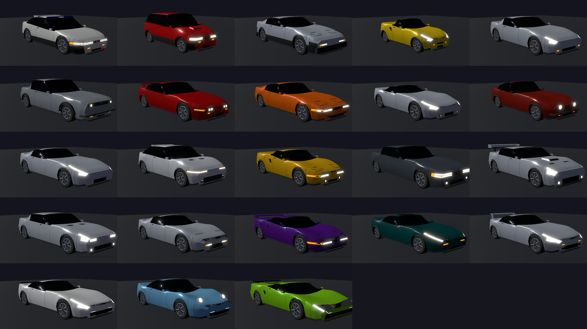
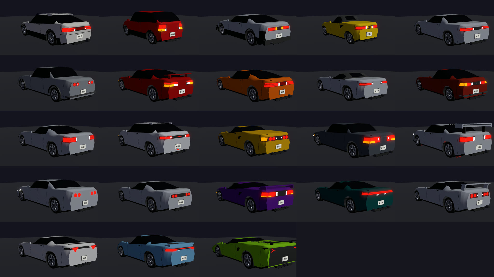

Alle 23 Autos ab Werk, in der Reihenfolge des Freischaltens (je Zeile fünf): Kaizen Rally S, Chibi K-Turbo, Hachi
Touge, Hotaru MR-K, Sakura D2 · Kaido 2000GT, Hayate R8, Kitsune 18S, Tsubame Spyder, Hakone 240 · Mirai 240R,
Tanuki R4, Tenshi MR-T, Kumo JX6, Raijin RS-4 · Vortex GT-R, Ronin DR, Shiden NX-1, Ryujin 30Z, Kaze TT · Kagura V10,
Falke 9 RS, Furia V12 (Exoten).

| Neu in 2.17 | Art | Antrieb | Klasse | frei ab |
|---|---|---|---|---|
| Chibi K-Turbo | Kei-Wagen mit Turbo-Dreizylinder und Hutze | Front | D | Start |
| Hotaru MR-K | Kei-Roadster mit Mittelmotor und Stoffverdeck | Mittelmotor | D | 2 Rennsiege oder 1 Driftsieg |
| Kaido 2000GT | 70er-Hardtop mit Reihensechser, Chrom, Verbreiterungen | Heck | C | 3 Rennsiege oder 1 Driftsieg |
| Hakone 240 | 70er-Fließheck mit langer Haube, Scheinwerfer in Mulden | Heck | B | 5 Rennsiege oder 2 Driftsiege |
| Tanuki R4 | Allrad-Kleinwagen mit Turbo-Dreizylinder | Allrad | B | 7 Rennsiege |
| Kagura V10 | Supersportwagen mit V10 vorn, drei Endrohre | Heck | S | 15 Rennsiege |
| Falke 9 RS | Heckmotor-Boxer, runde Scheinwerfer auf den Kotflügeln | Heckmotor | S | 16 Rennsiege |
| Furia V12 | flacher V12-Keil, 2,03 m breit | Allrad | S | 17 Rennsiege |

## Städte (echte Orte)
Die Strecken folgen echten Straßen, die Wahrzeichen stehen an ihrem Platz, die Häuser hinter der Straßenfront
haben die echten Grundrisse. Kartendaten © OpenStreetMap-Mitwirkende (ODbL, openstreetmap.org/copyright).

<table>
<tr>
<td width="50%">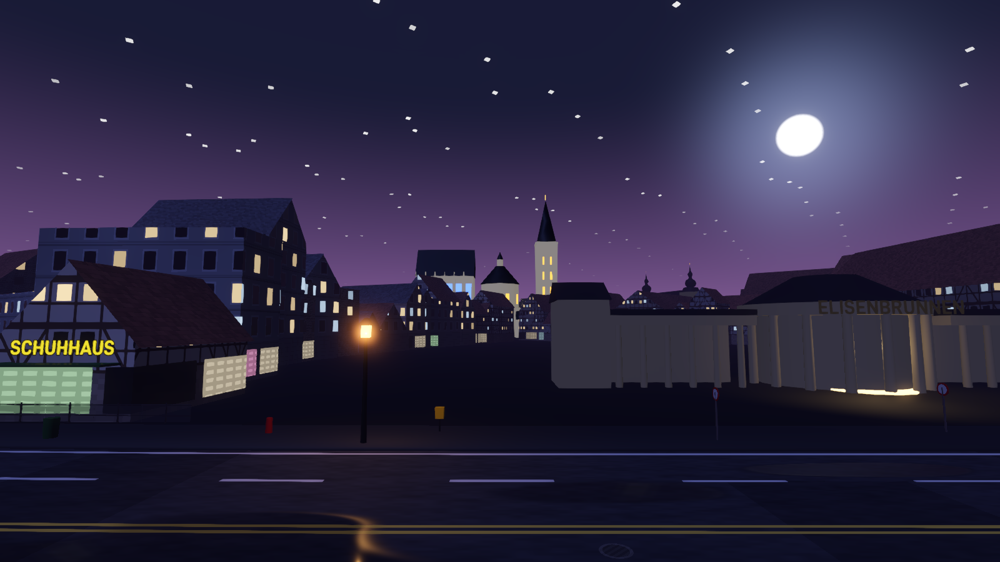 Aachen: Dom und Rathaus in der Mitte des Grabenrings</td>
<td width="50%">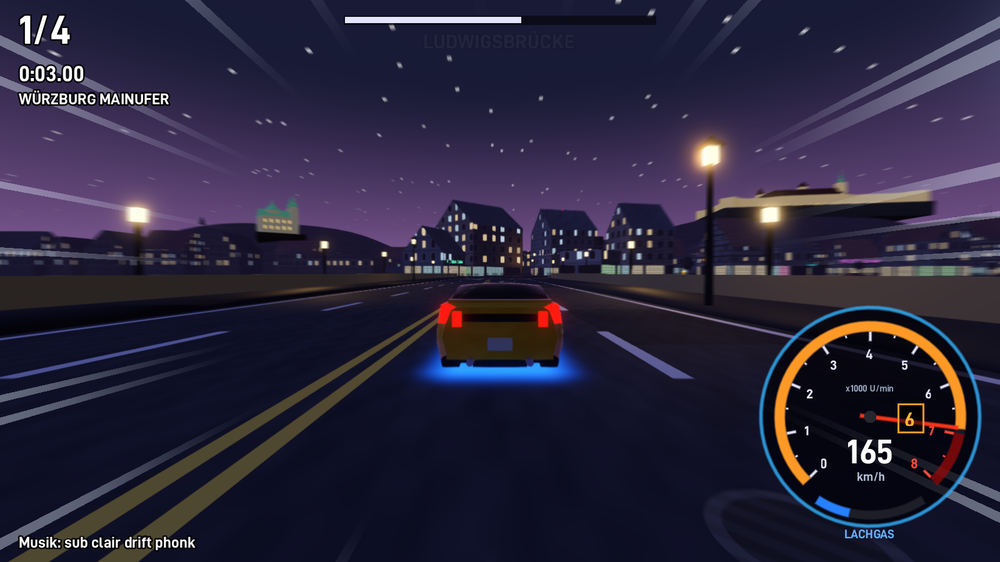 Würzburg: Alte Mainbrücke und Festung Marienberg</td>
</tr>
</table>
- **Aachen Grabenring** (Rundkurs, 2 Runden, 2,8 km): Templergraben am SuperC der RWTH vorbei, Seilgraben,
  Friedrich-Wilhelm-Platz am Elisenbrunnen, Theater, Kapuzinergraben, Löhergraben, Karlsgraben. In der Mitte Dom
  (Oktogon mit Faltkuppel, gläserne Chorhalle, Westturm) und Rathaus mit Granusturm, Marktturm und Karlsbrunnen.
- **Würzburg Mainufer** (Sprint, 5,4 km): Röntgenring, Rennweg an der Residenz (Ehrenhof, Frankoniabrunnen) vorbei,
  Friedrich-Ebert-Ring, Sanderring, über die Ludwigsbrücke, unter der Festung Marienberg (angestrahlt, auf dem
  Weinberg) entlang, über die Friedensbrücke zurück und den Main entlang zum Alten Kranen. Dazwischen Dom St. Kilian,
  Marienkapelle, Käppele und die Alte Mainbrücke mit zwölf Heiligenfiguren und Leuten beim Brückenschoppen.
- **Bad Kissingen Kurmeile** (Sprint, 2,9 km): am Regentenbau und Arkadenbau vorbei, Spielbank im Luitpoldpark,
  über die Fränkische Saale durch die Stadt und am Fluss entlang zum Gradierbau der Oberen Saline.
- **Tauberbischofsheim Altstadt** (Rundkurs, 3 Runden, 1,8 km): Schmiederstraße, Vitryallee, Hauptstraße rund um die
  Altstadt mit Türmersturm und Kurmainzischem Schloss, neugotischem Rathaus und St. Martin.
- **Hammelburg Saaleck** (Sprint, 2,5 km): Berliner Straße mit Bahnübergang dort, wo die Strecke Gemünden–Bad Kissingen
  kreuzt (in echt führt die Straße auf einer Brücke darüber, im Spiel kommt der Zug ebenerdig), am
  Renaissance-Rathaus mit Treppenturm und Marktbrunnen vorbei, über die Saale und den Schlossberg hinauf, oben auf dem
  Weinberg Schloss Saaleck.
- **Berlin Kreuzberg** (Rundkurs, 2 Runden, 5,2 km): Skalitzer Straße unter der Hochbahn der U1 (Kottbusser Tor,
  Schlesisches Tor), über die Oberbaumbrücke mit ihren Backsteintürmen, die Mühlenstraße an der East Side Gallery
  entlang, über die Schillingbrücke, Köpenicker und Adalbertstraße zurück zum Kotti mit dem Neuen Kreuzberger Zentrum.
  Altbauten mit Graffiti im Erdgeschoss, Spätis, Döner, Kiezkneipen, der Fernsehturm über den Dächern (näher gerückt
  und kleiner, damit er in Sichtweite steht).

Dazu: gelbes Ortsschild am Start, Straßenschilder, der echte Straßenname wird beim Abbiegen eingeblendet, Flüsse mit
Ufermauern und Steinbrücken, Hügel mit Weinbergen, Fachwerk, Putzfassaden, Ziegel- und Schieferdächer, Läden der
Stadt (Printen, Bocksbeutel, Kurcafé, Fechtclub, Häckerwirtschaft …). Die Straßen sind breiter als in echt
(vier Spuren), enge Ecken sind auf mindestens 38 m Radius abgerundet, die Wahrzeichen rücken bei Bedarf ein Stück
von der Straße weg. Neu erzeugen: `python3 tools/osm_city.py <ordner-mit-overpass-json>` (Abfragen und Wegpunkte im
Skript), schreibt `scripts/city_data.gd`.

## Strecken
- Jede Strecke führt durch mehrere Stadtviertel mit eigenem Stil (Name wird beim Reinfahren eingeblendet):
  - **Bankenviertel:** Glastürme, LED-Videowände, Schilderbrücken
  - **Marktviertel:** Wohn- und Geschäftshäuser (Altbau-Putz, Klinker) mit Läden unten, Ziegel- und Schieferdächer,
    Markisen, Lichterketten über der Straße, Hochbahn
  - **Prachtallee:** Gründerzeit-Altbauten mit Schieferdächern, dazwischen Bürohäuser, Mittelstreifen mit Bäumen
  - **Altstadt:** Putz, Fachwerk, Klinker, rote Ziegeldächer (teils mit Giebel zur Straße), Bäume, alte Laternen
  - **Hafen:** Hallen und Klinkerspeicher, Containerkräne über der Straße, Schornsteine, Natriumdampf-Licht
  - **Schnellstraße:** Lärmschutzwände mit Graffiti, Wegweiser-Brücken, Straßenbrücken
- **Häuserschlucht:** Hinter der Straßenfront stehen zwei weitere Häuserreihen (nur Baukörper und Dächer im
  gemeinsamen Häuser-Mesh, ohne Schilder), in den Städten die echten Gebäude. Jeder Bauplatz wird am ganzen Rand
  geprüft (Ecken und Kantenpunkte): hinter dem Gehweg, neben Gassen und Gabelungen, nicht im Fluss, See, Park oder
  Bahngelände, nicht in anderen Häusern, Wahrzeichen oder Hochbahn-Endblöcken. Passt ein Haus nicht (Kurveninnenseite,
  Einmündung), wird ein schmaleres versucht, sonst 4 m weiter. Echte Grundrisse (als umschließende Rechtecke) dürfen
  sich bis 2,5 m überlappen (Winkelbauten im Block).
- **Tunnel** unter Häuserblocks (Kacheln, Lichtbänder, Hall im Sound): Die Fahrbahn taucht vorher in einem offenen
  Betontrog gut 6 m ab (Leitlichter in der Mauer, oben läuft der Gehweg der Stadt weiter) und kommt dahinter wieder hoch.
  Am Anfang der Trogmauer führt ein schräger Anpralldämpfer vom Gehweg zur Mauer, damit man dort nicht hängen bleibt.
  **Hochbahn** mit Zug über der Außenspur, **Stadion** mit Flutlicht.
- **Höhen:** Die Altstadt-Route der Gabelungen zweigt nach oben ab und führt als Bergstraße über eine Kuppe (gut 5 m,
  Häuser stehen am Hang, Stützmauern). Mit viel Tempo hebt man an der Kuppe kurz ab. Bergauf zieht es etwas, bergab
  schiebt es. Viele Seitenstraßen steigen hinter ihrer Absperrung sichtbar den Hang hinauf.
- **Abkürzungen:** kurvige Gassen (Kopfsteinpflaster, Lichterketten) und ein Damm durch einen See (bis 2.23 eine
  Sprungschanze über eine Lücke im Damm; wirkte wie eine Schanze im Nirgendwo). Sie sparen 100–150 m, sind aber enger.
  Seit 2.27 muss man sie entdecken: keine Lichttunnel aus leuchtenden Bögen und kein „ABKÜRZUNG“-Schild mehr, und sie
  zweigen wie eine Seitenstraße zur Innenseite der Kurve ab (vorher liefen sie geradeaus weiter, während die
  Hauptstraße abbog, man fuhr fast von selbst hinein). Nur die Gabelung zur Altstadt (zwei gleichwertige Wege) behält
  ihre Lichter (`Track._shortcut_lights`).
- **Mehr Kurven (seit 2.27):** Sprints aus kürzeren Abschnitten (55–115 statt 70–150 m) mit stärkeren Knicken (x1,35),
  dafür gut ein Drittel mehr davon; Rundkurse bekommen auf langen Geraden einen seitlichen Versatz (S-Kurve).
- **Bahnübergang mit Bahnhof:** zweigleisig mit Oberleitung, daneben ein kleiner Bahnhof (Bahnsteige mit Dach und
  Stationsschildern, Wartende, Fußgängerbrücke, Empfangsgebäude mit Uhr, S-Bahn-Säule an der Straße, Signale).
  Seit 2.24 liegt alles auf einem flachen Bahndamm: die Straße steigt über gut 25 m sanft um 0,85 m an, liegt über
  den Gleisen flach und fällt wieder ab (mit Tempo hebt man kurz ab), Gleise und Bahnhof stehen auf Schotterdamm bzw.
  einer Fläche in Dammhöhe. Bis 2.23 stand auf der rechten Spur eine 3,7 m hohe Rampe, mit der man über den Zug
  sprang. Jetzt kommt der Zug so, dass man bei gleichem Tempo gut eine Sekunde vor ihm drüber ist: erst blinkt und
  läutet es (4 s vorher, Gegner halten an), 2,4 s vorher senken sich die Schranken, man huscht durch, und hinter einem
  rauscht der Zug vorbei. Wer langsamer wird, muss warten. Warnton, Signalhorn und Rollen des Zugs sind seit 2.24
  echte Aufnahmen (`CREDITS.md`).
- **Sprünge und Fallen:** Schwerkraft knapp 2 g. Seit 2.24 gibt es keine Rampen mehr, abgehoben wird nur noch an
  Kuppen (Bergstraße, Bahndamm). In der Luft hebt sich erst die Nase und kippt dann mit der Flugbahn ab; wer seitlich über eine
  Kante fährt, kippt zur freien Seite. Harte Landungen federn kurz nach, schiefe kosten Tempo. In der Luft kann man
  nicht lenken, Nitro schiebt aber weiter. Wer am See zu kurz springt, fällt ins Wasser.
- **Sprungkamera** wie in NFSU: Beim Absprung rechnet das Spiel die Flugbahn voraus. Wird der Sprung mindestens 1,6 m
  hoch und 0,6 s lang (Seesprung, Bahnrampe; Kuppen nicht), schneidet das Bild auf eine feste Kamera knapp über dem
  Boden schräg vor der Landestelle, nur wenn sie von dort Absprung, Scheitel und Landung frei sieht. Sie schaut dem
  Auto nach und zoomt mit, sodass es etwa gleich groß bleibt. Ein Aufhelllicht auf der Kameraseite sorgt dafür, dass
  das Auto nachts von vorn nicht schwarz bleibt, und oben und unten fahren schwarze Kino-Balken ein. Dazu leichte Zeitlupe (Faktor
  0,45–0,7, je länger der Flug, desto weniger), in der Motor und Effekte dumpf klingen. Kurz nach dem Aufsetzen geht es
  zurück zur Fahrerkamera, bei Überschlag oder Platsch erst etwas später. Einstellungen → Kamera & Tempo → Sprungkamera: An / Ohne
  Zeitlupe / Aus.
- **Überschlag** wie in echt: nur wer quer rutschend (ab 36 km/h Querfahrt, Schräglage über gut 30°, mindestens
  50 km/h) mit der Flanke gegen Wand oder Auto kracht, kippt darüber, oder wer schief landet. Beurteilt wird die Lage
  im Moment des Aufpralls (nicht erst nach dem Ausrichten an der Wand, sonst sähe jeder schräge Treffer wie Querrutschen aus). Frontal oder streifend
  gibt es Crash und Dreher, keinen Überschlag. Das Auto hebt ab, rollt um die Längsachse und federt bei jedem Aufschlag. Landet es auf den Rädern, geht es weiter; auf Dach oder
  Seite wird es nach gut einer Sekunde auf die Straße zurückgesetzt. Hart getroffene Verkehrsautos überschlagen sich
  ebenfalls und bleiben liegen. Laternen, Schilder und Poller werden am Treffpunkt angestoßen und kippen um.
- **Kollision:** Alles Feste und Schmale auf Fahrbahn und Gehweg (Masten, Pfosten, Stämme, Schaltkästen, Schilder,
  Bänke) bekommt beim Streckenbau automatisch eine Kollisionsbox (`Track._auto_collide`), am Bahnübergang Schranken-
  antrieb und Andreaskreuz. Durchlässig bleiben nur Schilf, Kabel und Passanten. Prüfen: `tools/track_check.tscn --
  --ghosts --nobatch`.
- **Gegner schieben:** Gegner fahren nicht durch dich oder einander hindurch. Von hinten bleiben sie an der
  Stoßstange und schieben mit (gleich schwere Autos teilen sich das Tempo, Gas geben schiebt den Vorderen weiter),
  nebeneinander drücken sich beide auseinander, wer blockiert wird, weicht auf die Spur mit dem meisten Platz aus.
- **Gabelungen:** Vor der Teilung zeigt ein Wegweiser beide Wege. Die Altstadt-Route ist kürzer, aber zweispurig
  mit Gegenverkehr; außen herum geht ein breiter Boulevard. Wer sich nicht entscheidet, landet auf der Verkehrsinsel.
- **Boulevards:** breite Straßen mit bepflanztem Mittelstreifen (auf der Schnellstraße mit Betonleitwand).
- Kreuzungen mit Ampeln, Verkehr in beide Richtungen. Laternen, Mülltonnen, Zeitungsboxen, Parkuhren,
  Schilder, Büsche und Container fliegen weg und kosten etwas Tempo. Sackgassen sind an der Einmündung abgesperrt,
  vor den Trögen lenkt eine schräge Leitwand hinein.
- **Anecken wie in NFSU:** An Wänden und Banden schrammt man entlang und dreht dabei weich parallel zur Wand
  (höchstens 230° pro Sekunde, ein schräger Treffer braucht etwa 0,2–0,4 s, nie ein Sprung im Bild); die Reifen
  halten dabei weniger, damit sie das Auto nicht wieder in die Wand ziehen, und das Schrammen zählt nicht als Drift. Je flacher der Winkel, desto weniger Tempo
  kostet es (15° ≈ 5 %, 30° ≈ 20 %, 45° ≈ 45 %). Feste Hindernisse federn seit 2.15 nicht mehr zurück: frontal
  (Wand, Hausecke, Baum, Mast) steht das Auto mit einem Schlag, man muss zurücksetzen; wer dagegen Gas gibt, wird
  nicht weggeschoben. Baumstämme und Pfosten halten das Auto auf, sobald es sie mit der Front trifft (die runde Form
  lenkt es nicht mehr um sich herum), nur seitliches Streifen rutscht vorbei. Kleine Hindernisse wie Poller und Bänke
  drehen das Auto kaum (ihre Ecken hätten sonst schräge Richtungen vorgegeben). Verkehr bestraft härter:
  seitlich abprallen, frontal oder beim Auffahren Dreher und kurz keine Kontrolle. Mittelstreifen laufen spitz aus.

## Fortschritt
Kein Geld: Seit 2.33 schaltet das Fahrer-Level alles frei (Karriere-Stufen, Autos, Teile, Vinyls, Titel; siehe oben,
Werte in `scripts/catalog.gd`). Erfahrung gibt es für jedes Rennen und für Stilpunkte in der Welt. Die Grundteile der
Optik sind von Anfang an frei. Gesperrte Teile kann man in der Garage als Vorschau ansehen. Alte Spielstände behalten,
was sie mit Siegen schon hatten.

**Spielstand** (`user://save.json`): wird nach jedem Sieg, jedem Einbau und jeder Einstellung geschrieben. Seit 2.23
schreiben Testläufe (Start mit Argumenten nach `--`) in `user://save_test.json`; bis 2.22 landeten sie im echten
Spielstand und die Testskripte kopierten danach eine alte Sicherung zurück, dabei ging Fortschritt verloren und ein
neuer Spielstand hatte Tuning aus den Tests (z. B. eine Folierung). Im Browser liegt zusätzlich eine Kopie im
localStorage. Blockiert der Browser das Speichern im eingebetteten Spiel (Drittanbieter-Daten im Rahmen von itch.io),
zeigt die Garage einen Hinweis, und oben rechts öffnet ein Knopf das Spiel in einem eigenen Tab, wo der Spielstand
bleibt.

## Stimmungen
Jedes Event hat sein eigenes Licht (`scripts/moods.gd`), damit sich die Städte unterscheiden: **Neon** (lila Himmel,
satte Farben), **Mitternacht** (tiefblau, Sterne, Mond), **Natrium** (orange Straßenlampen, dunstig), **Regen**
(Tropfen vor der Kamera, nasse Fahrbahn mit Spiegelungen und Pfützen, im Tunnel trocken), **Nebel** (dichter, kühler
Dunst), **Dämmerung** (oranger Horizont, letzte Helligkeit), **Kiez** (Magenta und Violett). Dazu Kopfsteinpflaster
in den Altstädten und Graffiti an den Altbauten im Kiez.

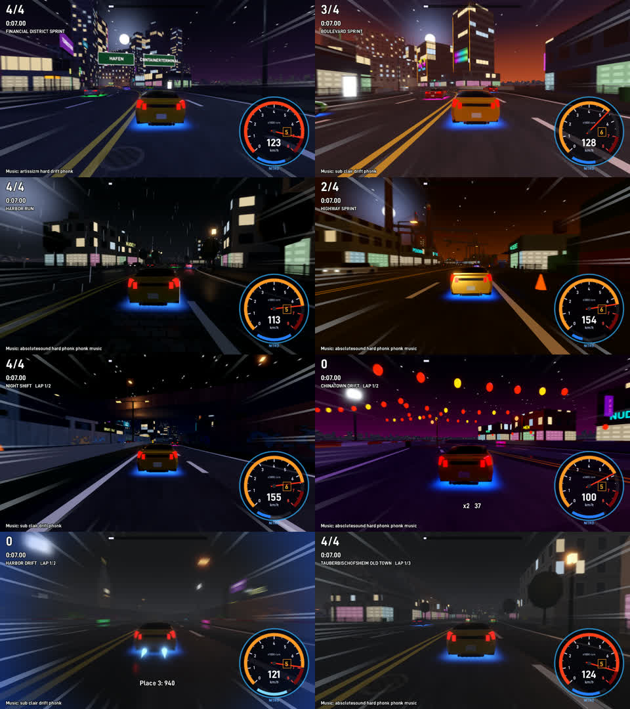

## Musik und Sounds
**Soundtrack seit 2.30** (`music/`, 18 Tracks von Pixabay, Quellen in `CREDITS.md`): Phonk, Drift-Phonk und Metal in
einer gemeinsamen Liste. Beim Spielstart läuft zuerst ein 30-Sekunden-Metal-Intro, danach die gemischte Liste.
Neue Tracks gibt es nur beim Spielstart und beim Start eines Rennens; Menü, Garage, Tuning und der Weg in die Welt
lassen den laufenden Track weiterlaufen. Bei jedem Trackwechsel blendet unten eine Blase Titel und Künstler ein.
**Stadt-Tracks:** fährt man in eine Stadt mit eigenem Track (Open World) oder startet dort ein Rennen, läuft er
einmal, danach geht es mit der Liste weiter (bis 2.29 lief er in Schleife). Aachen: Bruder Jakob x Jonas Platin „AC“
(mit Freigabe der Künstler, `music/staedte/`, nicht im öffentlichen Repo).
**Radio:** wie in NFS mehrere Sender, Taste **,** schaltet weiter: MIX (alles), NACHTDRIFT (Phonk), METALWERK (Metal). Taste **.**
springt zum nächsten Track, **-** sortiert den laufenden Track für immer aus. Sender und aussortierte Tracks stehen in
`user://music.json` (`Music.STATIONS`, `Music.GENRE`).
Datei der Stadt-Tracks: `music/staedte/<stadt>-<Künstler>-<Titel>.mp3` (Stadt klein, Umlaute ausgeschrieben),
Angleich in `Music.CITY_TRACKS`. Test: `world.tscn -- --wstart=15 --musiclog` („MUSIK …“). Die letzten 6 s eines
Tracks blendet der nächste über. Beim Laden eines Rennens wird die Musik um 13 dB leiser und bleibt das über Kameraflug und Countdown (Motoren
und Starttöne sind gut zu hören), bei LOS setzt ein neuer Track voll ein. Während des Ladens wartet die Titel-Blase. Die Tracks sind gleich laut gemacht (mit `ffmpeg -af ebur128` gemessen, Ziel -11 LUFS,
Tabelle `TRACKS`), Stille am Anfang und Ende wird übersprungen. M springt mit kurzer Überblendung weiter. Weitere
mp3/ogg-Dateien in `music/` laufen automatisch mit (ohne Eintrag in der Tabelle ohne Angleich).

**Motorklang seit 2.23 aus echten Aufnahmen** (`scripts/engine_audio.gd`): nahtlose Schleifen bei neun Drehzahlen
(900 bis 7400 U/min), einmal unter Last und einmal im Schiebebetrieb (`assets/engine/<aufnahme>/on_<U/min>.wav`,
`off_…`), geschnitten aus Aufnahmen echter Motoren von Wikimedia Commons (Urheber und Lizenzen in `CREDITS.md` und im
Spiel unter Einstellungen > Quellen & Lizenzen). Im Spiel laufen immer die beiden Drehzahlen um die echte herum, gleich
laut überblendet und in der Tonhöhe auf die echte Drehzahl gezogen; Gas und Schub werden genauso überblendet, beim
Hochschalten klingt er kurz nach Schub (Zündung weg). Bis 2.21 rechnete das Skript den Klang aus Sinustönen (klang
nach Orgel), 2.22 aus einem Rohr-Modell (klang blechern, heulend und kratzig).
- **Neun Aufnahmen für 23 Autos** (`CAR_BANK`): Turbo-Vierzylinder (Kaizen, Hayate, Kitsune und tiefer gestimmt die
  kleinen Dreizylinder Chibi und Tanuki), hochdrehender Sauger-Vierzylinder (Hachi, Tsubame, Tenshi), Sauger aus dem
  Motorraum aufgenommen (Sakura, Mirai, Hotaru), Boxer (Raijin), Sechszylinder in Reihe (Kumo, Kaido, Hakone),
  Sechszylinder-Boxer (Falke, Vortex, Kaze und tiefer die V6 Ryujin und Shiden), Wankel (Ronin), V10 (Kagura), V12
  (Furia). Autos mit derselben Aufnahme klingen durch einen eigenen Drehzahl-Faktor verschieden hoch.
- **Wie die Schleifen entstehen** (`tools/engine_rec/build_banks.sh <arbeitsordner>`, Werkzeug `tools/engine_rec/eng.c`):
  die Zündfrequenz wird über eine harmonische Summe im Spektrum und einen Viterbi-Pfad verfolgt (Oktavfehler werden
  über die Stärke der ungeraden Obertöne erkannt), daraus die Drehzahl. Je Zieldrehzahl werden passende Abschnitte
  gesucht (±12 %, Drehzahl steigt oder hält: Gas, fällt: Schub), ihre Tonhöhe auf genau diese Drehzahl geglättet (die
  Zeitachse folgt der gemessenen Phase, die Wellenform bleibt echt), ausgerichtet aneinandergehängt und nach einer
  ganzen Zahl von Arbeitsspielen geschlossen. Schleifen mit falsch erkannter Oktave werden verworfen, Lücken aus der
  nächsten Schleife umgetastet. Zum Schluss Pegelglättung (kein Pumpen bei jedem Durchlauf), Hochpass 30 Hz,
  Tiefpass 8 kHz (Wind und Kratzen der Aufnahme) und ein Pegel nach Drehzahl. `eng sweep` macht eine Probefahrt
  zum Anhören. Gut 4 MB im Export (QOA-komprimiert).
- **Kostet kaum Rechenzeit:** nur vier abgespielte Schleifen.
- **Seit 2.20 hört man die anderen:** Jeder Gegner hat seinen eigenen Motorklang (seit 2.22 zwei Schleifen seines
  Autos: Schub unten, Volllast oben), mit Gängen, Gas und Bremse, nach der Drehzahl überblendet. An der Startlinie lassen die Gegner den Motor
  aufheulen, beim Überholen zieht der Klang mit Dopplereffekt vorbei. Vom Verkehr sind die vier nächsten Autos im
  Umkreis von 80 m zu hören (Motor und Abrollen, der Bus als rauer Diesel), ebenfalls mit Doppler. Der Turbo pfeift
  seit 2.22 aus einer Schleife (`turbo.wav`), Aufpralle kommen aus `thud.wav`.
- **Schalten (seit 2.20):** beim Hochschalten unter Last ist die Zündung kurz weg (der Motor setzt hörbar aus und
  wieder ein), bei hoher Drehzahl knallt es manchmal im Auspuff, mit Flamme (`backfire.wav`). Gas weg bei hoher
  Drehzahl nach mindestens einer halben Sekunde Vollgas: ein bis vier Fehlzündungen nacheinander, jede mit kleiner
  orangefarbener Flamme, danach 1,5 s Ruhe (sonst knattert es beim Gas-Antippen wie ein Maschinengewehr). Sportauspuff
  und Turbo knallen öfter. Turbo und Gas weg: nachgerüsteter Lader mit Blow-off-Ventil (`bov.wav`, „Pschhh“), Serienlader
  flattert (`flutter.wav`); beim Hochschalten bläst das Ventil kurz ab.
- **Außerdem seit 2.20:** Abrollen der Reifen (`road.wav`, schon bei Stadttempo, mit dem Tempo höher) und Fahrtwind
  (`wind.wav`, mit Böen, wächst mit dem Quadrat des Tempos) als Schleifen statt im Skript gerechnet; Blech, das an der
  Wand entlangschrammt (`scrape.wav`); Countdown-Töne 3, 2, 1 und ein höherer, längerer bei LOS (`beep.wav`,
  `beep_go.wav`). Seit 2.22 runde Töne wie an einer Startampel (Sinus mit leisen Obertönen, abklingend; bis 2.21
  ein schnarrender Rechteckton), LOS eine Oktave höher mit einem tiefen, weichen Schlag darunter.
- **Menü-Töne (seit 2.22, `Sfx.ui`):** eigene kurze, leise Töne statt der Sprung-, Lande- und Laternen-Geräusche,
  die bis 2.21 im Menü liefen: Ticken beim Wandern (`ui_move`), Umschalten (`ui_change`), zwei aufsteigende Töne
  beim Bestätigen (`ui_select`), zwei absteigende beim Zurückgehen (`ui_back`), ein satter Schlag mit hellem
  Nachklang beim Einbauen (`ui_install`), zwei gedämpfte tiefe Töne bei Gesperrtem (`ui_locked`) und ein Luftzug mit
  Schlag beim Rennstart (`ui_go`). Ohne Hall, auch im Pausemenü. Zug, Glocke, Landung, Platschen, Tunnel, Stadion
usw. sind synthetisch erzeugte WAVs in `assets/sfx/` (`python3 tools/make_sfx.py`, einzelne mit
`python3 tools/make_sfx.py bell`).
- **Reifen (seit 2.14):** zwei Schleifen. `scrub.wav` ist das Schrubben schon bei leichtem Rutschen (raues, eher tiefes
  Rauschen mit Körnung vom Asphalt). `skid.wav` ist das Quietschen im echten Drift und bei durchdrehenden Rädern,
  seit 2.23 eine echte Aufnahme (BigSoundBank, CC0, als nahtlose 1,6-s-Schleife geschnitten mit
  `eng xloop`); bis 2.22 synthetisch (Haft-Gleit-Schwingung durch Reifenresonanzen), das klang unnatürlich. Beides setzt weich ein, wird mit dem Driftwinkel
  lauter und mit Tempo etwas höher. Seit 2.16 hängt es nicht mehr am Querrutschen in m/s (das reichte im normalen
  Rennen nie: selbst mit Handbremse rutscht ein Auto bei Tempo nur 2–3 m/s quer, das Quietschen begann erst bei 6),
  sondern am Rutschwinkel, an der Kurvenfahrt am Grip-Limit (Schrubben, leises Quietschen), an Handbremse,
  Vollbremsung, Drift und durchdrehenden Rädern. Gut 3 dB lauter als vorher.
- **Nitro (seit 2.14):** beim Zünden `nitro_on.wav` (Ventil-Klacken, dumpfer Stoß, aufschießendes Zischen und ein
  Wusch), solange es läuft `nitro.wav` (Fauchen der Düsen, Brausen der Flamme, leiser Pfeifton), beim Loslassen
  `nitro_off.wav` (Abblasen, seit 2.16). Seit 2.16 4 dB lauter: vorher lag das
  Fauchen etwa so laut wie der Motor und ging unter der Musik unter, jetzt steht es im Hochton rund 10 dB über der
  Musik. Reifen- und Nitro-Schleifen laufen im Stream-Modus wie der Motor (im Browser lassen sich fertige Samples nicht
  zuverlässig in jedem Bild in Lautstärke und Tonhöhe nachführen). Der Motor schaltet im Drift nicht mehr herunter: Gang und
  Drehzahl, die man hört und sieht, richten sich nach dem Tempo über Grund, mit Gas dreht er durch die
  durchdrehenden Hinterräder hoch (bis knapp unter den Begrenzer). Der Vortrieb rechnet weiter mit dem Gang nach
  dem Tempo nach vorn, das Fahrverhalten bleibt also gleich.

## Menüs
Im Stil von NFS Underground (`scripts/ui_style.gd`): schräge Leisten, Neongrün für die Auswahl, kursive
DIN-Schmalschrift, große Abschnittstitel (GARAGE, RENNEN, TUNING, AUTOHAUS), Leistungsbalken des Autos (mit
Motor-Tuning), Tastenleiste unten, wechselnde Tipps oben rechts. Pause und Ergebnis im gleichen Look.

**Ladebildschirm (seit 2.22, `scripts/loading_screen.gd`):** Vorher stand das Menü nach dem Klick auf ein Event
mehrere Sekunden still, während die Strecke gebaut wurde. Jetzt kommt sofort ein Ladebildschirm wie in NFS
Underground: Art des Events als Abzeichen, Name groß, Ort, Ziel, dein Auto mit Klasse, ein Tipp und ein
Fortschrittsbalken. Das Rennen baut die Strecke in Schritten (`Track.begin`/`Track.step`, dieselbe Reihenfolge und
dieselben Zufallszahlen wie vorher), das Verschmelzen der Häuser (der größte Brocken) in Stücken von gut 0,1 s,
dazwischen kommt jeweils ein Bild. Am Rechner hängt kein Schritt länger als gut eine halbe Sekunde. Messen:
`-- --race=N --loadlog`.

**Anzeigen im Rennen** im selben Stil:
- **Oben links (`scripts/hud_info.gd`):** Platz groß und kursiv mit „/4“ (leuchtet bei Platzgewinn grün, bei
  Verlust rot), darunter Zeit, Runde und Rennname auf schrägen Glasleisten; im Drift die Punkte.
- **Oben mittig:** ein Fortschrittsbalken mit allen Fahrern: du als gelbes Dreieck, die Gegner als Punkte in ihrer
  Lackfarbe, Rundenstriche und eine Zielflagge.
- **Unten links (`scripts/minimap.gd`):** Radar-Minimap, die sich mit der Kamera dreht. Du bist der gelbe Pfeil, die
  Gegner sind Punkte in Lackfarbe (außer Sicht kleiner am Rand). Abkürzungen sind orange, gesperrte Seitenstraßen
  grau, Flüsse und Seen blau, das Ziel eine Schachbrettflagge (außer Sicht am Rand, zeigt so die Richtung), dazu
  ein Nordzeiger. Je schneller du fährst, desto weiter zoomt sie heraus. Im Drag gibt es keine Minimap.
- **Unten rechts (`scripts/tacho.gd`):** Drehzahlmesser mit LED-Bogen aus 40 Segmenten (Cyan, Weiß, Orange, roter
  Bereich) mit Leuchtschein und spitzer Nadel. Der Gang steht neongrün in der Nabe, das Tempo groß in einem
  schrägen Feld mit blassen führenden Nullen, Nitro als Segmentbogen. Am Begrenzer blinkt der Rand rot, mit
  Nitro leuchtet er blau und das Instrument zittert. Im Drag kommen der grüne Schaltbereich, ein Schaltlicht und
  eine Temperaturleiste dazu.
- **Unten links über dem Radar:** Punkte-Zeilen (DRIFT +240, KNAPP VORBEI +300, SPRUNG 1,2 s +240, Abkürzung,
  Runde), darunter der Name des Viertels oder der Straße. Im Drift-Event steht dort die laufende Kette.
- **Drag:** neben dem Drehzahlmesser die Schalttasten und kurz das Ergebnis des letzten Schaltvorgangs.
- **Sonstiges:** Die Tastenhilfe blendet nach 12 s aus. Den Musiktitel zeigt seit 2.15 eine kleine Blase unten in der
  Mitte: beim Trackwechsel ploppt sie mit einem Equalizer auf, klappt auf (Titel, darunter klein der Künstler) und
  nach gut drei Sekunden wieder zu. Auf Handy und Tablet bleibt sie weg. Während der Startkarte wartet sie, bis die
  Karte weg ist; in der Garage sitzt sie rechts unten in der Tastenleiste (links liegt die lange Karriere-Liste).

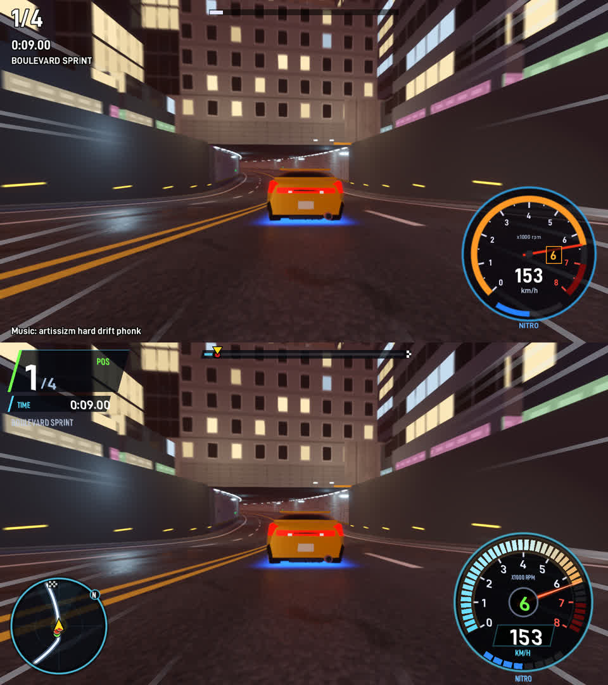

Oben die alten Anzeigen, unten die neuen seit 2.10 (Minimap, Drehzahlmesser, Platz, Fortschrittsbalken).
- **Leistung im Browser:** Alles Feste wird nur einmal gezeichnet; Nadel, Karte und Marken werden pro Bild nur
  gedreht oder verschoben. Die Karte liegt in Weltkoordinaten, `shaders/minimap_clip.gdshader` schneidet sie am
  Kreis ab. Zeit und Tempo werden Zeichen für Zeichen ohne Textformung gezeichnet.

## Tuning wie in NFS
**Leistung für die ganze Garage, Optik kommt beim Autowechsel mit (seit 2.38, wie in NFS Underground):** Motor, Turbo,
Nitro, Fahrwerk und Reifen passen auf alle eigenen Autos. Lack, Lackart, Felgen, Zoll, Spur, Spoiler, Bodykit, Haube,
Auspuff, Folie, Neon, Scheiben und Licht nimmt man zum nächsten Auto mit: das neue Auto übernimmt die Optik des bisherigen
(„Serie“ bleibt das Werksteil des neuen Autos, feste Zoll-Größen rücken um den Unterschied der Werksfelgen, Grenzen 13"
bis 24" und was über die Bremse passt). Das Autohaus zeigt jedes Auto schon mit der Optik, die es bekäme. Gespeichert wird
weiter je Auto (`GameState.looks`), beim Wechsel wird kopiert (`GameState.switch_car`); ist am bisherigen Auto nichts
angebaut, behält das neue seine eigene. 2.25 bis 2.37 gestaltete man die Optik je Auto und ein neu gewähltes Auto war
blank, bis 2.24 galt sie für alle Autos zugleich. Rücktaste und Esc gehen eine Ebene zurück (Teileliste → Kategorie →
Optik/Leistung → Garage), der Fokus steht wieder auf dem Eintrag, aus dem man kam.

**Alles frei bis auf edle Lacke (seit 2.27):** alle Teile sind von Anfang an eingebaut-bereit, Leistung wie Optik;
nur Metallic, Matt und Perlmutt (Lackart) und die Farben Mattschwarz, Mattgrau, Perlweiß, Gold und Chrom kommen mit
Siegen. **Farben im Raster:** Lack, Felgenfarbe, Folienfarbe, Neon und Licht wählt man in einem Farbraster (acht
Spalten, Pfeiltasten in alle Richtungen, Name und Zustand darüber) statt in der Leiste. **Flüssiges Blättern:** die
Garage baut das Vorschau-Auto ohne das Verschmelzen der Teile (das kostete je Teil gut 0,4 s, jetzt rund 50 ms) und
erst, wenn man kurz auf einer Kachel stehen bleibt.

**Seit 2.22 waagerecht wie in NFS Underground:** Tuning läuft in einer Leiste aus Kacheln unten im Bild statt in
der Liste links. Links/Rechts blättert (vom letzten geht es zum ersten), die gewählte Kachel rutscht in die Mitte,
Pfeile zeigen, wo es weitergeht. Jede Kachel zeigt den Namen und darunter klein das eingebaute Teil, „Eingebaut“
(grün) oder die nötigen Siege (rot, gesperrte Kacheln blasser); Lack, Felgenfarbe, Folie, Neon und Licht mit
Farbfeld. Ganz links eine Kachel zum Zurückgehen (für Maus und Touch). Das Auto steht dabei groß über der Leiste, von der
Kamera selbst eingerahmt; das Infofeld seit 2.38 klein oben links unter dem Titel (vorher links über der Leiste, wo es
Räder und Front verdeckte), die Werte bei Leistung klein oben rechts. Das Auto fährt auf dem Rollenprüfstand und hält
bei Rädern und Nahansichten an (siehe 2.38; seit 2.39 liegt das Band unsichtbar im Hallenboden, die Kamera hat 30° statt
eines Weitwinkels).

Garage → Tuning → **Optik** oder **Leistung** (Motor, Turbo, Nitro, Fahrwerk, Reifen) → Teil wählen. Optik:
- **Lack:** 21 Farben, einige mit eigener Oberfläche (Candyblau, Bronze und Gold metallic, Mattschwarz und Mattgrau
  matt, Perlweiß Perlmutt, Chrom).
- **Lackart (seit 2.19):** Standard (die Oberfläche der Farbe bzw. des Werkslacks), Glanz, Metallic, Matt, Perlmutt,
  für jede Farbe frei wählbar. Eigener Shader (`shaders/car_paint.gdshader`): Glanz ist Uni-Lack unter Klarlack,
  Metallic hat feinen Flitter (nur aus der Nähe, in den Glanzlichtern) und wird zur Seite dunkler, Matt hat keinen
  Klarlack und spiegelt nicht, bei Perlmutt kippt die Farbe zum Rand hin in einen helleren Schimmerton (Weiß und Silber
  lavendel, Schwarz tiefblau, bunte Lacke etwas im Farbton verschoben). Chrom bleibt Chrom, matt wird es gebürstet.
  Werkslacke: Silber-Autos ab Werk metallic, Kumo, Ryujin, Falke, Tanuki und Kaido metallic, Shiden, Kagura und Furia
  Perlmutt.
- **Felgen:** 25 Bauarten nach echten Sportfelgen (seit 2.37): Serie (je Auto eine eigene Werksfelge), Fünfspeichen,
  Kreuzgitter Gold, Tiefbett Schwarz, Doppelspeichen, Y-Speichen, Mehrspeichen, Stahlfelge, Turbofächer,
  Rennsport-Sechs, Kreuzspeichen, Aero-Scheibe, Tiefbett Stern, Konkav-Stern, Retro-Loch (Telefon-Wählscheibe),
  Radkappe, Rallye, Sichel (gebogene Speichen in Laufrichtung), Schmiede-Zehn, Dreiteilig (Y-Gitter mit polierter
  Lippe), Fünfblatt, Drahtspeichen mit Flügelmutter, Zentralverschluss, Cup-Stern und Konkav Zehn. Alle mit
  Radmuttern (4 oder 5 je nach Auto), Nabendeckel und Ventil, dahinter Bremsscheibe und Sattel. **Felgenfarbe** extra
  (passend, Silber, Schwarz, Gunmetal, Weiß, Wagenfarbe, Rot, Gold, Bronze, Neongrün, Chrom).
- **Zoll:** Standard und feste Größen von 13 bis 24 Zoll (seit 2.37). Die Kachel zeigt die Reifengröße (z. B.
  „245/30 R19“). Der Reifen behält seinen Durchmesser, solange ein 20er-Querschnitt bleibt; darüber wächst das ganze
  Rad und das Auto steht höher. Mehr als zwei Zoll unter Werk fehlt (passt nicht über die Bremse). Nur Optik.
- **Spur:** Serie, Spurplatten 15 und 30 mm, Breit, Extrabreit (seit 2.37): die Räder rücken je Seite nach außen, bei
  Breit und Extrabreit mit breiteren Reifen, Extrabreit steht gut 5 cm über den Kotflügel. Mit dem Breitbau-Kit füllen
  die Räder die Verbreiterungen; tief und breit gibt negativen Sturz. Nur Optik.
- **Spoiler:** Lippe, Entenbürzel, Street-Flügel, GT-Flügel, Schwanenhals, Doppeldecker, Dachspoiler, Bügelflügel,
  Monster-Flügel.
- **Bodykit:** Seitenschweller, Street (lackierte Lippe, Schweller, Heckschürze), Rallye (Schmutzfänger,
  Unterfahrschutz, Zusatzscheinwerfer), Racing (Kohlefaser-Splitter, Canards, großer Diffusor), Breitbau, Breitbau
  Racing. Seit 2.22 sind Schweller und Lippen in Wagenfarbe (vorher schwarz); nur die Racing-Kits bleiben Kohlefaser.
  Auch das schwarze Band unten um Kaizen, Hachi und Chibi, die schwarzen Stoßfängerleisten des Hachi und die
  Kotflügelverbreiterungen des Hakone sind jetzt lackiert: ab Werk ist das ganze Auto einfarbig, andere Farben
  kommen nur über die Folierung.
- **Motorhaube:** Lufthutze, Lamellen, NACA-Einlass, Doppelhutze, Kohlefaser (Köperbindung), Kohlefaser mit Hutze.
- **Auspuff:** Sport, Doppelrohr, Ovalrohr, Titan (blau angelaufen), Rennauspuff mittig.
- **Folierung:** Rennstreifen, Seitenstreifen, Mittelstreifen, Zweifarbig, Flankenband, Haube und Heck,
  Kontrastdach, Rallye; **Folienfarbe** extra (Kontrast, Weiß, Schwarz, Rot, Blau, Gelb, Gold, Neongrün, Pink, Carbon).
- **Unterbodenneon** in acht Farben, **Scheiben** getönt bis verspiegelt, **Scheinwerfer** Serie, Xenon, Gelb,
  Eisblau (Lichtkegel in derselben Farbe).

Beim Auswählen fährt die Kamera an das Teil (Felge, Heck, Haube, Auspuff, Scheinwerfer …; Lack, Folie, Scheiben, Neon
und Bodykit zeigen das ganze Auto),
beim Motor und Turbo geht die Haube auf (Ventildeckel in der Farbe der Stufe, Pilzfilter, Turbolader, Domstrebe),
beim Nitro der Kofferraum (Flaschen je nach Stufe). Vorschau beim Auswählen, Einbauen mit Enter, gesperrte Teile
zeigen die nötigen Siege. Leistungsteile wirken wirklich (`Catalog.stats`): Motor und Turbo auf Schub und Endtempo,
Fahrwerk und Reifen auf Grip und Lenkung, das Fahrwerk legt das Auto tiefer; die Balken zeigen Gewinn (cyan) und
Verlust (rot) gegenüber dem eingebauten Teil. Ab Werk: Bremsscheiben mit Sätteln (rot ab der ersten Leistungsstufe),
Frontlippe, Diffusor, Chrom-Endrohre (größer ab Motor+Turbo 2), Ladeluftkühler im Einlass mit Turbo, Haubenschlitze
mit Motor Stufe 3.

**Feinere Teile (seit 2.16):** Reifen sind Drehkörper mit runden Schultern, leicht gewölbten Flanken und drei
Profilrillen (36 Segmente statt eines Zylinders mit 14 Ecken). Bremsscheiben mit dunklem Topf und zwei versetzten
Lochkreisen, kräftigere Sättel mit Deckplatte. Speichen an der Nabe breiter als am Horn, mit gefasten Kanten; Felgenhorn,
Tiefbett und Zwischenringe mit 40 statt 16 Segmenten, große Scheiben (Felgen, Leuchten) runder. Heckflügel haben ein
echtes Flügelprofil (oben flach, unten gewölbt) mit Abrisskante statt flacher Kästen. Damit Gegner in der Ferne nicht
teurer werden, lässt die Fernansicht (LOD) Lochkreise, Schrift und Wischer weg und nimmt einen einfachen Reifen.
Die Garage rendert die 3D-Welt in voller Fensterauflösung (bis 1440 Zeilen, Handy 900) mit 4x MSAA (Handy 2x),
unabhängig von der Einstellung „3D-Auflösung“, die erst im Rennen gilt.

## Handy und Tablet (Browser)
Auf Handy und Tablet erscheinen Knöpfe, am Rechner nicht (Einstellungen → Touch-Steuerung: Auto/An/Aus; Auto erkennt
das Gerät am Browser, auch iPads im Desktop-Modus): links Lenken (Daumen kann rüberrutschen), rechts Gas, Bremse, Handbremse, Nitro,
im Drag Hoch-/Runterschalten statt Bremse; Pause oben in der Mitte, Drehzahlmesser klein oben rechts, Minimap links
unter der Platzanzeige. Hochkant kommt
ein Hinweis zum Drehen. Auf Handys werden in den Städten nur die Häuser nahe der Strecke gebaut, Grafik startet
auf „Niedrig“ mit dynamischer Auflösung. Zum Testen am Rechner: `-- --touch`.

## Sprachen
Englisch und Deutsch: Beim ersten Start fragt das Spiel (Englisch vorausgewählt), später unter Einstellungen → Sprache.
Übersetzungen in `scripts/i18n.gd` (Schlüssel sind die deutschen Texte, `tr()`); Titel, Ortsnamen, Läden und Schilder
in der Welt bleiben deutsch.

## Schrift und Texte
Alles auf Deutsch, im Ton von NFS Underground (KNAPP VORBEI +300, DRIFT +240, SPRUNG, Tuning-Marken auf den
Dächern, Ladetipps im Menü). Menüs und Anzeigen seit 2.30 in Inter (Rasmus Andersson, SIL Open Font License 1.1,
`assets/fonts/inter/`): schlicht und technisch, gerade statt kursiv, eng gesetzt; Überschriften und Knöpfe in Inter
Display Bold, Text in Inter SemiBold. Auffallen soll die Grafik, nicht die Schrift. 2.29 war es D-DIN (leicht
schräg), 2.28 Rajdhani, 2.27 Saira Condensed. Vergleich im Spiel: `--uifont=din`, `--uifont=rajdhani`,
`--uifont=chakra` oder `--uifont=saira`. Ladenschilder und Kennzeichen ebenfalls D-DIN
(`assets/fonts/COPYING.txt`). Alte englische Eventnamen werden im
Spielstand automatisch umgeschrieben, der Spielstand aus „Underground Sprint“ wird beim ersten Start übernommen.

## Grafik
Garage → Einstellungen → Grafik (wird gespeichert), aufgebaut wie in großen PC-Spielen: eine **Voreinstellung**
(Niedrig / Mittel / Hoch / Ultra) setzt alle Optionen, jede lässt sich danach einzeln verstellen (Links/Rechts),
dann steht „Benutzerdefiniert“ da. Werte in `GameState.GFX`.
- **3D-Auflösung** 540p–1440p (höchstens so viele Zeilen, darüber weich hochskaliert), **Dynamische Auflösung**
  (fällt die Bildrate unter 60, geht die 3D-Auflösung in Stufen bis 60 % herunter; bringt das nichts, weil der
  Prozessor bremst, bleibt sie oben), **Sichtweite** 600–1400 m, **Detaildichte** (ab wann Kleinteile verschwinden
  und Autos auf die Fernansicht wechseln), **Texturdetails** (Normal: Straße mit 4-facher anisotroper Filterung,
  Lichtkarte bis 1024 Pixel; Hoch: 16-fach, Lichtkarte bis 2048 Pixel), **Lichter** (wie weit Laternen Autos und Häuser beleuchten; die Lichtkreise auf der Straße sind immer da), **Kantenglättung** (Aus, FXAA,
  MSAA 2x/4x), **Glühen**, **Spiegelungen** und **Umgebungsverdeckung** (nur am Rechner, nicht im Browser),
  **Effekte** (Regen, Dampf), **Pixel-Look**.
- Einstellungen: **Schwierigkeit** (Leicht / Normal / Schwer), **FPS anzeigen** (oben in der Mitte, mit aktueller 3D-Auflösung), **V-Sync**, **FPS-Limit**, **Vollbild**.
- **Kamera & Tempo** (alles einzeln abschaltbar, z. B. gegen Übelkeit): **Bewegungsunschärfe** (Aus / Dezent / Normal /
  Stark), **Tempo-Zoom** (Sichtfeld wird mit Tempo und Nitro weiter), **Kamerawackeln** (Stöße bei Einschlägen und
  Landungen, Neigen beim Lenken), **Sprungkamera** (An / Ohne Zeitlupe / Aus).
- **Bewegungsunschärfe wie in NFS Underground** (`shaders/speed_fx.gdshader`) statt gezeichneter Tempolinien: ab gut
  90 km/h verwischt der Bildrand entlang der Fahrtrichtung (Zoom-Unschärfe vom Fluchtpunkt aus, zehn versetzte
  Proben je Bildpunkt), bis gut 230 km/h deutlich; die Mitte mit dem eigenen Auto bleibt scharf. Seit 2.26 näher am
  Vorbild: gut doppelt so stark wie vorher und nach km/h statt nach Anteil der Höchstgeschwindigkeit (auch langsame
  Autos fühlen sich bei 180 schnell an), helle Lichter ziehen Spuren wie bei langer Belichtung, der Bildrand dunkelt
  mit dem Tempo leicht ab, und ab gut 80 % Tempo zittert die Kamera um wenige Millimeter (mit „Kamerawackeln aus“
  nicht). Beim Einlenken verwischt das Bild zusätzlich seitlich, mit Nitro stärker, dazu ein blauer Schimmer und
  leichte Farbsäume. Steht nichts an, ist der Effekt ganz aus; beim Laden wird er einmal unsichtbar gezeichnet,
  damit der Browser den Shader nicht erst mitten im Rennen übersetzt. Seit 2.27.2 ohne Oval ums Auto: der verwischte
  Bereich war vorher heller bzw. dunkler gerechnet als die scharfe Mitte, die Grenze stand als Fleck auf dem Heck.
- **Nitro:** ein blauer Kegel aus jedem Endrohr, der in der Größe flackert; Fehlzündungen zeigen kurz einen kleinen
  orangefarbenen. Die Nitro-Grafik aus 2.20 (lodernde Flamme, Feuerball, Licht, Druckwelle, Kamerasprung beim Zünden)
  ist seit 2.22 wieder weg: sie wirkte wie eine Rakete.
  Seit 2.14 rechnet er in der 3D-Auflösung (Ebene im Welt-Viewport) statt im ganzen Fenster: auf 4K-Bildschirmen nur
  noch ein Viertel bis die Hälfte der Bildpunkte, ohne eigene Kopie des Fensterbilds. Spiegelungen auf „Niedrig“
  laufen in halber Auflösung.
- Erststart: Handy/Tablet „Niedrig“, sonst „Mittel“ (beide mit dynamischer Auflösung).
- **Browser schneller (seit 2.26):** Der Web-Renderer zeichnet jedes Objekt für jedes Echtzeit-Licht, das es trifft,
  noch einmal, und neue Lichter erzwingen beim ersten Auftauchen neue Shader-Varianten (Ruckler). Im Browser haben
  deshalb die Autos keine echten Scheinwerfer- und Neonlichter mehr (der Lichtteppich auf der Straße bleibt), die
  Teiche keine Laternenlichter (Leuchte und Spiegelung bleiben) und der Zug kein Spitzenlicht. Gemessen mit dem
  Web-Renderer am Rechner (Hafenrunde, Autopilot): 8,9 statt 10,6 ms je Bild, Ruckler über 30 ms von 14 auf 1.
- **Leistung:** Unbewegliche Teile der Strecke werden je Material und Rasterzelle zu einem Mesh verschmolzen
  (`Track.batch_static`), Autos je Material und beweglichem Teil (Karosserie, Räder), dazu eine Fernansicht in
  Vertexfarben mit wenigen Flächen (`CarBuilder._build_lod`). Das halbiert etwa die Draw Calls. Im Browser fährt
  vor dem Start eine unsichtbare Kamera die Strecke ab, damit alle Shader übersetzt sind, bevor es losgeht
  (seit 2.22 noch hinter dem Ladebildschirm, das letzte Stück des Balkens), sonst ruckelt es beim ersten Anblick
  jedes neuen Materials. Verkehr außer Sichtweite wird ausgeblendet und nur zweimal pro Sekunde bewegt. Seit 2.22 rechnet das Skript den Motorklang gar nicht mehr, es spielt nur vorgerechnete
  Schleifen ab (siehe Musik und Sounds). Wind und Abrollen sind Schleifen statt Rechnung je Sample. Messmodus: `-- --race=N --drive --quit=32 --bench` (Bildzeit, Draw Calls, Ruckler,
  was im Bild ist, `BENCH audio=` die Rechenzeit des Motorklangs je Bild); `--nobatch` schaltet das Verschmelzen zum Vergleich ab, `--gfx=ssr:0,bloom:0,blur:0` stellt
  einzelne Grafikoptionen nur für den Test um. GPU-Zeiten liefert Godot unter macOS nur mit
  `--rendering-driver vulkan`.
- Verkehr nach Schwierigkeit: 1 Stern ohne, 2 Sterne wenig, 3 Sterne voller Verkehr.
- **Tempo-Stufe:** am Anfang fahren alle (auch Gegner) mit 72 % Höchsttempo, mit jedem Sieg mehr, ab 20 Siegen volles Tempo.
- **Gegner-Stärke** wie in NFSU mit dem Spiel wachsend: Gegner fahren Autos passend zur Stufe des Events (1 Stern:
  Kaizen, Hachi, Sakura; 2 Sterne bis Klasse A; 3 Sterne alle), mit 84 / 88 / 92 % Können je Stufe, dazu
  0,4 % je Sieg (bis 10 Siege). Schwierigkeit **Leicht** −11 % (zum Kennenlernen der Strecken), **Schwer** +5 % und
  Autos eine Stufe höher. Gummiband: liegst du weit vorn, holen sie auf Leicht gar nicht, auf Normal höchstens 7 %,
  auf Schwer 15 % auf; liegst du weit hinten, fahren sie mit 82 / 88 / 90 % (Leicht / Normal / Schwer).
  Abkürzungen (sie sparen bis zu einem Fünftel der Zeit) nehmen Gegner in den 1-Stern-Rennen nie, danach auf Leicht nur 30 % so oft, auf Normal 80 %. Oben heraus beschleunigen auch Gegner
  schwächer (Gänge, Luftwiderstand). Driftziele: Leicht 65 %, Normal 85 %, Schwer 100 %.
- **Antrieb (seit 2.15):** Frontantrieb (Kaizen, Hayate), Heckantrieb (die meisten), Mittelmotor mit Heckantrieb
  (Tenshi, Shiden) und Allrad (Raijin, Vortex); steht in der Garage. Hecktriebler drängen unter Gas in der Kurve mit
  dem Heck nach außen (Mittelmotor noch mehr), Fronttriebler schieben dagegen über die Vorderräder und drehen beim
  Gaswegnehmen etwas ein, Allradler liegen ruhig. Beim Anfahren greift Allrad am besten, Frontantrieb am
  schlechtesten. Im Drift-Event fahren alle gleich (dort zählen nur Leistung und Handling).
- **Bremse und Rückwärtsgang (seit 2.15):** die Bremse verzögert bis zum Stand; wer im Stand weiter bremst, legt nach
  0,3 s den Rückwärtsgang ein (Tacho: R) und rollt gemächlich rückwärts (5 m/s², höchstens ~40 km/h). Gas im
  Rückwärtsgang bremst erst bis zum Stand, nach 0,15 s geht es vorwärts. Vorher sprang die Bremse unter 1 m/s ohne
  Pause auf vollen Rückwärtsschub (wie ein Hoverboard).
- **Fahrgefühl:** mit Gas in der Kurve schiebt das Heck raus, im Drift dreht das Auto um die Vorderachse. Gas baut sich in gut einer Drittelsekunde auf, Drehmoment folgt der Drehzahl, beim Anfahren
  begrenzt die Haftung (die Kupplung schleift, der Zug kommt mit dem Tempo), jeder Gangwechsel nimmt kurz Zug weg, das
  Getriebe schaltet mit Hysterese (kein Pendeln an Gangwechseln). Seit 2.13 gibt es keine Sprünge mehr im Tempo:
  der perfekte Start gibt gut eine Sekunde mehr Zug statt 30 km/h auf einen Schlag, Nitro setzt in einer
  Drittelsekunde ein, im Drag gibt perfektes Schalten einen kurzen Schub statt eines Satzes nach vorn. Langsam begrenzt der Wendekreis (5,2 m), bei Tempo die Querbeschleunigung (2,1–2,7 g je
  Auto, bei Topspeed etwas weniger). Kurven kosten kein Tempo, an der Haftgrenze rutscht das Auto sichtbar ein paar
  Grad (seit 2.19 bei 80–120 km/h 4–8°, bei 200 km/h knapp 3°; vorher 1–2°, das wirkte wie auf Schienen; Radius und
  Querbeschleunigung bleiben gleich, unter der Drift-Schwelle); Rutschen radiert etwas ab, würgt das Tempo aber nicht ab. Anbremsen in die Kurve lässt das Heck leicht kommen,
  Handbremse dreht bei 80 km/h in 0,8 s um gut 90°. Bremsen ~2,4 g, Gegenlenken geht schneller als Einlenken.
  Karosserie wankt nach der echten Querbeschleunigung, taucht beim Bremsen ein; die Verfolgerkamera dreht leicht
  verzögert mit und bleibt nah am Auto (im Stand 4,7 m, bei Tempo knapp 7 m, Blickwinkel 58°–80°). Messwerte aller Autos: `tools/handling_lab.tscn`.
**Räder (seit 2.18):** Jedes Auto hat eine eigene Werksfelge in eigener Größe, Kei-Wagen und 70er auf 13 bis 14 Zoll
mit hohem Reifen, die Exoten auf 18 bis 20 Zoll (`Catalog.FACTORY_RIMS`). Aufrüstfelgen sind ein bis drei Zoll größer
als die Werksfelge (`plus`), die Kategorie Zoll verschiebt das (`Builder.rim_spec`). Das Rad hat jetzt Tiefe: der
Reifen ist innen offen, darin liegt das Felgenbett (zwischen den Speichen sichtbar), Bremsscheibe und Sattel sitzen
5 cm hinter der Speichenebene, die Speichen laufen konkav von der Nabe zum Horn. Klasse S hat ab Werk gelbe Sättel und
gelochte Scheiben, getunte Autos rote. Die Räder drehen wie echte: Bremse und Handbremse lassen sie blockieren (alle
vier bzw. hinten, das Auto rutscht mit stehenden Rädern und die Reifen radieren hörbar), beim Start mit zu viel Gas,
beim Anfahren mit Vollgas und im Drift drehen die Antriebsräder durch (Front, Heck oder alle, je nach Antrieb), in
der Luft laufen sie frei weiter. Gegner blockieren beim kräftigen Bremsen. Gegen den Wagenrad-Effekt (bei 60 Bildern je
Sekunde scheinen schnelle Speichen zu stehen oder rückwärts zu laufen) dreht das Rad sichtbar höchstens 0,42
Speichenteilungen je Bild weiter, darüber blendet eine Unschärfescheibe in der Mischfarbe aus Speichen und Felgenbett
ein, wie auf echten Aufnahmen. Kostet im Rennen etwa 4 % mehr Draw Calls und Dreiecke, die Bildzeit bleibt gleich.

- **Autos** (23) sind aus Querschnitten gebaut (Radhäuser, Kotflügel-Buckel, Hüften, eingezogenes Glashaus), lose
  angelehnt an RX-7, 350Z, Civic EG, Silvia, Skyline, AE86, S2000/MX-5, Lancer Evo/Impreza, Supra, Integra (vier runde
  Scheinwerfer, Flügel auf der Klappe), 180SX (Klappscheinwerfer, Fließheck), MR2 und NSX (Mittelmotor: Kabine vorn,
  Lufteinlässe in den Flanken, Motor in der Garage hinten), Chaser (Viertürer mit Chrom) und 300ZX (Glasdach mit
  Mittelsteg, Leuchtenband über die ganze Breite). Seit 2.17 dazu Kei-Autos (Alto Works, Beat), ein Allrad-Kleinwagen
  (GR Yaris), zwei 70er-Klassiker (Hakosuka mit Chromstoßstangen und aufgeschraubten Verbreiterungen, S30 mit
  Scheinwerfern in Mulden) und drei Exoten (LFA, 911 mit runden Scheinwerfern auf den Kotflügeln und Heckmotor,
  Countach-Keil mit Y-Leuchten). Radgröße (`wheel_r`) und Achsabstand zu Bug und Heck (`axle`) stehen je Auto in
  `SHAPES`: Kei-Wagen rollen auf 0,27-m-Rädern mit kurzen Überhängen, die Exoten auf 0,34 m mit langen; das ganze Rad
  (Reifen, Felge, Bremse) wird dafür skaliert. Neuer Antrieb `rr` (Heckmotor): viel Traktion beim Start, das Heck
  kommt leichter als beim Mittelmotor. Der Startwagen
  Kaizen ist ein JDM-Fließheck: langes Dach, steile Heckscheibe, schmale Scheinwerfer, durchgehendes Leuchtenband,
  Dachspoiler, Sonnenstreifen mit Schriftzug, rotes Emblem und Abschlepphaken, unten schwarz abgesetzt, ab Werk tiefer
  und in Championship-Weiß (Lack-Stufe „Werkslack“ ist je Auto eigen, `CARS.paint`). Front- und
  Heckschürze sind eigene Teile. Leuchten sind je ein Stück (`_lamp`): ein Feld auf der Stirnfläche und ein Streifen,
  der der Flanke auf gleicher Höhe um die Ecke folgt, so sitzen Rücklicht-Ecke und Band nie versetzt (vorher wirkte das
  wie ein Auto im Auto). Türfugen, Spiegel, Griffe, Scheibenwischer, Kennzeichen mit Schrift („NF-G 86“); Anbauteile der Schürzen werden mit der Karosserie
  verschmolzen (~15 Draw Calls weniger je Auto) und sind auch in der Fernansicht zu sehen. Unterbodenneon ist ein Lichtteppich auf der Straße.
- **Runder seit 2.21** (vorher sah vieles nach Lego aus):
  - Jeder Querschnitt hat 25 statt 11 Punkte: zwischen den alten Punkten läuft eine Kurve (Catmull-Rom, zentripetal,
    `_refine`). Flanke, Schulter und Dachkante sind rund statt geknickt; die Bänder (Lack, Glas, Leuchten, Folien, Fugen)
    bleiben, wo sie waren. Leuchten, die um die Ecke laufen, folgen derselben Kurve (`_side_x`).
  - Bug und Heck enden nicht mehr in einer senkrechten Wand: in den letzten 7 cm rückt der Querschnitt nach innen
    (Viertelkreis, `edge_f`/`edge_r` je Auto möglich). Hinten rundum, vorn nur seitlich, weil bei vielen Autos die
    Scheinwerfer bis an die Haubenkante reichen. Die Unterkante bleibt (Lippe, Einlass, Diffusor).
  - Anbauteile mit runden Kanten (`rbox`): Schweller, Lippen, Bodykits, Spiegel, Flügelstützen. Flügelblätter sind
    Profile mit runder Nase statt Bretter, Endplatten haben eine schräge Form mit runden Ecken (`_endplate`), Hutzen
    sind gerundet (`rtapered_box`).
  - Neue Details: Spiegel mit Gehäuse quer zur Fahrt und dunklem Glas, gerollte Radlaufkanten (`_arch_lips`),
    seitliche Begrenzungsleuchten vorn (orange) und hinten (rot), Tankdeckel, dritte Bremsleuchte.
  - Verkehrsautos mit runden Kanten, Stoßfängern, Spiegeln und Radkappen.
  - Kosten: gut 10 % mehr Dreiecke im Bild, aber weniger Draw Calls als vorher: beim Verschmelzen von Autos und
    Verkehr trennen Texturkoordinaten und Index nicht mehr (`collect_static(..., loose)`), so landen fertige Formen und
    selbst gebaute Teile desselben Materials in einem Draw Call (Bankenviertel 369 → 364, Hafenrunde 563 → 518).
- **Straße wie in Underground** (`shaders/road.gdshader`): dunkler, körniger Asphalt mit Splitt, Flecken, Rissen und
  Teerfugen aus einer nahtlosen Detail-Textur samt Normal-Map (8 x 8 m, eine zweite, gedrehte Lage gegen sichtbare
  Kachelung). Immer etwas feucht glänzend, bei Regen deutlich; das Relief bricht trocken die Lichtreflexe in Körnung
  auf, nass wird es glatt und Laternen und Rücklichter spiegeln sich als lange Streifen. In jeder Spur zwei dunkle,
  glatt gefahrene Radspuren mit Öltropfen dazwischen, am Rand ein Rinnstein mit Gully-Rosten, abgefahrene
  Markierungen, Flickstellen mit Teerrand, Gullydeckel, Pfützen; Linien kantengeglättet (kein Flimmern in der Ferne).
  Normal-Mapping ohne Tangenten im Mesh (Basis aus Bildschirm-Ableitungen), daher auch nach dem Zusammenfassen.
- **Laternenlicht auf der Straße** (`Track._bake_street_light`, `shaders/street_light.gdshaderinc`): Beim Aufbau der
  Strecke kommt unter jede Lampe (Laternen, Tunnel, Brücken, Flutlicht, Lichterketten) ein weicher Lichtkreis in eine
  Lichtkarte über der ganzen Strecke (2 m je Bildpunkt, meist unter 1000 x 1000, 10–35 ms). Tunnel bekommen
  dazu ein durchgehendes Lichtband. Fahrbahn, Gehweg und Tunnelwände lesen sie im Shader: Jede Laterne beleuchtet
  sichtbar die Straße, auch im Browser, wo jedes Objekt nur von wenigen echten Lampen Licht bekommt (lange
  Straßenstücke und Tunnel blieben dort stellenweise schwarz). Überlagern sich viele Kreise, sättigt es weich.
  Seit 2.19 liest auch der Autolack die Lichtkarte (Rennautos und Verkehr): unter einer Laterne leuchten Dach und Haube
  in ihrer Farbe auf, im Tunnel stehen Autos im Tunnellicht. Vorher bekam ein Auto im hell erleuchteten Tunnel nur das
  stark gedimmte Umgebungslicht und war fast schwarz, während Wand und Straße leuchteten.
- **Garage:** Ein unsichtbarer Studio-Himmel (`shaders/studio_sky.gdshader`) steht nur in den Spiegelungen: drei
  Lichtbänder an der Decke, ein Lichtfeld an der Wand und eine hohe Softbox auf der Seite der Kamera (seit 2.38, sie
  zieht eine klare Lichtkante über die Flanke, die man sieht). Vorher spiegelte der Lack nur die schwarze Halle, Glanz
  und Matt sahen gleich aus.
- **Kopfsteinpflaster:** kleine, gewölbte Steine in Reihen quer zur Fahrtrichtung, jede Reihe mit eigener Steinbreite
  und zufällig versetzt; in der Ferne geht das Muster in den mittleren Farbton über (kein Flimmern). Vorher waren es
  große Rechtecke im Ziegelverband, die im Dunkeln wie eine Hauswand aussahen.
- **Fassaden** (`shaders/building.gdshader`, seit 2.15 in Fassadenkoordinaten): jede Hauswand kennt ihre Breite,
  Höhe und Lage zur Straße (`Track._bb_box`). Die Fensterachsen werden gleichmäßig auf die Breite verteilt (an
  beiden Ecken gleicher Rand, keine angeschnittenen Fenster), nur ganze Geschosse unter der Dachkante bekommen
  Fenster, Erdgeschoss und Schaufenster sitzen auf Straßenhöhe, auch am Hang. Vorher lag das Raster in
  Weltkoordinaten: an Ecken angeschnittene Fenster, an schräg stehenden Häusern bis zu 40 % breitere Fenster,
  an 45°-Kanten ein Sprung im Muster. Licht geht wohnungsweise an (zwei Fenster, im Büro ganze Räume), mit einer
  Lichtfarbe je Haus (Wohnhaus warm, Büro kühl). Dazu Fensterkreuze, Vorhänge oder Jalousien, Deckenlicht (oben
  heller), Schaufenster mit Regalen und Theke, Graffiti als Stücke mit Kontur. In der Ferne geht alles in den
  Mittelwert über (kein Flimmern). Giebel und Sockel am Hang bleiben ohne Fenster.
- **Schilder:** seit 2.24 je Ladenart ein eigener Stil (`Track._shop_sign`, `shaders/shop_sign.gdshader`): Kasten
  mit Farbverlauf, als Leuchtkasten oder angestrahlt, Schrift und Zeichen passend. Apotheke grün mit rotem A,
  Friseur dunkel mit Drehsäule, Bäckerei warmes Braun, Metzgerei rot, Pizzeria hell mit Grün-Weiß-Rot, Imbiss gelb-orange
  leuchtend, Kiosk blau mit gelber Schrift, Lotto rot-gelb, Café creme, Eiscafé pastell, Juwelier schwarz-gold, Bank
  blau, Post gelb, Optiker weiß-blau, Buchladen dunkelgrün, Tuning schwarz mit Schachbrett und so weiter. Bars,
  Tattoo, Spielhallen und Wettbüros behalten den Neon-Stil (dunkler Kasten mit Neonrahmen, `Track._sign_box`). Bis
  2.23 sah jedes Ladenschild so aus, mit Zufallsfarbe. Dazu senkrechte Leuchtschilder und Dachwerbung. Frei an der Fassade schwebende Schriftzüge gibt es nicht mehr.
- **Gehweg** (`shaders/pavement.gdshader`): Betonplatten 1,5 x 1,5 m mit Fugen, je Platte etwas anders getönt,
  Flecken und Kaugummi-Punkte, an beiden Rändern eine Reihe heller Bordsteine, Bordsteinkanten aus hellem Beton.
  Wo kein Haus die Streckenbegrenzung verdeckt, steht ein Zaun.

## Autos und Licht (seit 2.25)
- **Scheiben** (`shaders/car_glass.gdshader`): getönt und glatt, mit einer leichten, falschen Spiegelung der Stadt
  (Horizontstreifen mit warmen Lichtern, oben etwas Himmel, im flachen Winkel stärker). Bis 2.24 fast schwarz.
- **Leuchthöfe** (`Builder._lamp_glows`): weiche Lichtflecken eng an Scheinwerfern und Rückleuchten (seit 2.27 nur
  wenig größer als die Leuchte und schwächer, vorher wirkten sie wie Kugeln), nur von vorn bzw. hinten sichtbar; die
  Lage misst `_lamp_spots` an den Leuchtflächen jedes Autos (ohne dritte Bremsleuchte am Dach).
- **Lichtteppiche** (`Builder._light_pools`): die Scheinwerfer legen einen 22 m langen Lichtkegel vor das Auto, seit
  2.27 schmal wie echtes Abblendlicht (fast autobreit, nach vorn nur wenig breiter statt zur Seite hinaus) und
  schwächer; die Rückleuchten einen kleinen roten Schein dahinter (Decal, im Browser additive Fläche). Seit 2.27.1 liegt
  der Kegel vorn nur noch im Browser: am Rechner leuchtet der echte Scheinwerfer auf die Straße, der zusätzliche Teppich
  sah dort wie ein heller, scharf begrenzter Kasten vor dem Auto aus. Der rote Schein hinten bleibt überall.
- **Kaido 2000GT** flacher und runder (Dach 1,30 statt 1,37 m, Gürtellinie tiefer, mehr Rundung, größere Räder).
  Die aufgeschraubten Verbreiterungen sind bei allen Autos ein glatter, gerundeter Bogen statt elf Klötzchen.

**Stadtparks mit Teich (seit 2.25):** auf jeder normalen Strecke ein, auf langen zwei Bauplätze am Straßenrand mit
Rasen, unregelmäßig rundem Teich mit Steinkante, Kiesweg drumherum, Bänken, Bäumen, Parklaternen und einem niedrigen
Zaun zur Straße (`Track._pond`). Das Wasser spiegelt stark (Reflexionssonde, einmal beim Laden), und jede Laterne wirft
einen schimmernden Lichtstreifen über das Wasser zum Betrachter hin, der mit den Wellen flackert
(`shaders/water_glint.gdshader`, geht auch im Browser).

## Entwicklung in Bildern
Vergleichsbilder aus der Entwicklung liegen in `update_bilder/` (Godot ignoriert den Ordner, sie landen nicht im
Spiel). Die wichtigsten:

- **2.22 – Ladebildschirm und Tuning-Leiste:** links der neue Ladebildschirm, rechts das Tuning als waagerechte
  Leiste; unten Kaizen, Hachi und Chibi ab Werk ganz in Wagenfarbe (vorher mit schwarzem Band unten herum).
   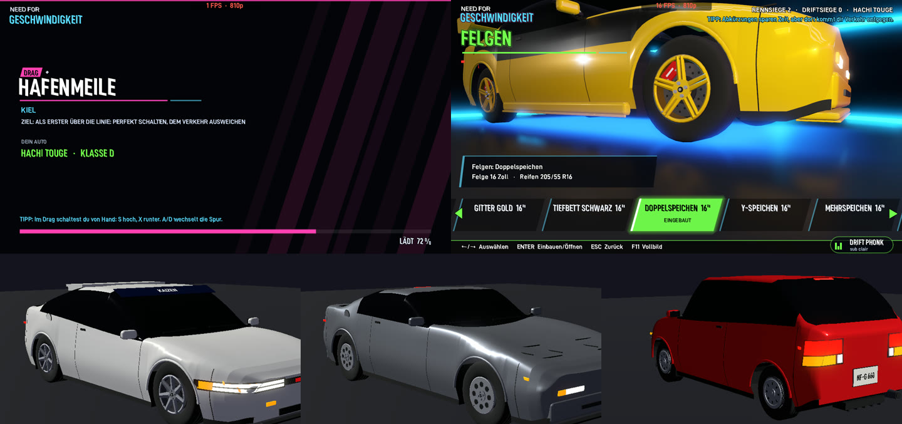
- **2.21 – Rundungen:** links bis 2.20, rechts mit runden Querschnitten, runden Heckkanten, Spiegeln, Schwellern,
  Radlaufkanten und Flügelprofil.
   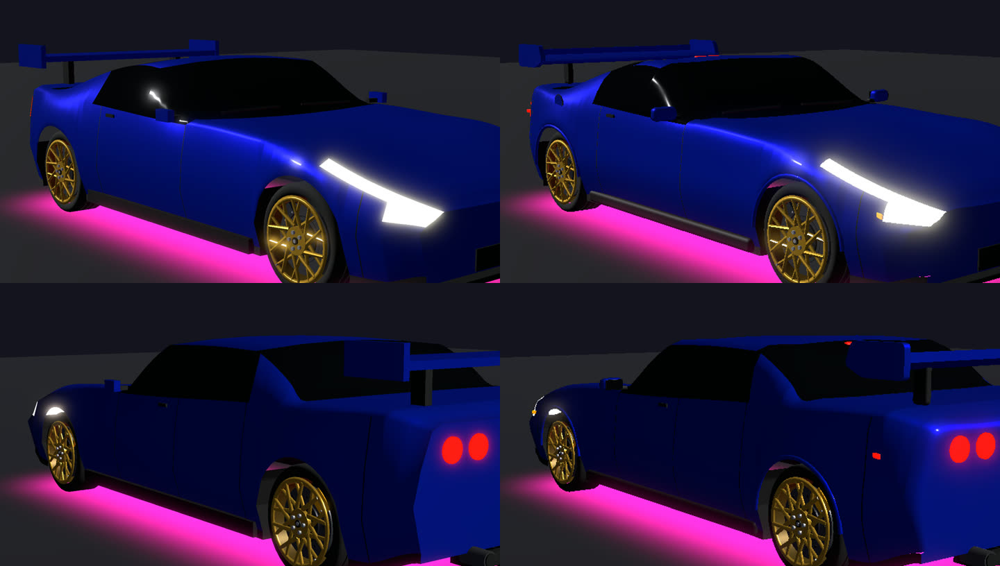
- **2.20 – Nitro:** oben bis 2.19 (blauer Kegel), unten mit Flamme, Feuerball, Licht auf der Straße und Lichtstreifen;
  links kurz nach dem Zünden (Sichtfeld zieht auf, die Kamera fällt zurück), rechts eine Sekunde später.
   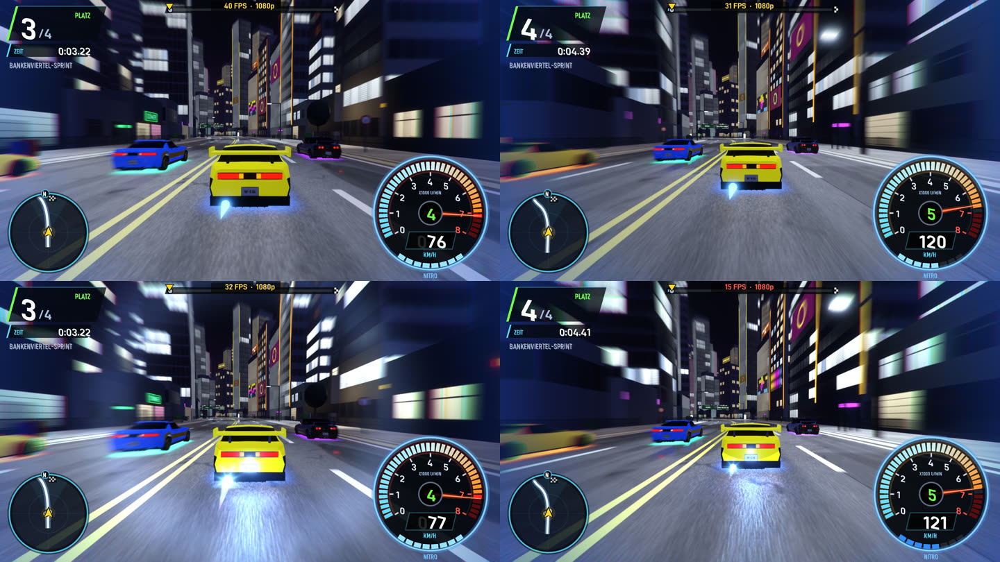
- **2.19 – Lackarten:** je Zeile eine Farbe (Rot, Schwarz, Weiß, Blau), von links Glanz, Metallic, Matt, Perlmutt.
  Aufgenommen in der Garage mit den neuen Spiegelungen (Lichtbänder an der Decke, Neonröhren).
   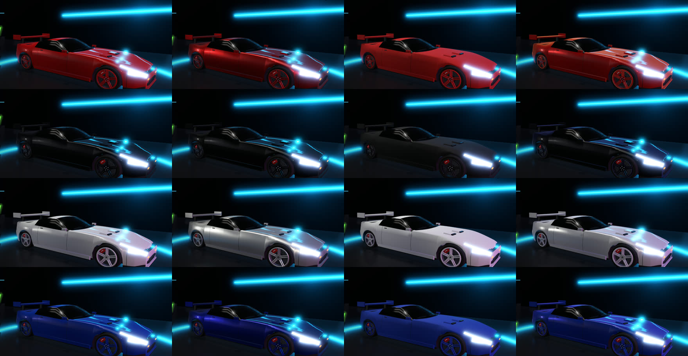
- **2.19 – Tunnellicht:** links bis 2.18 (das Auto bekam im Tunnel kaum Licht und stand schwarz vor den hellen
  Wänden), rechts mit Laternenlicht aus der Lichtkarte auch auf dem Lack.
   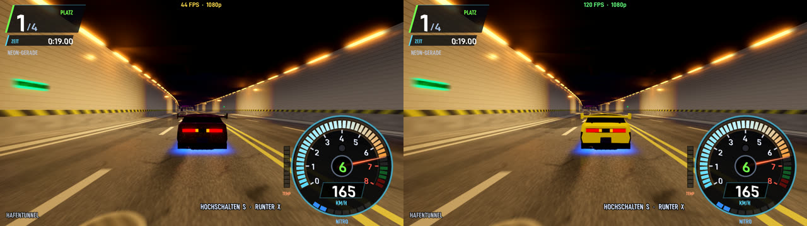
- **2.39 – Städte mit Hinterland:** Frankfurt, links bis 2.38 (hinter den Hochhäusern gleich Felder), rechts mit
  Häuserblöcken, Höfen, Parks und Sportplatz; oben von oben, unten schräg.
   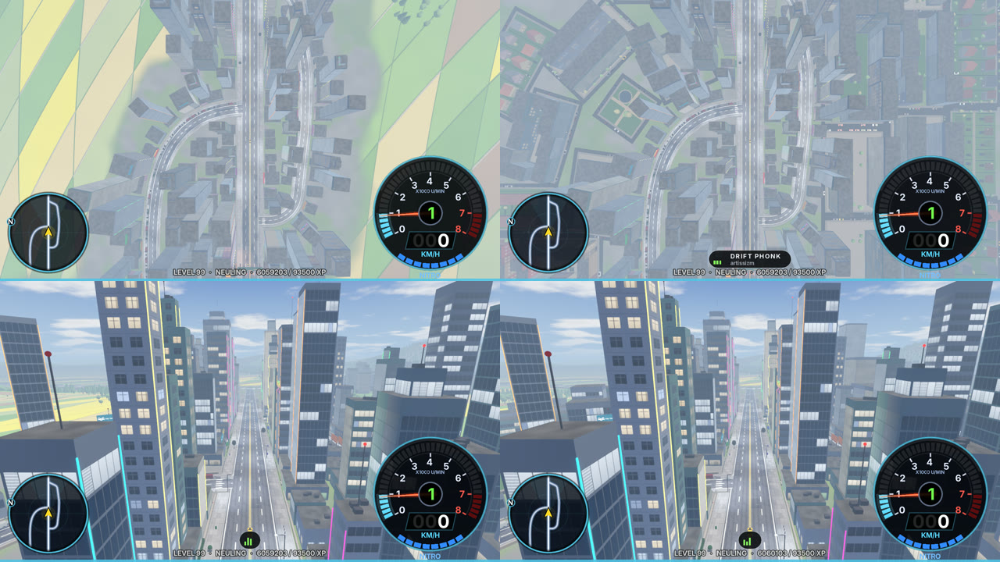
- **2.39 – Straßennetz:** Kreuzberg und Würzburg, links bis 2.38, rechts mit schrägen Einmündungen, Kreuzungen und
  Zebrastreifen.
   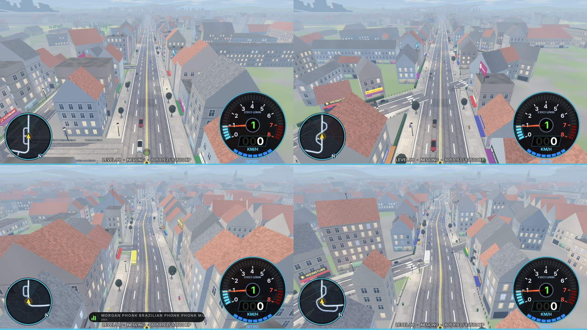
- **2.39 – Gelände:** Golfclub Eichenhain, Golfcarts am Clubhaus, Kiesgrube Moosbrunn, große Karte mit beiden Flächen.
   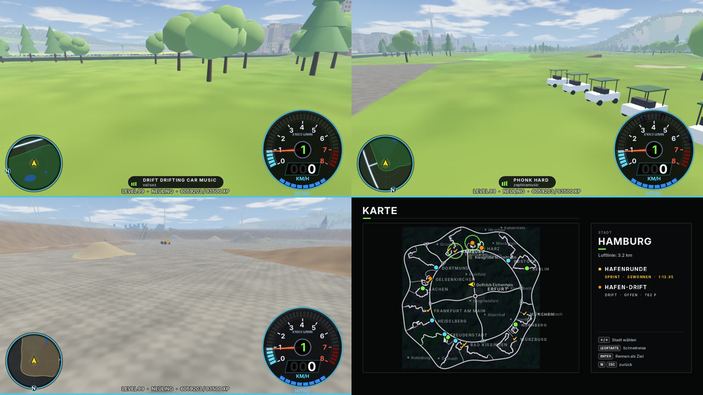
- **2.39 – Kürzere Hauben:** je Zeile ein Auto von der Seite, links bis 2.38, rechts mit der Scheibe weiter vorn.
   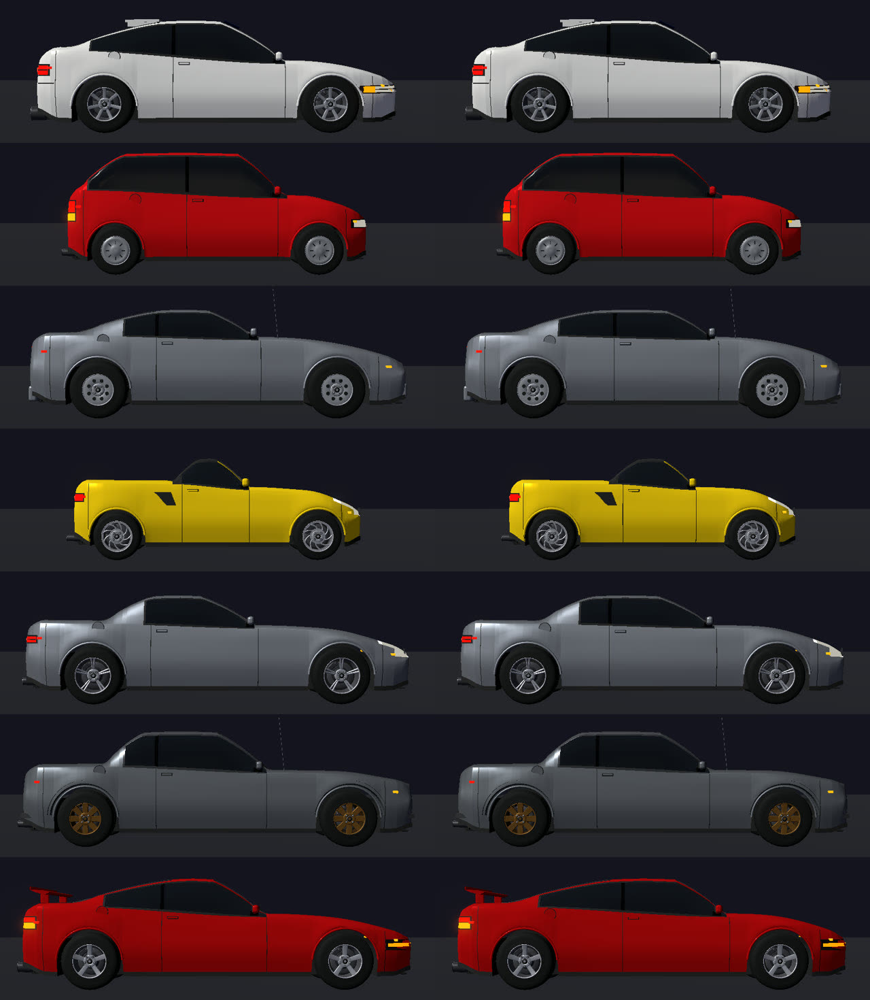
- **2.39 – Garage:** links 2.38 (Laufband mit Rahmen und Strichen, Weitwinkel), rechts 2.39 (Band im Hallenboden,
  30°-Kamera, neue Form; oben in einer anderen Schwenkstellung von der Seite).
   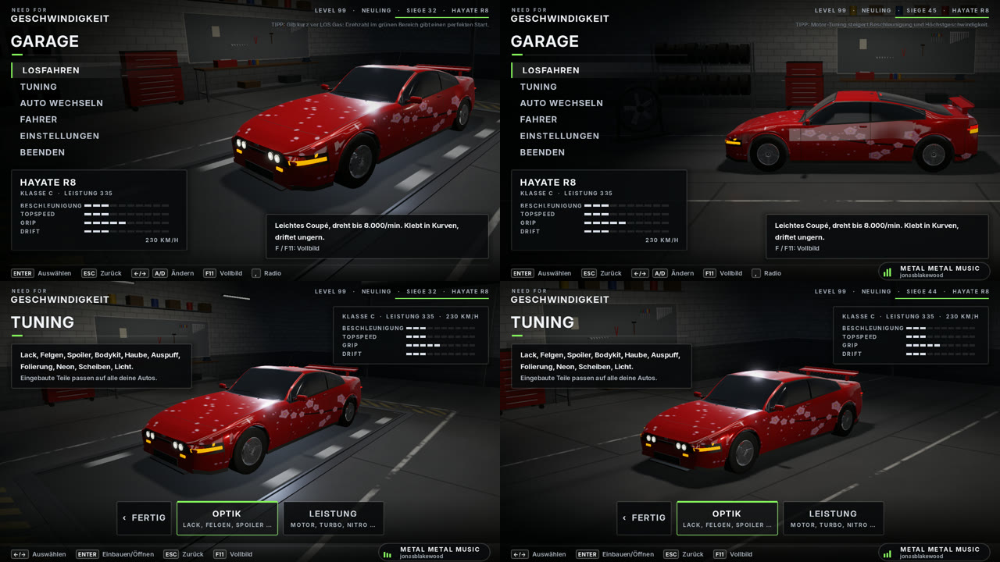
- **2.38 – Garage:** links bis 2.37 (Drehteller, die Wertekarte verdeckt das Auto), rechts die Werkstatt mit
  Rollenprüfstand; oben die Garage, unten die Tuning-Übersicht.
   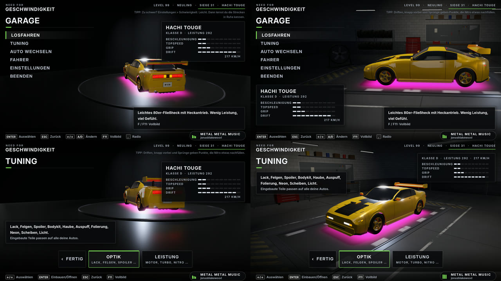
- **2.38 – Anflug von oben:** Aachen bei Nacht, etwa alle 0,3 s: Draufsicht aus 380 m, erster Sprung, Halt, zweiter
  Sprung, Halt über dem Auto, Schwenk hinter das Auto, zuletzt die Landung mit Ortsnamen und HUD.
   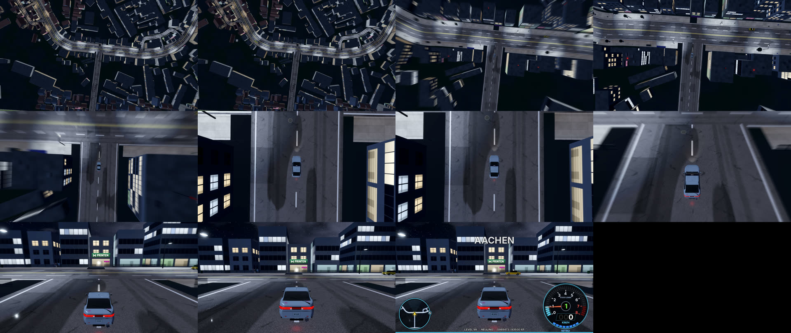
- **2.37 – Zuschauer:** oben die Figuren bis 2.36 (Röhren, Kugelgelenke, flache Hände), unten die neuen mit
  durchgehender Haut, echten Proportionen, Händen, Gesichtern, Frisuren und Kleidung.
   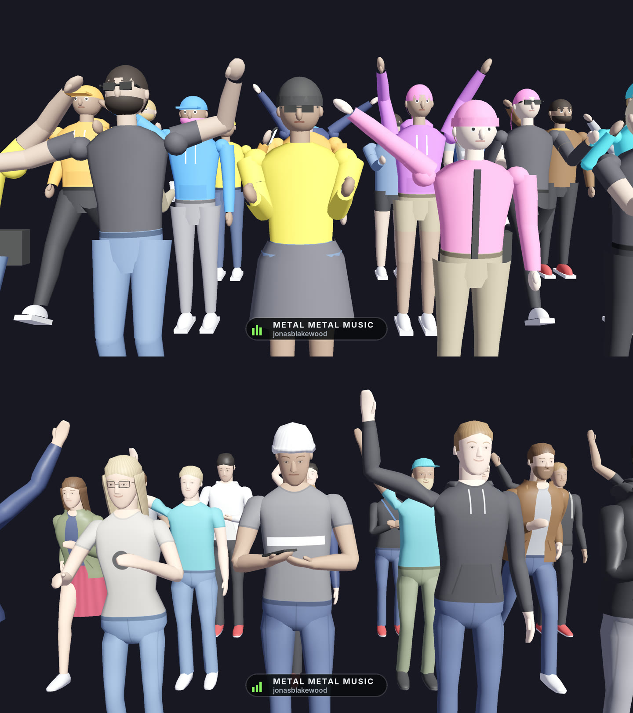
- **2.37 – Sportfelgen:** alle 25 Bauarten am Mirai, je Zeile von links: Serie, Fünfspeichen, Kreuzgitter Gold,
  Tiefbett Schwarz, Doppelspeichen · Y-Speichen, Mehrspeichen, Stahlfelge, Turbofächer, Rennsport-Sechs ·
  Kreuzspeichen, Aero-Scheibe, Tiefbett Stern, Konkav-Stern, Retro-Loch · Radkappe, Rallye, Sichel, Schmiede-Zehn,
  Dreiteilig · Fünfblatt, Drahtspeichen, Zentralverschluss, Cup-Stern, Konkav Zehn.
   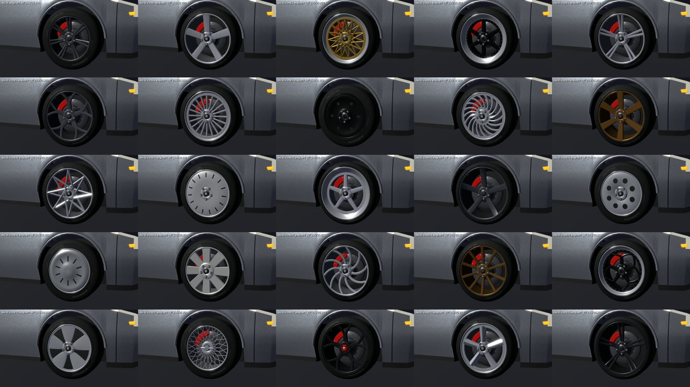
- **2.18 – Felgen:** alle 23 Bauarten am Kaizen in ihrer Standardgröße, je Zeile von links: Serie (Kaizen),
  Fünfspeichen, Gitter Gold, Tiefbett Schwarz, Doppelspeichen, Y-Speichen · Mehrspeichen, Stahlfelge, Turbine,
  Rennsport-Sechs, Kreuzspeichen, Aero-Scheibe · Tiefbett Stern, Konkav-Stern, Retro-Loch, Radkappe, Rallye, Sichel ·
  Schmiede-Zehn, Dreiteilig, Kleeblatt, Drahtspeichen, Zentralverschluss und zuletzt Fünfspeichen bei 100 km/h mit
  Unschärfe.
   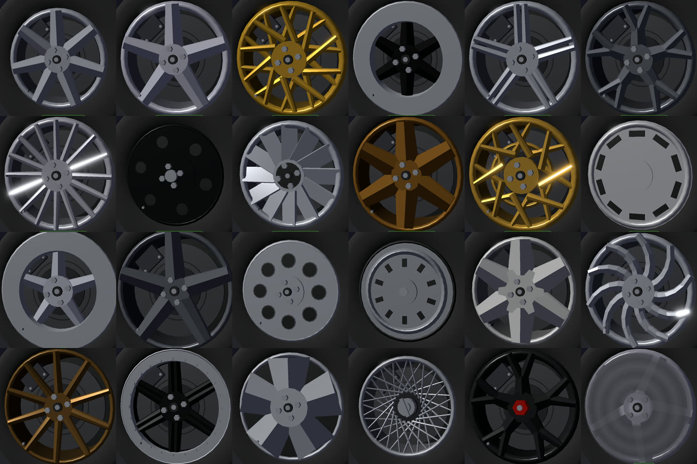
- **2.14 – Zuschauer:** oben die Blockfiguren bis 2.13 (bleiben als Fernansicht), unten die neuen Figuren mit
  Gesicht, Ellbogen, Händen, Kleidung und Frisuren.
   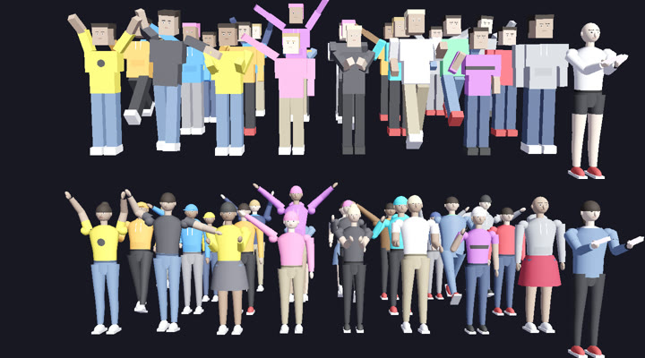
- **2.13 – neue Tuningteile:** Felgen (13 Bauarten, Felgenfarbe), Bodykits, Motorhauben, Auspuffe, Spoiler,
  Scheinwerferfarben und Folien.
   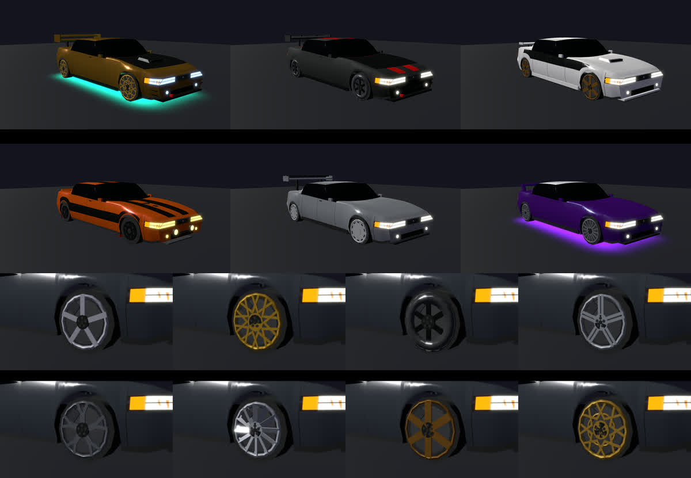
- **2.12 – Laternenlicht auf der Straße:** links vorher, rechts nachher, an denselben Stellen derselben Rennen
  (Hafentunnel, Aachen, Unterführung mit Asphalt statt Ziegelmuster am Boden).
   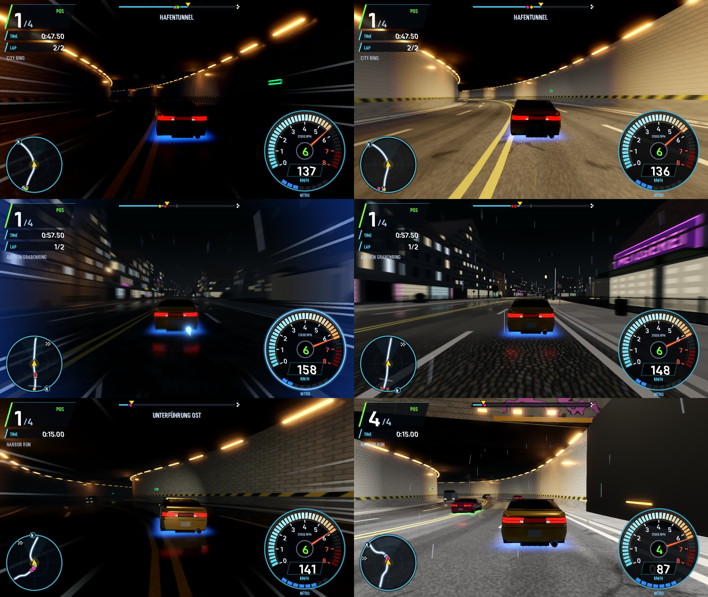
- **2.11 – Startwagen von hinten:** links vorher (Keile an den Ecken plus ein zweites Band innen), rechts nachher
  (ein Leuchtenband um die Ecken).
   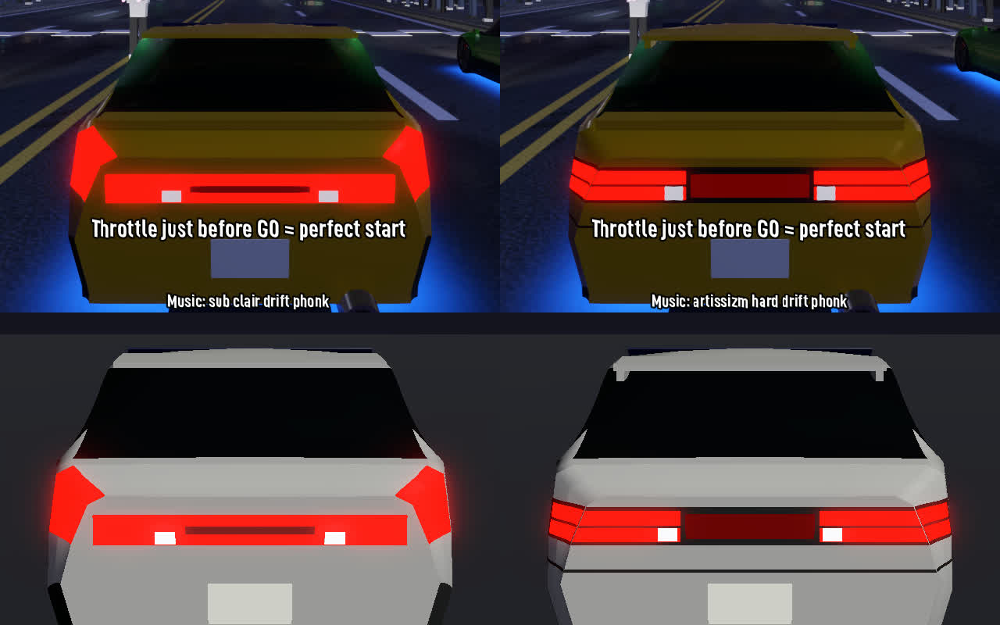
- **Häuserschluchten im deutschen Stil:** oben vorher, unten nachher (Kamerafahrt über Bankenviertel, Marktviertel
  und Prachtallee).
   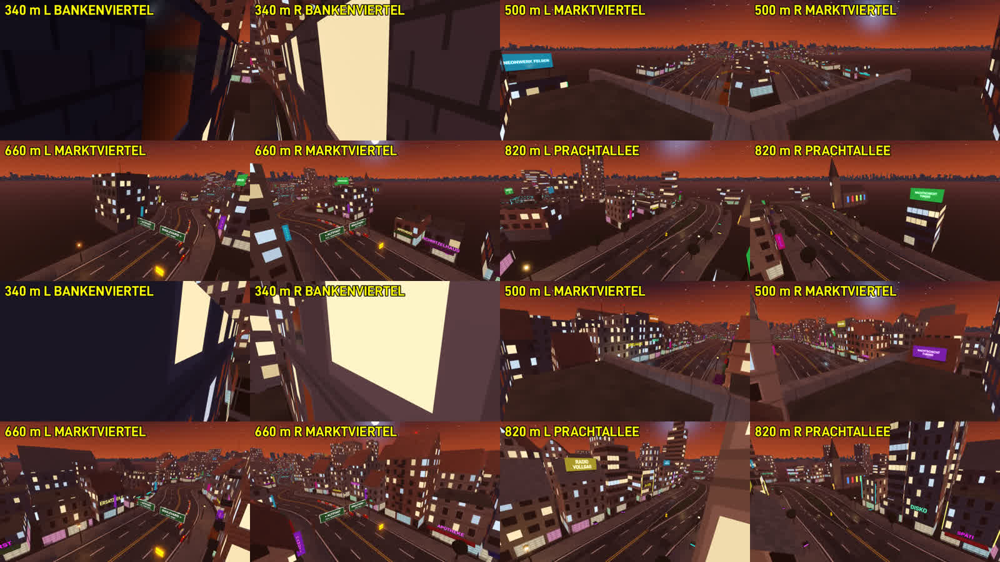
- **Asphalt und Gehwege im Underground-Stil:** je Reihe der alte und der neue Boden an derselben Stelle.
   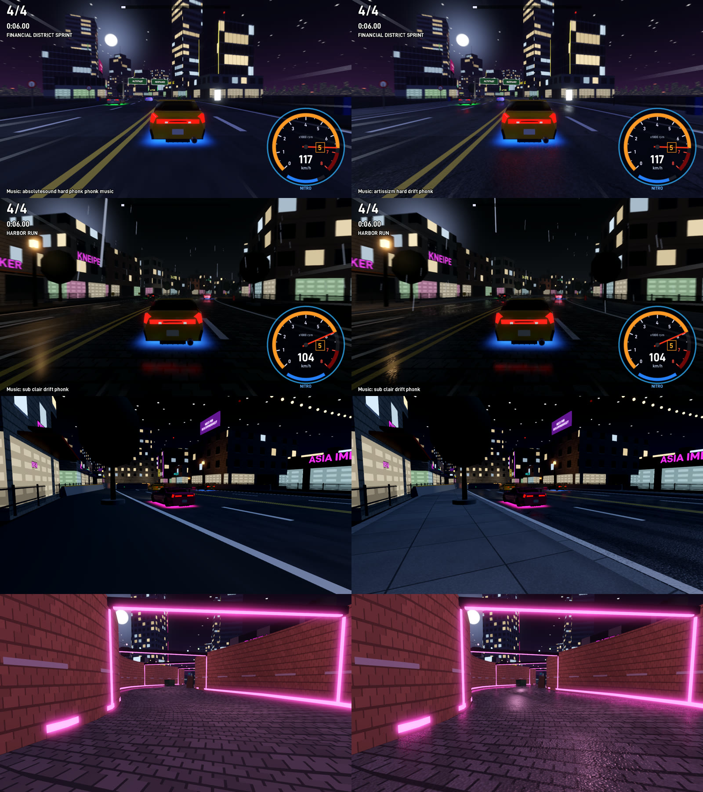
- **Lichttunnel, Abkürzungen, Sprünge und Überschläge:**
   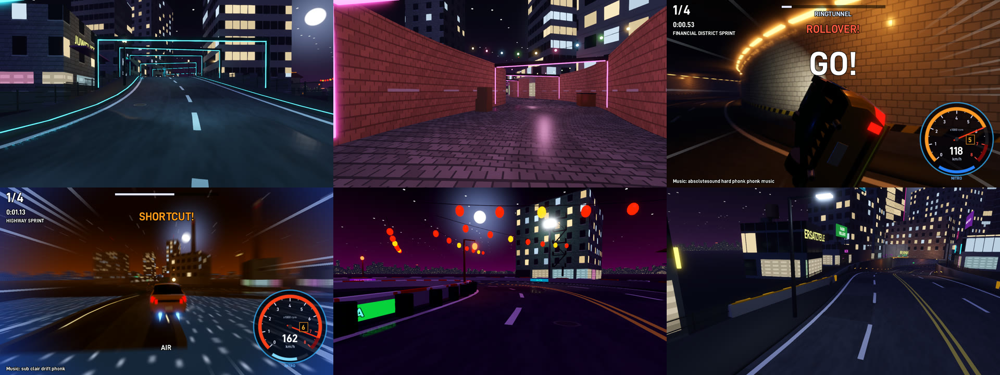
- **Erste Fassung des JDM-Startwagens** und der Stand mit neun Autos:
   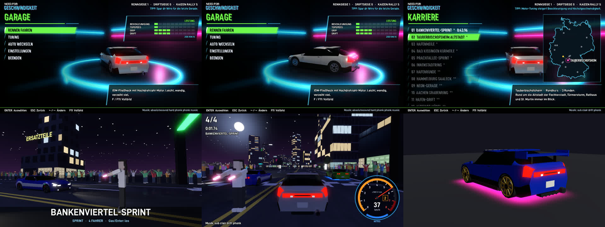
   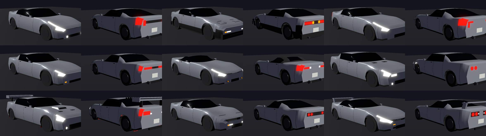
- **Karriere mit Deutschlandkarte** (frühe Liste) und die erste Fassung von Berlin-Kreuzberg:
   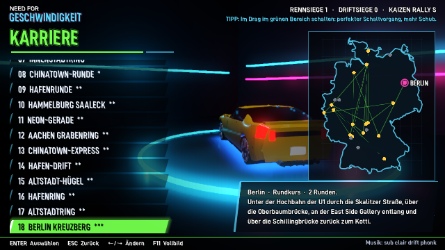 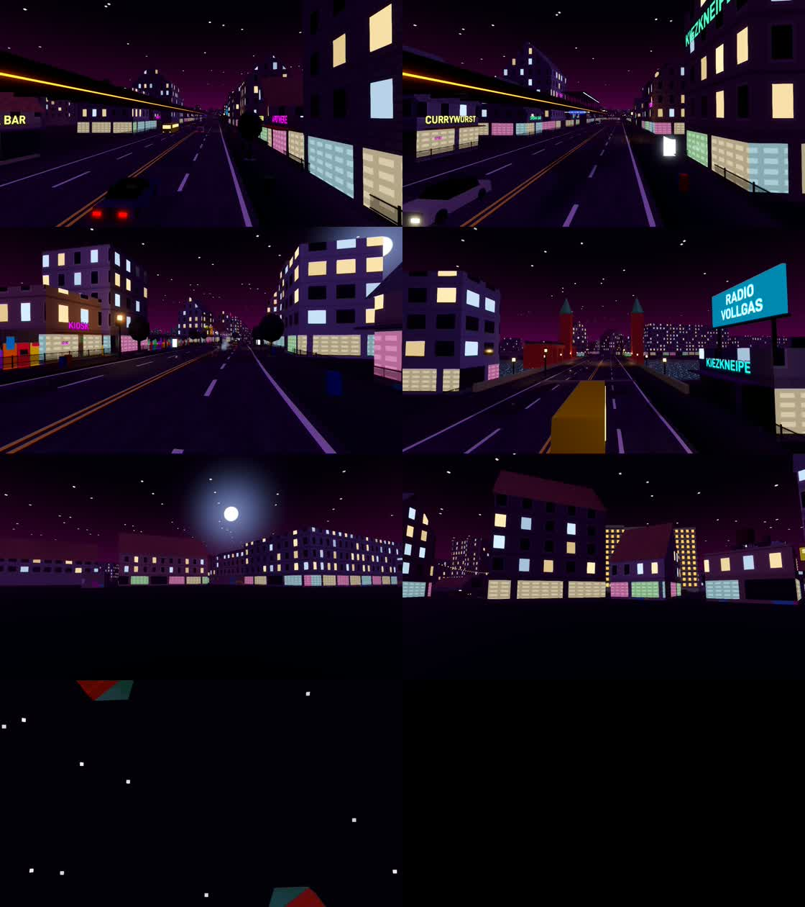
- **Früher Überblick:** Strecken, Bahnübergang, Startaufstellung mit Publikum und Siegertanz:
   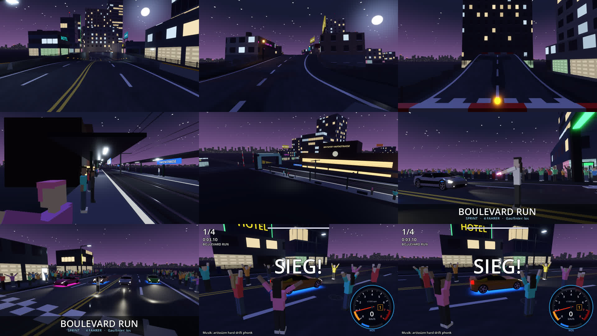

## Export
Vorlagen für Windows, macOS, Linux und Web stehen in `export_presets.cfg` (Godot-Exportvorlagen 4.7.1 nötig).

**Im Browser:** Die Web-Version (`builds/web`, ohne Threads, läuft auf itch.io ohne Sondereinstellungen) nutzt den
einfacheren WebGL-Renderer: keine Spiegelungen auf der Straße und keine Umgebungsverdeckung (fehlen dort im
Grafikmenü), entfernte Kleinteile werden ausgeblendet. Deshalb gibt es keine Shader-Werte pro Objekt (Häuser sind zu Meshes je
Stadtzelle zusammengefasst, ihre Werte stehen in den Vertexdaten). Lokal testen:
`python3 -m http.server 8060 --directory builds/web`.
Texte, Cover und Screenshots für die itch.io-Seite: `release/`.

## Aufbau
- `scripts/catalog.gd` – Autos, Teile, Rennen
- `scripts/player_car.gd` – Fahrphysik, Kamera, Geschwindigkeitsgefühl
- `scripts/engine_audio.gd` – Motorklang aus Schleifen echter Aufnahmen (`assets/engine/`, erzeugt von
  `tools/engine_rec/build_banks.sh`, Quellen in `CREDITS.md`), Turbo, Blow-off, Schalten, Fehlzündungen, Reifen,
  Wind, Abrollen, Schrammen
- `scripts/loading_screen.gd` – Ladebildschirm vor dem Rennen
- `scripts/track_builder.gd` – prozedurale Stadtstrecke
- `scripts/street_net.gd` – Straßennetz der Städte in der freien Fahrt (Nebenstraßen, Gassen, Kreuzungen mit Ampeln,
  Querverbindungen, Plätze, Ränder)
- `scripts/city_fill.gd` – Hinterland der erfundenen Städte (Häuserblöcke, Höfe, Parks, Plätze, parkende Autos)
- `scripts/offroad.gd`, `scripts/offroad_build.gd`, `shaders/offroad.gdshader` – Gelände zum Austoben (Golfplatz,
  Kiesgrube: Planung, Bodenhöhe und Untergrund, Bau), Tests in `scripts/offroad_test.gd`, Draufsicht
  `tools/gelaende_karte.tscn`
- `scripts/track_design.gd` – handgezeichnete Strecken (Verlauf, Höhenprofil, Gelände, Tunnel, Wahrzeichen, Querstraßen)
  für Driftberg und die entworfenen Städte, `shaders/mountain.gdshader` – Waldboden, Fels, Weinberg
- `scripts/interchange.gd` – Autobahndreiecke der offenen Welt (Gabelung, Rampen, Brücke, Schilder) und Talbrücken
- `scripts/tire_fx.gd` – Reifenqualm, Reifenspuren, Staub und Splitter
- `scripts/ai_car.gd` – Gegner
- `scripts/garage.gd` / `scripts/race.gd` – Menü und Rennen
- `scripts/garage_set.gd` – Werkstatt der Garage mit Rollenprüfstand (Band im Hallenboden, Wände, Werkzeug, Gebläse),
  `shaders/garage_floor.gdshader`, `garage_wall.gdshader`
- `scripts/intro.gd` – Studio-Intro
- `scripts/traffic_car.gd` – Verkehr, `scripts/traffic_models.gd` – Modelle des Verkehrs (seit 2.41),
  Vorschau `tools/traffic_shots.tscn`
- `scripts/rail_crossing.gd` – Bahnübergang mit Bahnhof und Zug
- `scripts/city_builder.gd` – Wahrzeichen der Städte-Strecken (Dom, Residenz, Festung, Gradierbau, Türmersturm …)
- `scripts/city_data.gd` – Straßenverläufe, Flüsse, Gebäude und Wahrzeichen-Positionen (erzeugt von `tools/osm_city.py`)
- `scripts/people.gd` + `shaders/people.gdshader` – Figuren (Publikum, Starterin, Fans, Wartende): ein Modell mit allen
  Kleidungs- und Frisur-Varianten, der Shader wählt je Figur aus und bewegt sie; Vorschau mit `tools/people_shots.tscn`
- `scripts/race_show.gd` – Kameraflug, Publikum und Starterin am Start, Zielszene
- `scripts/elevated_rail.gd` – Hochbahn-Zug, `scripts/ambient_sound.gd` – ortsfeste Geräusche (Stadion)
- `tools/track_stats.tscn` – baut alle Strecken und zeigt Kennzahlen
- `tools/gen_ground_tex.tscn` – erzeugt die nahtlosen Bodentexturen `assets/textures/asphalt.png` (Körnung, Flecken,
  Risse, Glanz) und `asphalt_n.png` (Normal-Map) aus Rauschen, in gut 2 Sekunden
- `tools/track_check.tscn` – prüft alle Strecken auf Baufehler: zu enge Kurven (dort schneiden sich Fahrbahnrand und
  Wände) und Wände in der Fahrbahn; mit `-- --buildings` Häuser in Fahrbahn, Gehweg, Nebenstraßen, Fluss, See,
  Bahngelände, Wahrzeichen, Hochbahn-Endblöcken oder ineinander (gibt auch die Bauzeit je Strecke aus). Kurven enger als die halbe Breite plus Gehweg rundet `Track._round_corners`
  beim Bauen selbst ab (die Drift-Sterne hatten 5 m Radius: Leitplanke quer über der Straße).
- `tools/track_map.tscn` – Plan von oben (Straßen, Abkürzungen, Wände, Umfahrbares, Rampen, Lampen mit Reichweite):
  `-- --race=8 --out=karte.png [--zoom=d0:d1]`
- `tools/handling_lab.tscn` – Fahrphysik-Messlabor (0–100, Bremsweg, Kurvenradius, Querbeschleunigung, Schräglauf,
  Lenkansprechen, Handbremse) auf leerer Fläche: `--headless --fixed-fps 60 … -- --cars=kaizen,kaze`
- `tools/overview.tscn` – Bilder aus erhöhter Sicht auf Tunnel, Hochbahn, Stadion, Viertel (`-- --race=1 --out=pfad`)
- `scripts/debug_shot.gd` – nur für Tests/Videos (`-- --drive`, `--demo`, `--at=lake|crossing|alley|fork|tunnel|el|stadium|<viertel>|d:<m>`,
  `--race=n`, `--trace`, `--shot=pfad`, `--times=…`, `--quit=s`, `--intro` (Kameraflug auch im Test),
  `--view=weg:d:quer:höhe:ziel_d:ziel_quer:ziel_höhe` (feste Kamera ohne HUD), `--sweep=schritt[:hoch]` (Kamera fährt
  die Hauptstraße ab, je Schritt ein Bild auf jede Häuserzeile, mit Streckenmeter und Viertel im Bild), `--look=wahrzeichen:höhe:blickhöhe:abstand[:d]`
  (Kamera auf ein Wahrzeichen der Städte-Strecken), `--racelog` (Rennverlauf alle 3 s), `--crash=tempo:winkel|k[:d]`
  (Auto mit Tempo gegen die Wand bzw. auf die nächste Laterne, `q` quer rutschend, Verlauf von Überschlag und Flug),
  `--airlog`, `--tumblelog` (wodurch ein Überschlag ausgelöst wurde), `--jumplog` (vorhergesagte Sprünge und
  geprüfte Standorte der Sprungkamera), `--block=d:spur` (Spieler blockiert, Abstände der
  Gegner), `--fulltest` (ganzes Rennen mit Autopilot, der vor engen Kurven bremst; meldet als `FT …` Hänger,
  Stürze unter den Boden, Fahrten neben der Strecke, Ruckler über 60 ms, hängende Gegner mit Ursache, Abkürzungen
  der Gegner und das Ergebnis, beendet sich nach dem Ziel), `--branches` (Autopilot nimmt jede Abkürzung), `--tune=engine` (Garage direkt
  in einer Tuning-Kategorie), `--touch` (Touch-Knöpfe am Rechner); im Drag schaltet der Autopilot im
  grünen Bereich, `--lateshift` erst im Begrenzer, `--noshift` gar nicht, `--nolanes` ohne Spurwechsel, `--dragcrash`
  setzt Verkehr vor das Auto)
- `tools/short_overlays.gd` – rendert Texttafeln fürs Release-Short
- `tools/trailer_cards.tscn` – Texttafeln für den Trailer (Titel, Abspann, Sprüche, gelbe Ortsschilder): `-- --out=ordner`
